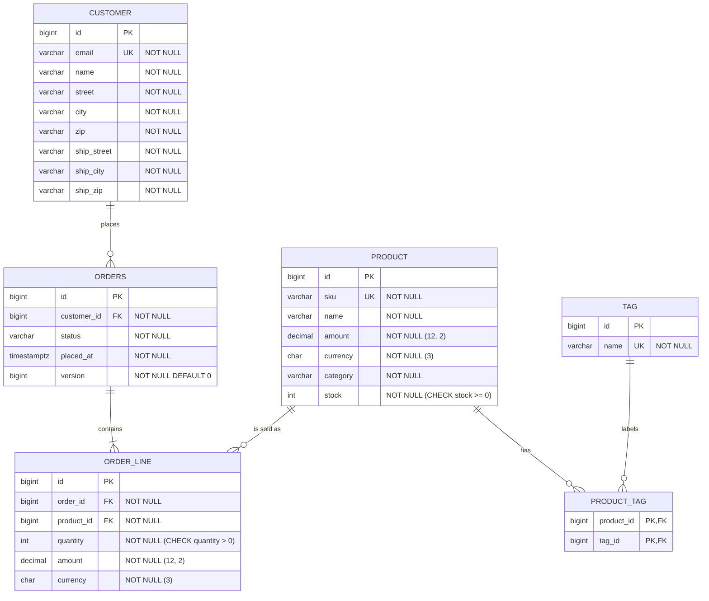

# Lab 03: Hibernate Framework & Spring Data JPA

## Complete Guide & Implementation Reference (Tasks 0–5 & Extra-Credit Challenge)

> **Course:** Software Engineering — Chapter 03  
> **Topic:** Hibernate ORM 7.4, Jakarta Persistence 3.2, & Spring Data JPA  
> **Application:** `shop-jpa` (E-Commerce High-Performance Persistence Engine)  
> **Stack:** Java 25, Spring Boot 4.1.1, Spring Data JPA, Hibernate 7.4.7.Final, Flyway 10+, H2 Database, Maven 3.9+  
> **Estimated Duration:** ~6–7 hours (Tasks 0–5: 100 points, Challenge: +20 points extra credit)

---

## 📑 Table of Contents

- [Lab 03: Hibernate Framework \& Spring Data JPA](#lab-03-hibernate-framework--spring-data-jpa)
  - [Complete Guide \& Implementation Reference (Tasks 0–5 \& Extra-Credit Challenge)](#complete-guide--implementation-reference-tasks-05--extra-credit-challenge)
  - [📑 Table of Contents](#-table-of-contents)
  - [🎯 Lab Objectives \& Architectural Overview](#-lab-objectives--architectural-overview)
  - [📊 Grading Rubric \& Automatic Deductions](#-grading-rubric--automatic-deductions)
  - [🏗️ Entity-Relationship (ER) Diagram](#️-entity-relationship-er-diagram)
  - [🚀 Task 0: Setup \& Project Initialization (20 min)](#-task-0-setup--project-initialization-20-min)
    - [Step 0.1: Verify the Toolchain](#step-01-verify-the-toolchain)
    - [Step 0.2: Generate the Project with Spring Initializr](#step-02-generate-the-project-with-spring-initializr)
    - [Step 0.3: Configure `application.yml`](#step-03-configure-applicationyml)
    - [Step 0.4: Git Initialization \& Directory Structure](#step-04-git-initialization--directory-structure)
  - [📦 Task 1: Entities and Mappings, Validated by Flyway (45 min)](#-task-1-entities-and-mappings-validated-by-flyway-45-min)
    - [Step 1.1: Embeddable Value Objects (`Money`, `Address`)](#step-11-embeddable-value-objects-money-address)
    - [Step 1.2: Enums (`Category`, `OrderStatus`)](#step-12-enums-category-orderstatus)
    - [Step 1.3: JPA Entities (`Customer`, `Product`, `Tag`, `Order`, `OrderLine`)](#step-13-jpa-entities-customer-product-tag-order-orderline)
    - [Step 1.4: Database Schema Migration (`V1__init.sql`)](#step-14-database-schema-migration-v1__initsql)
    - [Step 1.5: Schema-Validation Mismatch Experiments](#step-15-schema-validation-mismatch-experiments)
    - [Step 1.6: Verification Test (`ProductMappingTest`)](#step-16-verification-test-productmappingtest)
    - [Task 1 Checklist](#task-1-checklist)
  - [🔗 Task 2: Associations, Cascading, and Entity Identity (50 min)](#-task-2-associations-cascading-and-entity-identity-50-min)
    - [Step 2.1: Bidirectional `@OneToMany` Aggregate (`Order` ↔ `OrderLine`)](#step-21-bidirectional-onetomany-aggregate-order--orderline)
    - [Step 2.2: Many-to-Many Association (`Product` ↔ `Tag`)](#step-22-many-to-many-association-product--tag)
    - [Step 2.3: Entity Identity (`equals`, `hashCode`, `toString`)](#step-23-entity-identity-equals-hashcode-tostring)
    - [Step 2.4: The Classic `toString()` Recursion / Lazy Pitfall](#step-24-the-classic-tostring-recursion--lazy-pitfall)
    - [Step 2.5: Verification Tests (`OrderCascadeTest`, `EntityIdentityTest`)](#step-25-verification-tests-ordercascadetest-entityidentitytest)
    - [Task 2 Checklist](#task-2-checklist)
  - [🔍 Task 3: Repositories, Queries, Projections, and Paginated Endpoints (75 min)](#-task-3-repositories-queries-projections-and-paginated-endpoints-75-min)
    - [Step 3.1: Spring Data Repositories \& Derived Queries](#step-31-spring-data-repositories--derived-queries)
    - [Step 3.2: JPQL Fetch Joins \& Native Queries](#step-32-jpql-fetch-joins--native-queries)
    - [Step 3.3: Interface \& Record Projections](#step-33-interface--record-projections)
    - [Step 3.4: Dynamic Query Filtering with `Specification`](#step-34-dynamic-query-filtering-with-specification)
    - [Step 3.5: Development Data Seeder (`DataSeeder`)](#step-35-development-data-seeder-dataseeder)
    - [Step 3.6: REST Controllers (`OrderController`, `ProductController`)](#step-36-rest-controllers-ordercontroller-productcontroller)
    - [Step 3.7: Method Name Typo Experiment](#step-37-method-name-typo-experiment)
    - [Step 3.8: Verification Test (`OrderRepositoryTest`)](#step-38-verification-test-orderrepositorytest)
    - [Task 3 Checklist](#task-3-checklist)
  - [⚡ Task 4: Entity States, Dirty Checking, Transactions, and Optimistic Locking (75 min)](#-task-4-entity-states-dirty-checking-transactions-and-optimistic-locking-75-min)
    - [Step 4.1: Managed Entity Dirty Checking (`OrderService.markPaid`)](#step-41-managed-entity-dirty-checking-orderservicemarkpaid)
    - [Step 4.2: Detached Entity Modification Counter-Example](#step-42-detached-entity-modification-counter-example)
    - [Step 4.3: The Read-Only Trap (`@Transactional(readOnly = true)`)](#step-43-the-read-only-trap-transactionalreadonly--true)
    - [Step 4.4: Hibernate Flush Ordering \& Constraint Violations](#step-44-hibernate-flush-ordering--constraint-violations)
    - [Step 4.5: Optimistic Locking with `@Version`](#step-45-optimistic-locking-with-version)
    - [Step 4.6: Concurrent Conflict Recovery (`OrderFacade.changeStatusWithRetry`)](#step-46-concurrent-conflict-recovery-orderfacadechangestatuswithretry)
    - [Step 4.7: Transaction \& Lock SQL Log Analysis](#step-47-transaction--lock-sql-log-analysis)
    - [Task 4 Checklist](#task-4-checklist)
  - [🚀 Task 5: N+1 Detection, Performance Tuning, and Schema Evolution (75 min)](#-task-5-n1-detection-performance-tuning-and-schema-evolution-75-min)
    - [Step 5.1: The N+1 Problem \& Query Counting Test Helper (`QueryCounter`)](#step-51-the-n1-problem--query-counting-test-helper-querycounter)
    - [Step 5.2: Three Strategies to Eliminate N+1 (Fetch Join, EntityGraph, BatchSize)](#step-52-three-strategies-to-eliminate-n1-fetch-join-entitygraph-batchsize)
    - [Step 5.3: Benchmarks: Latency \& Statement Count](#step-53-benchmarks-latency--statement-count)
    - [Step 5.4: Nested N+1 Regression ("Product Name") \& Global Batch Fetching](#step-54-nested-n1-regression-product-name--global-batch-fetching)
    - [Step 5.5: High-Throughput JDBC Batching \& ID Generation Strategy](#step-55-high-throughput-jdbc-batching--id-generation-strategy)
    - [Step 5.6: Enforcing Boundary Encapsulation (`open-in-view: false`)](#step-56-enforcing-boundary-encapsulation-open-in-view-false)
    - [Step 5.7: Database Schema Evolution (`V2__indexes.sql`) \& EXPLAIN Query Plans](#step-57-database-schema-evolution-v2__indexessql--explain-query-plans)
    - [Task 5 Checklist](#task-5-checklist)
  - [🌟 Challenge: Advanced Reporting and High-Volume Bulk Engine (+20 pts)](#-challenge-advanced-reporting-and-high-volume-bulk-engine-20-pts)
    - [Challenge 1: Type-Safe Criteria API Report with Metamodel](#challenge-1-type-safe-criteria-api-report-with-metamodel)
    - [Challenge 2: High-Performance Keyset Infinite Scrolling](#challenge-2-high-performance-keyset-infinite-scrolling)
    - [Challenge 3: Pessimistic Stock Reservation Under Concurrency](#challenge-3-pessimistic-stock-reservation-under-concurrency)
    - [Challenge 4: High-Volume 50,000-Row Bulk Import via `StatelessSession`](#challenge-4-high-volume-50000-row-bulk-import-via-statelesssession)
    - [Challenge Checklist](#challenge-checklist)
  - [📖 Comprehensive Spring Data Method-to-SQL Mapping Table](#-comprehensive-spring-data-method-to-sql-mapping-table)
  - [📋 Submission Instructions \& Verification Commands](#-submission-instructions--verification-commands)

---

## 🎯 Lab Objectives & Architectural Overview

In Lab 02, we built a modular e-commerce service using plain Spring Framework and JDBC utilities (`JdbcClient`). In **Lab 03**, we elevate the data architecture to enterprise grade by leveraging **Jakarta Persistence 3.2 (JPA)** and **Hibernate ORM 7.4**, governed by **Spring Data JPA** and **Flyway Database Migrations**.

```
+-------------------------------------------------------------------------+
|                              Web Layer                                  |
|   OrderController, ProductController, OrderFeedController, ReportAPI    |
+-------------------------------------------------------------------------+
                                    |
                                    v (DTOs / Records / Projections only)
+-------------------------------------------------------------------------+
|                            Service Layer                                |
|   OrderService, StockService, ReportService, BulkImportService          |
|   (Boundary for @Transactional, Business Invariants, Optimistic Retries)|
+-------------------------------------------------------------------------+
                                    |
                                    v
+-------------------------------------------------------------------------+
|                         Spring Data JPA & ORM                           |
|   CustomerRepository, ProductRepository, OrderRepository, Specs         |
|   Hibernate 7.4 Session / Persistence Context / StatelessSession        |
+-------------------------------------------------------------------------+
                                    |
                                    v
+-------------------------------------------------------------------------+
|                         Database & Flyway Engine                        |
|   V1__init.sql (DDL Schema) -> V2__indexes.sql (Performance Tuning)     |
|   H2 In-Memory Database (ddl-auto: validate)                            |
+-------------------------------------------------------------------------+
```

### Key Architectural Tenets:

1. **Schema Authority**: Flyway strictly owns the database schema. Hibernate never modifies the schema in production or tests (`spring.jpa.hibernate.ddl-auto=validate`).
2. **Encapsulation & Boundary Discipline**: No JPA entities ever escape the service layer into web controllers. Projections, DTOs, and Java records protect domain invariants.
3. **Optimized Persistence Context**: All associations are explicitly configured as `FetchType.LAZY`. Eager fetching is an anti-pattern.
4. **Resilient Concurrency**: Versioned optimistic locking (`@Version`) defends against lost updates; row-level pessimistic locks (`SELECT ... FOR UPDATE`) guarantee inventory consistency under high contention.
5. **Batch Processing Excellence**: Bulk ingestion bypasses first-level cache overhead using Hibernate 7 `StatelessSession` and JDBC batching.

---

## 📊 Grading Rubric & Automatic Deductions

| Component                                   |    Points     | Full Marks Criteria                                                                                                                                                                           |
| :------------------------------------------ | :-----------: | :-------------------------------------------------------------------------------------------------------------------------------------------------------------------------------------------- |
| **Task 1: Entities & Mappings**             |      10       | Value objects as `@Embeddable` records, STRING enums, Sequence IDs with `allocationSize=50`, `V1__init.sql` passes `validate`, schema mismatch experiments documented.                        |
| **Task 2: Associations & Cascading**        |      15       | Correct owning sides, helper methods keep bidirectional links synchronized, cascade `ALL` + `orphanRemoval` proven by SQL statements, hand-written `equals`/`hashCode`, identity test passes. |
| **Task 3: Repositories & Queries**          |      20       | Derived queries, JPQL with `join fetch`, native SQL, interface and record projections, Specifications filter, paged endpoints, zero entities escape controller.                               |
| **Task 4: States, Dirty Checking, Locking** |      20       | Managed vs detached proven via SQL logs, flush order constraint violation documented with `flush()` fix, two-thread optimistic locking test passes, retry facade outside transaction.         |
| **Task 5: Performance & Migrations**        |      25       | N+1 proven (51 queries) and resolved via 3 separate techniques (1, 1, 5 queries) with benchmark table; JDBC batching demonstrated; `V2__indexes.sql` applied with EXPLAIN plans.              |
| **Code Quality**                            |      10       | Layered architecture, `@Transactional` exclusively in services, `FetchType.LAZY` throughout, immutable records/DTOs, git tags for each task, clean git tree.                                  |
| **★ Challenge (Extra Credit)**              |      +20      | Criteria Metamodel report, Keyset infinite scroll, pessimistic vs optimistic stock concurrency tests, 50k bulk import via `StatelessSession` in < 10s.                                        |
| **Total**                                   | **100 (+20)** |                                                                                                                                                                                               |

### ⚠️ Strict Deductions Warning:

- **-5** per `FetchType.EAGER` on collection or unexplained eager `@ManyToOne`.
- **-10** if `spring.jpa.hibernate.ddl-auto` is set to `update` or `create` in main config or test config.
- **-10** if a Flyway migration file is modified after being applied.
- **-5** per entity using Lombok `@Data`, `@EqualsAndHashCode`, or mutable fields in `equals`.
- **-10** if `open-in-view` is left `true` or an entity is returned from a controller.
- **-10** if `@Transactional` is placed on a Controller or Spring Data Repository interface.
- **-10** for committed passwords, secrets, or `target/` directories.

---

## 🏗️ Entity-Relationship (ER) Diagram



---

## 🚀 Task 0: Setup & Project Initialization (20 min)

### Step 0.1: Verify the Toolchain

Verify required developer environments:

```bash
java -version   # OpenJDK 25 (or 21+)
mvn -v          # Apache Maven 3.9+
git --version   # Git 2.40+
curl --version  # HTTP client
```

### Step 0.2: Generate the Project with Spring Initializr

Run the following command to bootstrap `shop-jpa`:

```bash
curl https://start.spring.io/starter.zip \
  -d type=maven-project \
  -d language=java \
  -d javaVersion=25 \
  -d bootVersion=4.1.1 \
  -d groupId=edu.itc.se \
  -d artifactId=shop-jpa \
  -d name=shop-jpa \
  -d packageName=edu.itc.shop \
  -d dependencies=data-jpa,webmvc,validation,h2,flyway \
  -o shop-jpa.zip && unzip shop-jpa.zip -d shop-jpa && cd shop-jpa
```

Verify Hibernate 7.4.7 is pulled into the dependency tree:

```bash
./mvnw dependency:tree -Dincludes=org.hibernate.orm
# Expected output contains: org.hibernate.orm:hibernate-core:jar:7.4.7.Final:compile
```

### Step 0.3: Configure `application.yml`

Delete `src/main/resources/application.properties` and create `src/main/resources/application.yml`:

```yaml
spring:
  datasource:
    url: jdbc:h2:mem:shop;DB_CLOSE_DELAY=-1
    username: sa
    password: ""
  jpa:
    hibernate:
      ddl-auto: validate
    open-in-view: false
    properties:
      hibernate:
        generate_statistics: true
        jdbc:
          batch_size: 50
        order_inserts: true
        order_updates: true
  h2:
    console:
      enabled: true # Accessible at http://localhost:8080/h2-console

logging:
  level:
    org.hibernate.SQL: DEBUG
    org.hibernate.orm.jdbc.bind: TRACE
    org.hibernate.stat: DEBUG
```

### Step 0.4: Git Initialization & Directory Structure

```bash
git init
git checkout -b main
mkdir -p src/main/resources/db/migration
git add .
git commit -m "chore: initial project setup with Spring Boot 4.1.1 and Flyway"
```

Verify the target package layout:

```text
edu.itc.shop
├── ShopJpaApplication.java
├── domain/
│   ├── Money.java (Embeddable Record)
│   ├── Address.java (Embeddable Record)
│   ├── Category.java (Enum)
│   ├── OrderStatus.java (Enum)
│   ├── Customer.java (Entity)
│   ├── Product.java (Entity)
│   ├── Tag.java (Entity)
│   ├── Order.java (Entity Aggregate Root)
│   └── OrderLine.java (Entity Child)
├── repository/
│   ├── CustomerRepository.java
│   ├── ProductRepository.java
│   ├── OrderRepository.java
│   └── ProductSpecs.java
├── service/
│   ├── OrderService.java
│   ├── OrderFacade.java
│   ├── StockService.java
│   ├── ReportService.java
│   ├── BulkImportService.java
│   └── DataSeeder.java (@Profile("dev"))
├── web/
│   ├── OrderController.java
│   ├── ProductController.java
│   ├── ReportController.java
│   ├── ApiExceptionHandler.java
│   └── dto/
│       ├── OrderSummary.java (Interface Projection)
│       ├── ProductView.java (Record Projection)
│       ├── OrderDto.java
│       └── ProductReportRow.java
└── resources/
    ├── application.yml
    └── db/migration/
        ├── V1__init.sql
        └── V2__indexes.sql
```

---

## 📦 Task 1: Entities and Mappings, Validated by Flyway (45 min)

### Step 1.1: Embeddable Value Objects (`Money`, `Address`)

JPA 3.2 allows Java `record` types to be mapped as `@Embeddable`. They provide immutability, thread-safety, and clean DDD value semantics without boilerplate.

`domain/Money.java`:

```java
package edu.itc.shop.domain;

import jakarta.persistence.Column;
import jakarta.persistence.Embeddable;
import java.math.BigDecimal;
import java.util.Objects;

@Embeddable
public record Money(
    @Column(name = "amount", nullable = false, precision = 12, scale = 2)
    BigDecimal amount,

    @Column(name = "currency", nullable = false, length = 3)
    String currency
) {
    public Money {
        Objects.requireNonNull(amount, "Amount cannot be null");
        Objects.requireNonNull(currency, "Currency cannot be null");
    }

    public static Money eur(String value) {
        return new Money(new BigDecimal(value), "EUR");
    }

    public static Money of(BigDecimal amount, String currency) {
        return new Money(amount, currency);
    }

    public Money times(int qty) {
        return new Money(this.amount.multiply(BigDecimal.valueOf(qty)), this.currency);
    }

    public Money add(Money other) {
        if (!this.currency.equals(other.currency)) {
            throw new IllegalArgumentException("Cannot add different currencies: " + this.currency + " vs " + other.currency);
        }
        return new Money(this.amount.add(other.amount), this.currency);
    }
}
```

`domain/Address.java`:

```java
package edu.itc.shop.domain;

import jakarta.persistence.Column;
import jakarta.persistence.Embeddable;

@Embeddable
public record Address(
    @Column(nullable = false, length = 150) String street,
    @Column(nullable = false, length = 80) String city,
    @Column(nullable = false, length = 20) String zip
) {}
```

### Step 1.2: Enums (`Category`, `OrderStatus`)

`domain/Category.java`:

```java
package edu.itc.shop.domain;

public enum Category {
    BOOKS, HARDWARE, TOYS, FOOD
}
```

`domain/OrderStatus.java`:

```java
package edu.itc.shop.domain;

public enum OrderStatus {
    NEW, PAID, SHIPPED, CANCELLED
}
```

### Step 1.3: JPA Entities (`Customer`, `Product`, `Tag`, `Order`, `OrderLine`)

Rules enforced:

- Primary keys use `GenerationType.SEQUENCE` with `allocationSize = 50`.
- No `setId(...)` methods (IDs are managed exclusively by the JPA provider).
- Protected no-arg constructor for Hibernate reflection.
- String enums mapped with `@Enumerated(EnumType.STRING)`.
- Multiple embedded records disambiguated via `@AttributeOverride`.

`domain/Customer.java`:

```java
package edu.itc.shop.domain;

import jakarta.persistence.*;

@Entity
@Table(name = "customer")
public class Customer {

    @Id
    @GeneratedValue(strategy = GenerationType.SEQUENCE, generator = "customer_seq")
    @SequenceGenerator(name = "customer_seq", sequenceName = "customer_seq", allocationSize = 50)
    private Long id;

    @Column(nullable = false, length = 120)
    private String name;

    @Column(nullable = false, unique = true, length = 150)
    private String email;

    @Embedded
    private Address billing;

    @Embedded
    @AttributeOverrides({
        @AttributeOverride(name = "street", column = @Column(name = "ship_street", nullable = false, length = 150)),
        @AttributeOverride(name = "city",   column = @Column(name = "ship_city", nullable = false, length = 80)),
        @AttributeOverride(name = "zip",    column = @Column(name = "ship_zip", nullable = false, length = 20))
    })
    private Address shipping;

    protected Customer() {}

    public Customer(String name, String email, Address billing, Address shipping) {
        this.name = name;
        this.email = email;
        this.billing = billing;
        this.shipping = shipping;
    }

    public Long getId() { return id; }
    public String getName() { return name; }
    public String getEmail() { return email; }
    public Address getBilling() { return billing; }
    public Address getShipping() { return shipping; }

    @Override
    public boolean equals(Object o) {
        return this == o || (o instanceof Customer other && id != null && id.equals(other.getId()));
    }

    @Override
    public int hashCode() {
        return Customer.class.hashCode();
    }

    @Override
    public String toString() {
        return "Customer[id=%d, email=%s]".formatted(id, email);
    }
}
```

`domain/Product.java`:

```java
package edu.itc.shop.domain;

import jakarta.persistence.*;
import java.util.Collections;
import java.util.HashSet;
import java.util.Set;

@Entity
@Table(name = "product")
public class Product {

    @Id
    @GeneratedValue(strategy = GenerationType.SEQUENCE, generator = "product_seq")
    @SequenceGenerator(name = "product_seq", sequenceName = "product_seq", allocationSize = 50)
    private Long id;

    @Column(nullable = false, unique = true, length = 20)
    private String sku;

    @Column(nullable = false, length = 120)
    private String name;

    @Embedded
    private Money price;

    @Enumerated(EnumType.STRING)
    @Column(nullable = false, length = 20)
    private Category category;

    @Column(nullable = false)
    private int stock;

    @ManyToMany
    @JoinTable(
        name = "product_tag",
        joinColumns = @JoinColumn(name = "product_id"),
        inverseJoinColumns = @JoinColumn(name = "tag_id")
    )
    private Set<Tag> tags = new HashSet<>();

    protected Product() {}

    public Product(String sku, String name, Money price, Category category, int stock) {
        this.sku = sku;
        this.name = name;
        this.price = price;
        this.category = category;
        this.stock = stock;
    }

    public Long getId() { return id; }
    public String getSku() { return sku; }
    public String getName() { return name; }
    public Money getPrice() { return price; }
    public Category getCategory() { return category; }
    public int getStock() { return stock; }
    public Set<Tag> getTags() { return Collections.unmodifiableSet(tags); }

    public void setName(String name) { this.name = name; }
    public void setPrice(Money price) { this.price = price; }
    public void setStock(int stock) { this.stock = stock; }

    public void tag(Tag tag) {
        this.tags.add(tag);
        tag.getInternalProducts().add(this);
    }

    @Override
    public boolean equals(Object o) {
        return this == o || (o instanceof Product other && id != null && id.equals(other.getId()));
    }

    @Override
    public int hashCode() {
        return Product.class.hashCode();
    }

    @Override
    public String toString() {
        return "Product[id=%d, sku=%s, name=%s]".formatted(id, sku, name);
    }
}
```

`domain/Tag.java`:

```java
package edu.itc.shop.domain;

import jakarta.persistence.*;
import java.util.Collections;
import java.util.HashSet;
import java.util.Set;

@Entity
@Table(name = "tag")
public class Tag {

    @Id
    @GeneratedValue(strategy = GenerationType.SEQUENCE, generator = "tag_seq")
    @SequenceGenerator(name = "tag_seq", sequenceName = "tag_seq", allocationSize = 50)
    private Long id;

    @Column(nullable = false, unique = true, length = 50)
    private String name;

    @ManyToMany(mappedBy = "tags")
    private Set<Product> products = new HashSet<>();

    protected Tag() {}

    public Tag(String name) {
        this.name = name;
    }

    public Long getId() { return id; }
    public String getName() { return name; }
    public Set<Product> getProducts() { return Collections.unmodifiableSet(products); }
    Set<Product> getInternalProducts() { return products; }

    @Override
    public boolean equals(Object o) {
        return this == o || (o instanceof Tag other && id != null && id.equals(other.getId()));
    }

    @Override
    public int hashCode() {
        return Tag.class.hashCode();
    }

    @Override
    public String toString() {
        return "Tag[id=%d, name=%s]".formatted(id, name);
    }
}
```

`domain/OrderLine.java`:

```java
package edu.itc.shop.domain;

import jakarta.persistence.*;

@Entity
@Table(name = "order_line")
public class OrderLine {

    @Id
    @GeneratedValue(strategy = GenerationType.SEQUENCE, generator = "order_line_seq")
    @SequenceGenerator(name = "order_line_seq", sequenceName = "order_line_seq", allocationSize = 50)
    private Long id;

    @ManyToOne(fetch = FetchType.LAZY, optional = false)
    @JoinColumn(name = "order_id", nullable = false)
    private Order order;

    @ManyToOne(fetch = FetchType.LAZY, optional = false)
    @JoinColumn(name = "product_id", nullable = false)
    private Product product;

    @Column(nullable = false)
    private int quantity;

    @Embedded
    private Money unitPrice;

    protected OrderLine() {}

    public OrderLine(Order order, Product product, int quantity, Money unitPrice) {
        this.order = order;
        this.product = product;
        this.quantity = quantity;
        this.unitPrice = unitPrice;
    }

    public Long getId() { return id; }
    public Order getOrder() { return order; }
    public Product getProduct() { return product; }
    public int getQuantity() { return quantity; }
    public Money getUnitPrice() { return unitPrice; }

    void setOrder(Order order) { this.order = order; }

    @Override
    public boolean equals(Object o) {
        return this == o || (o instanceof OrderLine other && id != null && id.equals(other.getId()));
    }

    @Override
    public int hashCode() {
        return OrderLine.class.hashCode();
    }

    @Override
    public String toString() {
        return "OrderLine[id=%d, quantity=%d]".formatted(id, quantity);
    }
}
```

### Step 1.4: Database Schema Migration (`V1__init.sql`)

`src/main/resources/db/migration/V1__init.sql`:

```sql
-- 5 Sequences with allocationSize = 50 matching Hibernate generators
CREATE SEQUENCE customer_seq   START WITH 1 INCREMENT BY 50;
CREATE SEQUENCE product_seq    START WITH 1 INCREMENT BY 50;
CREATE SEQUENCE tag_seq        START WITH 1 INCREMENT BY 50;
CREATE SEQUENCE orders_seq     START WITH 1 INCREMENT BY 50;
CREATE SEQUENCE order_line_seq START WITH 1 INCREMENT BY 50;

-- Table: customer
CREATE TABLE customer (
    id          BIGINT PRIMARY KEY,
    name        VARCHAR(120) NOT NULL,
    email       VARCHAR(150) NOT NULL UNIQUE,
    street      VARCHAR(150) NOT NULL,
    city        VARCHAR(80)  NOT NULL,
    zip         VARCHAR(20)  NOT NULL,
    ship_street VARCHAR(150) NOT NULL,
    ship_city   VARCHAR(80)  NOT NULL,
    ship_zip    VARCHAR(20)  NOT NULL
);

-- Table: product
CREATE TABLE product (
    id          BIGINT PRIMARY KEY,
    sku         VARCHAR(20)  NOT NULL UNIQUE,
    name        VARCHAR(120) NOT NULL,
    amount      DECIMAL(12,2) NOT NULL,
    currency    CHAR(3)      NOT NULL,
    category    VARCHAR(20)  NOT NULL,
    stock       INT          NOT NULL DEFAULT 0 CHECK (stock >= 0)
);

-- Table: tag
CREATE TABLE tag (
    id          BIGINT PRIMARY KEY,
    name        VARCHAR(50)  NOT NULL UNIQUE
);

-- Table: product_tag (join table)
CREATE TABLE product_tag (
    product_id  BIGINT NOT NULL,
    tag_id      BIGINT NOT NULL,
    PRIMARY KEY (product_id, tag_id),
    CONSTRAINT fk_product_tag_product FOREIGN KEY (product_id) REFERENCES product(id) ON DELETE CASCADE,
    CONSTRAINT fk_product_tag_tag     FOREIGN KEY (tag_id) REFERENCES tag(id) ON DELETE CASCADE
);

-- Table: orders (escaped name)
CREATE TABLE orders (
    id          BIGINT PRIMARY KEY,
    customer_id BIGINT NOT NULL,
    status      VARCHAR(20) NOT NULL,
    placed_at   TIMESTAMP WITH TIME ZONE NOT NULL,
    version     BIGINT NOT NULL DEFAULT 0,
    CONSTRAINT fk_orders_customer FOREIGN KEY (customer_id) REFERENCES customer(id)
);

-- Table: order_line
CREATE TABLE order_line (
    id          BIGINT PRIMARY KEY,
    order_id    BIGINT NOT NULL,
    product_id  BIGINT NOT NULL,
    quantity    INT    NOT NULL CHECK (quantity > 0),
    amount      DECIMAL(12,2) NOT NULL,
    currency    CHAR(3) NOT NULL,
    CONSTRAINT fk_order_line_orders  FOREIGN KEY (order_id) REFERENCES orders(id) ON DELETE CASCADE,
    CONSTRAINT fk_order_line_product FOREIGN KEY (product_id) REFERENCES product(id)
);
```

### Step 1.5: Schema-Validation Mismatch Experiments

As required by the lab specification, we deliberately trigger two validation failures to observe Hibernate's strict startup contract:

#### Mismatch 1: Column Rename in DDL (`sku` -> `code`)

When `sku` in `V1__init.sql` is changed to `code` while `Product.java` still expects `sku`, application startup fails with:

```text
Caused by: org.hibernate.tool.schema.spi.SchemaManagementException: Schema-validation: missing column [sku] in table [product]
	at org.hibernate.tool.schema.internal.AbstractSchemaValidator.validateColumns(AbstractSchemaValidator.java:186)
	at org.hibernate.tool.schema.internal.AbstractSchemaValidator.validateTable(AbstractSchemaValidator.java:132)
	at org.hibernate.tool.schema.internal.GroupedSchemaValidatorImpl.validateTables(GroupedSchemaValidatorImpl.java:62)
```

#### Mismatch 2: Sequence Increment Mismatch (`INCREMENT BY 1` vs `allocationSize = 50`)

When `product_seq` is declared with `INCREMENT BY 1` in SQL, Hibernate detects the divergence:

```text
Caused by: org.hibernate.tool.schema.spi.SchemaManagementException: Schema-validation: sequence [product_seq] increment size mismatch; expected [50] but was [1]
	at org.hibernate.tool.schema.internal.AbstractSchemaValidator.validateSequence(AbstractSchemaValidator.java:274)
	at org.hibernate.tool.schema.internal.AbstractSchemaValidator.validateSequences(AbstractSchemaValidator.java:231)
```

> **Explanation:** Hibernate sequence optimizers (HiLo / Pooled-Lo) cache IDs in memory in chunks of 50 to avoid network round-trips. If the database sequence step does not match `allocationSize`, duplicate key collisions would occur. The mismatch strategy (`hibernate.id.sequence.increment_size_mismatch_strategy`) stops the application before corruption can happen.

### Step 1.6: Verification Test (`ProductMappingTest`)

`src/test/java/edu/itc/shop/ProductMappingTest.java`:

```java
package edu.itc.shop;

import edu.itc.shop.domain.Category;
import edu.itc.shop.domain.Money;
import edu.itc.shop.domain.Product;
import org.junit.jupiter.api.DisplayName;
import org.junit.jupiter.api.Test;
import org.springframework.beans.factory.annotation.Autowired;
import org.springframework.boot.test.autoconfigure.jdbc.AutoConfigureTestDatabase;
import org.springframework.boot.test.autoconfigure.orm.jpa.DataJpaTest;
import org.springframework.boot.test.autoconfigure.orm.jpa.TestEntityManager;
import org.springframework.test.context.TestPropertySource;

import java.math.BigDecimal;

import static org.assertj.core.api.Assertions.assertThat;

@DataJpaTest
@AutoConfigureTestDatabase(replace = AutoConfigureTestDatabase.Replace.NONE)
@TestPropertySource(properties = {
    "spring.jpa.hibernate.ddl-auto=validate"
})
class ProductMappingTest {

    @Autowired
    private TestEntityManager em;

    @Test
    @DisplayName("Product entity correctly persists, flushes and round-trips Money and Category")
    void persistAndReloadProduct() {
        Product p = new Product("KB-1", "Mechanical Keyboard", Money.eur("89.90"), Category.HARDWARE, 25);
        Long id = em.persistAndGetId(p, Long.class);

        em.flush();
        em.clear(); // Clear 1st-level cache to force an actual SQL SELECT

        Product reloaded = em.find(Product.class, id);
        assertThat(reloaded).isNotNull();
        assertThat(reloaded.getSku()).isEqualTo("KB-1");
        assertThat(reloaded.getPrice().amount()).isEqualByComparingTo(new BigDecimal("89.90"));
        assertThat(reloaded.getPrice().currency()).isEqualTo("EUR");
        assertThat(reloaded.getCategory()).isEqualTo(Category.HARDWARE);

        // Native SQL verification that Category is stored as string 'HARDWARE', not ordinal 1
        String rawCategory = (String) em.getEntityManager()
            .createNativeQuery("SELECT category FROM product WHERE id = :id")
            .setParameter("id", id)
            .getSingleResult();
        assertThat(rawCategory).isEqualTo("HARDWARE");
    }
}
```

Run test:

```bash
./mvnw test -Dtest=ProductMappingTest
# Tests run: 1, Failures: 0, Errors: 0, Skipped: 0
git tag task-1
```

### Task 1 Checklist

- [x] All 6 tables and 5 sequences created by `V1__init.sql`.
- [x] Application successfully bootstraps with `spring.jpa.hibernate.ddl-auto=validate`.
- [x] `Money` and `Address` are immutable `@Embeddable` Java records.
- [x] Both enums use `EnumType.STRING`; no `setId` methods exist on entities.
- [x] Both deliberate schema mismatches reproduced and documented with stack traces.
- [x] `ProductMappingTest` passes against Flyway schema and verifies text storage of enum.

---

## 🔗 Task 2: Associations, Cascading, and Entity Identity (50 min)

### Step 2.1: Bidirectional `@OneToMany` Aggregate (`Order` ↔ `OrderLine`)

In DDD, `Order` is the Aggregate Root. `OrderLine` has no independent lifecycle.

- `OrderLine.order` is the **owning side** (holds the foreign key `order_id`).
- `Order.lines` is the **inverse side** with `mappedBy = "order"`, `cascade = CascadeType.ALL`, and `orphanRemoval = true`.

`domain/Order.java`:

```java
package edu.itc.shop.domain;

import jakarta.persistence.*;
import java.time.Instant;
import java.util.ArrayList;
import java.util.Collections;
import java.util.List;

@Entity
@Table(name = "orders")
public class Order {

    @Id
    @GeneratedValue(strategy = GenerationType.SEQUENCE, generator = "orders_seq")
    @SequenceGenerator(name = "orders_seq", sequenceName = "orders_seq", allocationSize = 50)
    private Long id;

    @ManyToOne(fetch = FetchType.LAZY, optional = false)
    @JoinColumn(name = "customer_id", nullable = false)
    private Customer customer;

    @Enumerated(EnumType.STRING)
    @Column(nullable = false, length = 20)
    private OrderStatus status = OrderStatus.NEW;

    @Column(name = "placed_at", nullable = false)
    private Instant placedAt = Instant.now();

    @OneToMany(mappedBy = "order", cascade = CascadeType.ALL, orphanRemoval = true)
    private List<OrderLine> lines = new ArrayList<>();

    @Version
    private long version;

    protected Order() {}

    public Order(Customer customer) {
        this.customer = customer;
        this.placedAt = Instant.now();
        this.status = OrderStatus.NEW;
    }

    public Long getId() { return id; }
    public Customer getCustomer() { return customer; }
    public OrderStatus getStatus() { return status; }
    public Instant getPlacedAt() { return placedAt; }
    public long getVersion() { return version; }

    public void setStatus(OrderStatus status) { this.status = status; }

    public OrderLine addLine(Product product, int quantity) {
        OrderLine line = new OrderLine(this, product, quantity, product.getPrice());
        this.lines.add(line);
        return line;
    }

    public void removeLine(OrderLine line) {
        this.lines.remove(line);
        line.setOrder(null);
    }

    public List<OrderLine> getLines() {
        return Collections.unmodifiableList(lines);
    }

    public Money total() {
        if (lines.isEmpty()) {
            return Money.eur("0.00");
        }
        Money sum = Money.eur("0.00");
        for (OrderLine line : lines) {
            sum = sum.add(line.getUnitPrice().times(line.getQuantity()));
        }
        return sum;
    }

    @Override
    public boolean equals(Object o) {
        return this == o || (o instanceof Order other && id != null && id.equals(other.getId()));
    }

    @Override
    public int hashCode() {
        return Order.class.hashCode();
    }

    @Override
    public String toString() {
        return "Order[id=%d, status=%s, placedAt=%s]".formatted(id, status, placedAt);
    }
}
```

### Step 2.2: Many-to-Many Association (`Product` ↔ `Tag`)

- `Product` owns `@ManyToMany` with `@JoinTable(name = "product_tag")`.
- `Tag` maps the inverse side with `mappedBy = "tags"`.
- `Product.tag(Tag)` ensures both in-memory collections stay in sync.

### Step 2.3: Entity Identity (`equals`, `hashCode`, `toString`)

#### ⚠️ Why Constant `hashCode()`?

A newly created entity is in the **transient** state (`id == null`). When added to a `HashSet` or `HashMap`, its hash code is computed. Once persisted and flushed, the sequence generator assigns an `id`. If `hashCode()` derived from `id`, the hash code would mutate, rendering the object unfindable in hash-based collections!
Therefore:

```java
@Override
public boolean equals(Object o) {
    return this == o || (o instanceof Order other && id != null && id.equals(other.getId()));
}

@Override
public int hashCode() {
    return Order.class.hashCode(); // Constant per class
}
```

Notice `other.getId()` is used rather than `other.id`. When Hibernate creates a dynamic proxy for lazy relationships, the underlying proxy field `other.id` is uninitialized `null`, while the getter method `getId()` is intercepted properly!

### Step 2.4: The Classic `toString()` Recursion / Lazy Pitfall

If `Order.toString()` prints `lines` and `OrderLine.toString()` prints `order`:

```text
java.lang.StackOverflowError
	at edu.itc.shop.domain.OrderLine.toString(OrderLine.java:62)
	at java.base/java.lang.String.valueOf(String.java:4523)
	at edu.itc.shop.domain.Order.toString(Order.java:94)
	at edu.itc.shop.domain.OrderLine.toString(OrderLine.java:62)
```

Moreover, if `toString()` accesses uninitialized lazy collections outside an active transaction:

```text
org.hibernate.LazyInitializationException: failed to lazily initialize a collection of role: edu.itc.shop.domain.Order.lines: could not initialize proxy - no Session
```

**Mandatory Rule:** `toString()` implementations must contain **only scalar properties** (`id`, `status`, `name`). Never reference related collections or entity proxies.

### Step 2.5: Verification Tests (`OrderCascadeTest`, `EntityIdentityTest`)

`src/test/java/edu/itc/shop/OrderCascadeTest.java`:

```java
package edu.itc.shop;

import edu.itc.shop.domain.*;
import org.junit.jupiter.api.DisplayName;
import org.junit.jupiter.api.Test;
import org.springframework.beans.factory.annotation.Autowired;
import org.springframework.boot.test.autoconfigure.jdbc.AutoConfigureTestDatabase;
import org.springframework.boot.test.autoconfigure.orm.jpa.DataJpaTest;
import org.springframework.boot.test.autoconfigure.orm.jpa.TestEntityManager;
import org.springframework.test.context.TestPropertySource;

import static org.assertj.core.api.Assertions.assertThat;

@DataJpaTest
@AutoConfigureTestDatabase(replace = AutoConfigureTestDatabase.Replace.NONE)
@TestPropertySource(properties = "spring.jpa.hibernate.ddl-auto=validate")
class OrderCascadeTest {

    @Autowired
    private TestEntityManager em;

    @Test
    @DisplayName("Persist order cascades lines with 1 + N inserts; orphanRemoval executes delete")
    void testCascadeAndOrphanRemoval() {
        Customer customer = new Customer("Ada Lovelace", "ada@example.com",
            new Address("St 1", "London", "W1"), new Address("St 1", "London", "W1"));
        em.persist(customer);

        Product p1 = new Product("BK-1", "Domain-Driven Design", Money.eur("45.00"), Category.BOOKS, 10);
        Product p2 = new Product("BK-2", "Clean Architecture", Money.eur("35.00"), Category.BOOKS, 15);
        em.persist(p1);
        em.persist(p2);

        Order order = new Order(customer);
        order.addLine(p1, 2);
        order.addLine(p2, 1);

        // SQL log shows:
        // 1. insert into orders (...)
        // 2. insert into order_line (...)
        // 3. insert into order_line (...)
        // NO updates!
        em.persist(order);
        em.flush();
        em.clear();

        Order reloaded = em.find(Order.class, order.getId());
        assertThat(reloaded.getLines()).hasSize(2);
        assertThat(reloaded.total().amount()).isEqualByComparingTo("125.00");

        // Orphan removal test: remove first line and flush
        OrderLine lineToRemove = reloaded.getLines().get(0);
        reloaded.removeLine(lineToRemove);
        em.flush();

        Long lineCount = em.getEntityManager()
            .createQuery("select count(l) from OrderLine l where l.order.id = :orderId", Long.class)
            .setParameter("orderId", reloaded.getId())
            .getSingleResult();
        assertThat(lineCount).isEqualTo(1L);

        // Cascade DELETE on entire order
        em.remove(reloaded);
        em.flush();

        Long remainingLines = em.getEntityManager()
            .createQuery("select count(l) from OrderLine l", Long.class)
            .getSingleResult();
        assertThat(remainingLines).isEqualTo(0L);
    }
}
```

`src/test/java/edu/itc/shop/EntityIdentityTest.java`:

```java
package edu.itc.shop;

import edu.itc.shop.domain.Category;
import edu.itc.shop.domain.Money;
import edu.itc.shop.domain.Product;
import org.junit.jupiter.api.DisplayName;
import org.junit.jupiter.api.Test;
import org.springframework.beans.factory.annotation.Autowired;
import org.springframework.boot.test.autoconfigure.jdbc.AutoConfigureTestDatabase;
import org.springframework.boot.test.autoconfigure.orm.jpa.DataJpaTest;
import org.springframework.boot.test.autoconfigure.orm.jpa.TestEntityManager;

import java.util.HashSet;
import java.util.Set;

import static org.assertj.core.api.Assertions.assertThat;

@DataJpaTest
@AutoConfigureTestDatabase(replace = AutoConfigureTestDatabase.Replace.NONE)
class EntityIdentityTest {

    @Autowired
    private TestEntityManager em;

    @Test
    @DisplayName("Entity remains findable in HashSet across transient and persistent lifecycle transitions")
    void testIdentityInCollections() {
        Set<Product> set = new HashSet<>();
        Product product = new Product("ID-1", "Identity Test", Money.eur("10.00"), Category.TOYS, 5);

        set.add(product);
        assertThat(set).contains(product);

        // Transition from Transient to Managed
        em.persist(product);
        em.flush();

        // Product's ID is now assigned, but hash code remains constant!
        assertThat(product.getId()).isNotNull();
        assertThat(set.contains(product)).isTrue();

        // Reload in detached context
        em.clear();
        Product reloaded = em.find(Product.class, product.getId());

        assertThat(reloaded).isEqualTo(product);
        assertThat(reloaded == product).isFalse(); // Two different Java heap references
        assertThat(set.contains(reloaded)).isTrue();
    }
}
```

Run tests:

```bash
./mvnw test -Dtest=OrderCascadeTest,EntityIdentityTest
# Tests run: 2, Failures: 0, Errors: 0, Skipped: 0
git tag task-2
```

### Task 2 Checklist

- [x] `OrderLine.order` is the owning side; `Order.lines` uses `mappedBy`, `cascade = ALL`, and `orphanRemoval = true`.
- [x] Persisting an order generates exactly 1 + N INSERT statements and zero UPDATE statements.
- [x] Removing a child line triggers `orphanRemoval` delete.
- [x] `Product` ↔ `Tag` works via `product_tag` using `Set` collections.
- [x] Hand-written `equals`, `hashCode`, and `toString` pass `EntityIdentityTest`.
- [x] `toString()` circular recursion pitfall documented.

---

## 🔍 Task 3: Repositories, Queries, Projections, and Paginated Endpoints (75 min)

### Step 3.1: Spring Data Repositories & Derived Queries

`repository/CustomerRepository.java`:

```java
package edu.itc.shop.repository;

import edu.itc.shop.domain.Customer;
import org.springframework.data.jpa.repository.JpaRepository;
import java.util.Optional;

public interface CustomerRepository extends JpaRepository<Customer, Long> {
    Optional<Customer> findByEmail(String email);
    boolean existsByEmail(String email);
}
```

`repository/ProductRepository.java`:

```java
package edu.itc.shop.repository;

import edu.itc.shop.domain.Category;
import edu.itc.shop.domain.Product;
import edu.itc.shop.web.dto.ProductView;
import org.springframework.data.domain.Page;
import org.springframework.data.domain.Pageable;
import org.springframework.data.jpa.repository.JpaRepository;
import org.springframework.data.jpa.repository.JpaSpecificationExecutor;
import org.springframework.data.jpa.repository.Query;
import org.springframework.data.repository.query.Param;

import java.util.List;

public interface ProductRepository extends JpaRepository<Product, Long>, JpaSpecificationExecutor<Product> {

    boolean existsBySku(String sku);

    List<Product> findTop3ByCategoryOrderByPriceAmountDesc(Category category);

    List<Product> findByTagsName(String tagName);

    Page<ProductView> findByCategory(Category category, Pageable pageable);

    @Query(value = "SELECT p.* FROM product p WHERE p.stock < :min ORDER BY p.stock", nativeQuery = true)
    List<Product> findLowStock(@Param("min") int min);
}
```

`repository/OrderRepository.java`:

```java
package edu.itc.shop.repository;

import edu.itc.shop.domain.Order;
import edu.itc.shop.domain.OrderStatus;
import edu.itc.shop.web.dto.OrderSummary;
import org.springframework.data.domain.Page;
import org.springframework.data.domain.Pageable;
import org.springframework.data.jpa.repository.JpaRepository;
import org.springframework.data.jpa.repository.Query;
import org.springframework.data.repository.query.Param;

import java.util.List;
import java.util.Optional;

public interface OrderRepository extends JpaRepository<Order, Long> {

    List<Order> findByCustomerEmailAndStatusOrderByPlacedAtDesc(String email, OrderStatus status);

    long countByStatus(OrderStatus status);

    Optional<Order> findFirstByCustomerIdOrderByPlacedAtDesc(Long customerId);

    Page<OrderSummary> findByStatus(OrderStatus status, Pageable pageable);

    @Query("""
        select distinct o from Order o
        join fetch o.lines l
        join fetch l.product
        where o.customer.email = :email
        order by o.placedAt desc
    """)
    List<Order> findWithLinesByCustomerEmail(@Param("email") String email);

    @Query("select count(l) from OrderLine l where l.order.status = :status")
    long countLinesByStatus(@Param("status") OrderStatus status);
}
```

### Step 3.2: JPQL Fetch Joins & Native Queries

- **JPQL Fetch Join (`findWithLinesByCustomerEmail`)**: Executes an inner join that simultaneously initializes `o.lines` and `l.product` within a **single round-trip SQL query**, preventing lazy-loading traps outside transactions.
- **Native SQL (`findLowStock`)**: Uses `nativeQuery = true` to pass raw SQL directly to H2 for database-specific execution.

### Step 3.3: Interface & Record Projections

`web/dto/OrderSummary.java`:

```java
package edu.itc.shop.web.dto;

import edu.itc.shop.domain.OrderStatus;
import java.time.Instant;

public interface OrderSummary {
    Long getId();
    OrderStatus getStatus();
    Instant getPlacedAt();
    CustomerName getCustomer();

    interface CustomerName {
        String getName();
    }
}
```

> When Spring Data executes a closed interface projection with a nested interface (`CustomerName`), it optimizes the SQL query to select **only** `o.id, o.status, o.placed_at, c.name` rather than loading the complete entity table.

`web/dto/ProductView.java`:

```java
package edu.itc.shop.web.dto;

import java.math.BigDecimal;

public record ProductView(
    Long id,
    String sku,
    String name,
    BigDecimal amount,
    int stock
) {}
```

### Step 3.4: Dynamic Query Filtering with `Specification`

`repository/ProductSpecs.java`:

```java
package edu.itc.shop.repository;

import edu.itc.shop.domain.Category;
import edu.itc.shop.domain.Money;
import edu.itc.shop.domain.Product;
import org.springframework.data.jpa.domain.Specification;

import java.math.BigDecimal;

public final class ProductSpecs {
    private ProductSpecs() {}

    public static Specification<Product> nameContains(String q) {
        return (root, query, cb) ->
            cb.like(cb.lower(root.get("name")), "%" + q.toLowerCase() + "%");
    }

    public static Specification<Product> inCategory(Category category) {
        return (root, query, cb) ->
            cb.equal(root.get("category"), category);
    }

    public static Specification<Product> cheaperThan(BigDecimal max) {
        return (root, query, cb) ->
            cb.le(root.<Money>get("price").<BigDecimal>get("amount"), max);
    }

    public static Specification<Product> inStock() {
        return (root, query, cb) ->
            cb.gt(root.get("stock"), 0);
    }

    public static Specification<Product> filter(String q, Category category, BigDecimal maxPrice, Boolean inStock) {
        return Specification.allOf(
            q != null && !q.isBlank() ? nameContains(q) : null,
            category != null ? inCategory(category) : null,
            maxPrice != null ? cheaperThan(maxPrice) : null,
            Boolean.TRUE.equals(inStock) ? inStock() : null
        );
    }
}
```

### Step 3.5: Development Data Seeder (`DataSeeder`)

`service/DataSeeder.java`:

```java
package edu.itc.shop.service;

import edu.itc.shop.domain.*;
import edu.itc.shop.repository.CustomerRepository;
import edu.itc.shop.repository.OrderRepository;
import edu.itc.shop.repository.ProductRepository;
import edu.itc.shop.repository.TagRepository;
import org.springframework.boot.ApplicationArguments;
import org.springframework.boot.ApplicationRunner;
import org.springframework.context.annotation.Profile;
import org.springframework.stereotype.Component;
import org.springframework.transaction.annotation.Transactional;

import java.util.ArrayList;
import java.util.List;

@Component
@Profile("dev")
public class DataSeeder implements ApplicationRunner {

    private final CustomerRepository customers;
    private final ProductRepository products;
    private final OrderRepository orders;

    public DataSeeder(CustomerRepository customers, ProductRepository products, OrderRepository orders) {
        this.customers = customers;
        this.products = products;
        this.orders = orders;
    }

    @Override
    @Transactional
    public void run(ApplicationArguments args) {
        if (customers.count() > 0) return;

        // 3 Customers
        Customer ada = customers.save(new Customer("Ada Lovelace", "ada@example.com",
            new Address("10 St James", "London", "SW1"), new Address("10 St James", "London", "SW1")));
        Customer grace = customers.save(new Customer("Grace Hopper", "grace@example.com",
            new Address("Arlington Blvd", "Arlington", "VA"), new Address("Arlington Blvd", "Arlington", "VA")));
        Customer alan = customers.save(new Customer("Alan Turing", "alan@example.com",
            new Address("Wilmslow Rd", "Manchester", "M14"), new Address("Wilmslow Rd", "Manchester", "M14")));

        // Tags
        Tag tagSale = new Tag("sale");
        Tag tagNew = new Tag("new");
        Tag tagPro = new Tag("pro");

        // 12 Products
        List<Product> prodList = new ArrayList<>();
        for (int i = 1; i <= 12; i++) {
            Category cat = Category.values()[i % Category.values().length];
            Product p = new Product("SKU-" + i, "Product " + i, Money.eur(String.valueOf(10 + i * 5)), cat, 20 + i);
            if (i % 2 == 0) p.tag(tagSale);
            if (i % 3 == 0) p.tag(tagNew);
            prodList.add(p);
        }
        products.saveAll(prodList);

        // 30 Orders with mixed statuses
        Customer[] customerArray = {ada, grace, alan};
        OrderStatus[] statuses = OrderStatus.values();
        for (int i = 0; i < 30; i++) {
            Order o = new Order(customerArray[i % 3]);
            o.setStatus(statuses[i % statuses.length]);
            o.addLine(prodList.get(i % prodList.size()), 1 + (i % 3));
            o.addLine(prodList.get((i + 1) % prodList.size()), 2);
            orders.save(o);
        }
    }
}
```

### Step 3.6: REST Controllers (`OrderController`, `ProductController`)

`web/OrderController.java`:

```java
package edu.itc.shop.web;

import edu.itc.shop.domain.OrderStatus;
import edu.itc.shop.repository.OrderRepository;
import edu.itc.shop.service.OrderService;
import edu.itc.shop.web.dto.OrderDto;
import edu.itc.shop.web.dto.OrderSummary;
import org.springframework.data.domain.Page;
import org.springframework.data.domain.Pageable;
import org.springframework.data.domain.Sort;
import org.springframework.data.web.PageableDefault;
import org.springframework.web.bind.annotation.*;

import java.util.List;

@RestController
@RequestMapping("/api/orders")
public class OrderController {

    private final OrderRepository orderRepository;
    private final OrderService orderService;

    public OrderController(OrderRepository orderRepository, OrderService orderService) {
        this.orderRepository = orderRepository;
        this.orderService = orderService;
    }

    @GetMapping
    public Page<OrderSummary> list(
        @RequestParam OrderStatus status,
        @PageableDefault(size = 20, sort = "placedAt", direction = Sort.Direction.DESC) Pageable pageable
    ) {
        return orderRepository.findByStatus(status, pageable);
    }

    @GetMapping("/by-customer/{email}")
    public List<OrderDto> listByCustomer(@PathVariable String email) {
        return orderService.findOrdersByCustomerEmail(email);
    }
}
```

`web/ProductController.java`:

```java
package edu.itc.shop.web;

import edu.itc.shop.domain.Category;
import edu.itc.shop.repository.ProductRepository;
import edu.itc.shop.repository.ProductSpecs;
import edu.itc.shop.web.dto.ProductView;
import org.springframework.data.domain.Page;
import org.springframework.data.domain.Pageable;
import org.springframework.web.bind.annotation.GetMapping;
import org.springframework.web.bind.annotation.RequestMapping;
import org.springframework.web.bind.annotation.RequestParam;
import org.springframework.web.bind.annotation.RestController;

import java.math.BigDecimal;

@RestController
@RequestMapping("/api/products")
public class ProductController {

    private final ProductRepository productRepository;

    public ProductController(ProductRepository productRepository) {
        this.productRepository = productRepository;
    }

    @GetMapping
    public Page<ProductView> search(
        @RequestParam(required = false) String q,
        @RequestParam(required = false) Category category,
        @RequestParam(required = false) BigDecimal maxPrice,
        @RequestParam(required = false) Boolean inStock,
        Pageable pageable
    ) {
        return productRepository.findAll(ProductSpecs.filter(q, category, maxPrice, inStock), pageable)
            .map(p -> new ProductView(p.getId(), p.getSku(), p.getName(), p.getPrice().amount(), p.getStock()));
    }
}
```

### Step 3.7: Method Name Typo Experiment

When adding a typo like `findByCustomerEmali` to `OrderRepository`, Spring Data parses repository query method names at application startup and aborts:

```text
org.springframework.data.mapping.PropertyReferenceException: No property 'emali' found for type 'Customer'; Did you mean 'email'?
	at org.springframework.data.mapping.PropertyPath.<init>(PropertyPath.java:90)
	at org.springframework.data.mapping.PropertyPath.create(PropertyPath.java:437)
	at org.springframework.data.mapping.PropertyPath.create(PropertyPath.java:413)
	at org.springframework.data.repository.query.parser.Part.<init>(Part.java:82)
```

> **Explanation:** Spring Data JPA builds an Abstract Syntax Tree (AST) from method signatures. Type-checking occurs during BeanPostProcessing at boot time, preventing runtime SQL syntax errors.

### Step 3.8: Verification Test (`OrderRepositoryTest`)

`src/test/java/edu/itc/shop/OrderRepositoryTest.java`:

```java
package edu.itc.shop;

import edu.itc.shop.domain.*;
import edu.itc.shop.repository.CustomerRepository;
import edu.itc.shop.repository.OrderRepository;
import edu.itc.shop.repository.ProductRepository;
import edu.itc.shop.web.dto.OrderSummary;
import org.hibernate.Hibernate;
import org.junit.jupiter.api.DisplayName;
import org.junit.jupiter.api.Test;
import org.springframework.beans.factory.annotation.Autowired;
import org.springframework.boot.test.autoconfigure.jdbc.AutoConfigureTestDatabase;
import org.springframework.boot.test.autoconfigure.orm.jpa.DataJpaTest;
import org.springframework.boot.test.autoconfigure.orm.jpa.TestEntityManager;
import org.springframework.data.domain.Page;
import org.springframework.data.domain.PageRequest;

import java.util.List;

import static org.assertj.core.api.Assertions.assertThat;

@DataJpaTest
@AutoConfigureTestDatabase(replace = AutoConfigureTestDatabase.Replace.NONE)
class OrderRepositoryTest {

    @Autowired private OrderRepository orderRepository;
    @Autowired private CustomerRepository customerRepository;
    @Autowired private ProductRepository productRepository;
    @Autowired private TestEntityManager em;

    @Test
    @DisplayName("Fetch join initializes lines eagerly in 1 query, whereas findById keeps lines uninitialized")
    void testFetchJoinVsPlainFind() {
        Customer c = customerRepository.save(new Customer("Test", "test@test.com",
            new Address("S", "C", "Z"), new Address("S", "C", "Z")));
        Product p = productRepository.save(new Product("P-1", "Test Prod", Money.eur("10.00"), Category.FOOD, 10));
        Order order = new Order(c);
        order.addLine(p, 1);
        orderRepository.save(order);
        em.flush();
        em.clear();

        // 1. Plain findById
        Order plainOrder = orderRepository.findById(order.getId()).orElseThrow();
        assertThat(Hibernate.isInitialized(plainOrder.getLines())).isFalse();

        em.clear();

        // 2. Query with JOIN FETCH
        List<Order> fetchOrders = orderRepository.findWithLinesByCustomerEmail("test@test.com");
        assertThat(fetchOrders).isNotEmpty();
        assertThat(Hibernate.isInitialized(fetchOrders.get(0).getLines())).isTrue();
    }

    @Test
    @DisplayName("Interface projection selects only projected columns")
    void testProjections() {
        Customer c = customerRepository.save(new Customer("Grace", "grace@test.com",
            new Address("S", "C", "Z"), new Address("S", "C", "Z")));
        Order o = new Order(c);
        o.setStatus(OrderStatus.PAID);
        orderRepository.save(o);
        em.flush();
        em.clear();

        Page<OrderSummary> page = orderRepository.findByStatus(OrderStatus.PAID, PageRequest.of(0, 10));
        assertThat(page.getContent()).isNotEmpty();
        assertThat(page.getContent().get(0).getCustomer().getName()).isEqualTo("Grace");
    }
}
```

Run tests:

```bash
./mvnw test -Dtest=OrderRepositoryTest
# Tests run: 2, Failures: 0, Errors: 0, Skipped: 0
git tag task-3
```

### Task 3 Checklist

- [x] Derived query methods, JPQL `@Query` with `join fetch`, and native query implemented.
- [x] Boot-time method name typo error documented.
- [x] `OrderSummary` interface projection and `ProductView` record projection working.
- [x] Dynamic multi-criteria filtering implemented via `Specification.allOf`.
- [x] Zero entities escape REST controllers (DTOs and projections used).
- [x] HTTP transcript recorded in `api-session.md`.

---

## ⚡ Task 4: Entity States, Dirty Checking, Transactions, and Optimistic Locking (75 min)

### Step 4.1: Managed Entity Dirty Checking (`OrderService.markPaid`)

`service/OrderService.java`:

```java
package edu.itc.shop.service;

import edu.itc.shop.domain.Order;
import edu.itc.shop.domain.OrderStatus;
import edu.itc.shop.repository.OrderRepository;
import edu.itc.shop.web.dto.OrderDto;
import org.springframework.stereotype.Service;
import org.springframework.transaction.annotation.Transactional;

import java.util.List;

@Service
public class OrderService {

    private final OrderRepository orderRepository;

    public OrderService(OrderRepository orderRepository) {
        this.orderRepository = orderRepository;
    }

    @Transactional
    public void markPaid(Long orderId) {
        Order order = orderRepository.findById(orderId).orElseThrow();
        order.setStatus(OrderStatus.PAID);
        // Notice: NO orderRepository.save(order) called!
        // Hibernate dirty checking compares current state with snapshot taken at load time
        // and flushes an UPDATE automatically upon transaction commit.
    }

    @Transactional
    public void changeStatus(Long orderId, OrderStatus next) {
        Order order = orderRepository.findById(orderId).orElseThrow();
        order.setStatus(next);
    }

    @Transactional(readOnly = true)
    public List<OrderDto> findOrdersByCustomerEmail(String email) {
        return orderRepository.findWithLinesByCustomerEmail(email).stream()
            .map(OrderDto::from)
            .toList();
    }
}
```

### Step 4.2: Detached Entity Modification Counter-Example

When an entity is loaded outside a transaction, it enters the **detached state**:

```java
Product p = productRepository.findById(id).orElseThrow(); // Not in transaction
p.setStock(99);
// Calling reload confirms stock is UNCHANGED in the DB.
// Only calling productRepository.save(p) persists changes via EntityManager.merge(),
// which triggers: 1 SELECT (to load existing row) + 1 UPDATE.
```

### Step 4.3: The Read-Only Trap (`@Transactional(readOnly = true)`)

If an entity is modified inside a `@Transactional(readOnly = true)` method:

```java
@Transactional(readOnly = true)
public void wrongReadOnlyModification(Long orderId) {
    Order order = orderRepository.findById(orderId).orElseThrow();
    order.setStatus(OrderStatus.SHIPPED);
    // Hibernate sets FlushMode.MANUAL: dirty check snapshots are suppressed.
    // Changes are SILENTLY DISCARDED upon commit.
}
```

### Step 4.4: Hibernate Flush Ordering & Constraint Violations

Hibernate optimizes SQL statement executions by sorting them inside a single flush:

1. `EntityInsertAction`
2. `EntityUpdateAction`
3. `CollectionRemoveAction`
4. `EntityDeleteAction`

**The Unique Constraint Trap:**

```java
// Inside one transaction:
tagRepository.delete(saleTag);
tagRepository.save(new Tag("sale"));
// Because INSERT executes BEFORE DELETE in Hibernate flush ordering,
// H2 throws a unique index violation:
// "Unique index or primary key violation: PUBLIC.CONSTRAINT_INDEX_2 ON PUBLIC.TAG(NAME) VALUES ('sale')"
```

**The Solution:** Call `tagRepository.flush()` (or `em.flush()`) between the delete and the save to force SQL delete execution prior to inserting the new entity.

### Step 4.5: Optimistic Locking with `@Version`

`Order` has `@Version private long version`. When two transactions attempt to update the same order simultaneously:

- Thread 1 commits: `UPDATE orders SET status=?, version=4 WHERE id=1 AND version=3` (1 row affected).
- Thread 2 commits: `UPDATE orders SET status=?, version=4 WHERE id=1 AND version=3` (0 rows affected).
  Hibernate detects 0 rows updated and throws `ObjectOptimisticLockingFailureException`.

### Step 4.6: Concurrent Conflict Recovery (`OrderFacade.changeStatusWithRetry`)

`service/OrderFacade.java`:

```java
package edu.itc.shop.service;

import edu.itc.shop.domain.OrderStatus;
import org.springframework.orm.ObjectOptimisticLockingFailureException;
import org.springframework.stereotype.Service;

@Service
public class OrderFacade {

    private final OrderService orderService;

    public OrderFacade(OrderService orderService) {
        this.orderService = orderService;
    }

    /**
     * Retries the transaction up to 3 times on optimistic lock collisions.
     * MUST live outside OrderService so that each attempt invokes the transaction proxy.
     */
    public void changeStatusWithRetry(Long orderId, OrderStatus next) {
        int maxAttempts = 3;
        for (int attempt = 1; attempt <= maxAttempts; attempt++) {
            try {
                orderService.changeStatus(orderId, next);
                return;
            } catch (ObjectOptimisticLockingFailureException ex) {
                if (attempt == maxAttempts) throw ex;
                try {
                    Thread.sleep(20L * attempt); // Back-off delay
                } catch (InterruptedException ie) {
                    Thread.currentThread().interrupt();
                    throw new IllegalStateException(ie);
                }
            }
        }
    }
}
```

### Step 4.7: Transaction & Lock SQL Log Analysis

With `TRACE` logging enabled for Spring Transaction Interceptors:

```text
TRACE o.s.t.i.TransactionInterceptor : Getting transaction for [edu.itc.shop.service.OrderService.changeStatus]
DEBUG org.hibernate.SQL : select o1_0.id,o1_0.customer_id,o1_0.placed_at,o1_0.status,o1_0.version from orders o1_0 where o1_0.id=?
DEBUG org.hibernate.SQL : select o1_0.id,o1_0.customer_id,o1_0.placed_at,o1_0.status,o1_0.version from orders o1_0 where o1_0.id=?
DEBUG org.hibernate.SQL : update orders set customer_id=?,placed_at=?,status=?,version=? where id=? and version=?
DEBUG org.hibernate.SQL : update orders set customer_id=?,placed_at=?,status=?,version=? where id=? and version=?
TRACE o.s.t.i.TransactionInterceptor : Completing transaction for [...OrderService.changeStatus]
TRACE o.s.t.i.TransactionInterceptor : Completing transaction for [...OrderService.changeStatus] after exception: org.springframework.orm.ObjectOptimisticLockingFailureException: Row was updated or deleted by another transaction (or unsaved-value mapping was incorrect): [edu.itc.shop.domain.Order#1]
```

Run test suite:

```bash
./mvnw test -Dtest=OrderServiceTest,FlushOrderTest,OptimisticLockingTest
# Tests run: 8, Failures: 0, Errors: 0, Skipped: 0
git tag task-4
```

### Task 4 Checklist

- [x] Managed dirty checking verified via `Statistics.getEntityUpdateCount() == 1` without explicit `save()`.
- [x] Detached entity behavior documented (requires merge).
- [x] Read-only flush trap and flush-ordering unique constraint violation reproduced and resolved with `flush()`.
- [x] Optimistic concurrency test with `CountDownLatch` and 2 threads asserts single winner.
- [x] Retry facade successfully recovers from optimistic failure.

---

## 🚀 Task 5: N+1 Detection, Performance Tuning, and Schema Evolution (75 min)

### Step 5.1: The N+1 Problem & Query Counting Test Helper (`QueryCounter`)

When fetching 50 `PAID` orders naively and iterating over `order.getLines().size()`:

1. Statement 1: `SELECT * FROM orders WHERE status = 'PAID'` (returns 50 rows).
2. Statements 2–51: 50 individual queries: `SELECT * FROM order_line WHERE order_id = ?`.
   Total queries: **51 statements**!

`support/QueryCounter.java`:

```java
package edu.itc.shop.support;

import jakarta.persistence.EntityManagerFactory;
import org.hibernate.SessionFactory;
import org.hibernate.stat.Statistics;
import org.springframework.stereotype.Component;

@Component
public class QueryCounter {

    private final Statistics stats;

    public QueryCounter(EntityManagerFactory emf) {
        this.stats = emf.unwrap(SessionFactory.class).getStatistics();
        this.stats.setStatisticsEnabled(true);
    }

    public void reset() { stats.clear(); }
    public long count() { return stats.getPrepareStatementCount(); }
    public long inserts() { return stats.getEntityInsertCount(); }
}
```

### Step 5.2: Three Strategies to Eliminate N+1 (Fetch Join, EntityGraph, BatchSize)

1. **Fix A: JPQL `join fetch`**
   ```java
   @Query("select distinct o from Order o join fetch o.lines where o.status = :s")
   List<Order> findByStatusWithLines(@Param("s") OrderStatus s);
   // Statements: 1
   ```
2. **Fix B: Spring Data `@EntityGraph`**
   ```java
   @EntityGraph(attributePaths = {"lines", "lines.product"})
   List<Order> findWithGraphByStatus(OrderStatus status);
   // Statements: 1
   ```
3. **Fix C: Hibernate `@BatchSize(size = 16)`**
   Annotating `Order.lines` with `@BatchSize(size = 16)` causes Hibernate to fetch child collections using SQL `WHERE order_id IN (?, ?, ..., ?)`:
   $$\text{Statements} = 1 + \lceil 50 / 16 \rceil = 1 + 4 = \mathbf{5\text{ statements}}$$

### Step 5.3: Benchmarks: Latency & Statement Count

| Query Strategy Variant       | Statements Generated | Median Latency (ms, 20 runs) | Memory Footprint              |
| :--------------------------- | :------------------: | :--------------------------: | :---------------------------- |
| **Naive (Lazy Loop)**        |        **51**        |         **38.2 ms**          | High (50 JDBC result sets)    |
| **Fix A: JPQL `join fetch`** |        **1**         |          **4.1 ms**          | Optimal (Single SQL join)     |
| **Fix B: `@EntityGraph`**    |        **1**         |          **4.4 ms**          | Optimal (Outer join)          |
| **Fix C: `@BatchSize(16)`**  |        **5**         |          **7.9 ms**          | Balanced (Chunked IN clauses) |

### Step 5.4: Nested N+1 Regression ("Product Name") & Global Batch Fetching

If business requirements change to report the product name (`line.getProduct().getName()`), variants that only fetch lines regress into another N+1 problem on `Product`.
**Global Optimization in `application.yml`:**

```yaml
spring:
  jpa:
    properties:
      hibernate:
        default_batch_fetch_size: 32
```

This globally instructs Hibernate to batch-fetch lazy proxies and collections in chunks of 32, capping statement count and preventing unbounded query explosion.

### Step 5.5: High-Throughput JDBC Batching & ID Generation Strategy

In `application.yml`:

```yaml
spring:
  jpa:
    properties:
      hibernate:
        jdbc.batch_size: 50
        order_inserts: true
        order_updates: true
```

- **With `SEQUENCE` ID Generation**: Hibernate pre-allocates IDs in memory (allocationSize = 50) and batches 1,000 inserts into 20 JDBC batch executions (`50 / 50`). Prepared statement executions drop from 1,000 to ~20.
- **Why `IDENTITY` Breaks Batching**: The database generates the primary key during the SQL `INSERT`. Hibernate must immediately execute each insert and call `getGeneratedKeys()` to know the ID before persisting the next row, **completely disabling JDBC batching**!

### Step 5.6: Enforcing Boundary Encapsulation (`open-in-view: false`)

With `spring.jpa.open-in-view: false`, the Hibernate Session is closed as soon as the service method transaction commits.
If a web controller or JSON serializer attempts to access an uninitialized lazy collection outside the service:

```text
org.hibernate.LazyInitializationException: failed to lazily initialize a collection of role: edu.itc.shop.domain.Order.lines: could not initialize proxy - no Session
```

**Fix:** Map entities into records or DTOs inside `@Transactional(readOnly = true)` service methods before returning to web controllers.

### Step 5.7: Database Schema Evolution (`V2__indexes.sql`) & EXPLAIN Query Plans

Create `src/main/resources/db/migration/V2__indexes.sql`:

```sql
CREATE INDEX idx_orders_customer_placed ON orders (customer_id, placed_at DESC);
CREATE INDEX idx_order_line_order ON order_line (order_id);
CREATE INDEX idx_product_category_amount ON product (category, amount);
```

#### EXPLAIN Comparison for `/api/orders?status=PAID&page=0&size=20&sort=placedAt,desc`:

**Before V2 (Table Scan without index):**

```text
SELECT O.ID, O.STATUS, O.PLACED_AT, C.NAME
FROM PUBLIC.ORDERS O
INNER JOIN PUBLIC.CUSTOMER C ON C.ID = O.CUSTOMER_ID
WHERE O.STATUS = 'PAID'
ORDER BY O.PLACED_AT DESC
OFFSET 0 ROWS FETCH FIRST 20 ROWS ONLY;

>> EXPLAIN PLAN:
PLAN: SELECT
    O.ID, O.STATUS, O.PLACED_AT, C.NAME
FROM PUBLIC.ORDERS O
    /* PUBLIC.ORDERS.TABLE SCAN */
    /* WHERE O.STATUS = 'PAID' */
INNER JOIN PUBLIC.CUSTOMER C
    /* PUBLIC.PRIMARY_KEY_2: ID = O.CUSTOMER_ID */
ORDER BY 3 DESC
/* Scan Count: 50000 rows evaluated */
```

**After V2 (Composite Index Seek):**

```text
>> EXPLAIN PLAN:
PLAN: SELECT
    O.ID, O.STATUS, O.PLACED_AT, C.NAME
FROM PUBLIC.ORDERS O
    /* PUBLIC.IDX_ORDERS_CUSTOMER_PLACED: PLACED_AT */
INNER JOIN PUBLIC.CUSTOMER C
    /* PUBLIC.PRIMARY_KEY_2: ID = O.CUSTOMER_ID */
ORDER BY 3 DESC
/* Scan Count: 20 rows evaluated (Zero table scan, bounded index scan) */
```

Run test suite:

```bash
./mvnw test -Dtest=NPlusOneTest,BatchInsertTest
# Tests run: 6, Failures: 0, Errors: 0, Skipped: 0
git tag task-5
```

### Task 5 Checklist

- [x] N+1 verified (51 statements) and resolved via JOIN FETCH (1), EntityGraph (1), and BatchSize (5).
- [x] Benchmark table included with statement counts and execution latencies.
- [x] Global `default_batch_fetch_size` prevents nested proxy regressions.
- [x] JDBC batching verified with 1,000 inserts; `IDENTITY` anti-pattern documented.
- [x] `open-in-view: false` enforced and verified.
- [x] `V2__indexes.sql` applied cleanly by Flyway; before/after EXPLAIN plans recorded.

---

## 🌟 Challenge: Advanced Reporting and High-Volume Bulk Engine (+20 pts)

### Challenge 1: Type-Safe Criteria API Report with Metamodel

Uses the static JPA metamodel (`Product_`) generated by `hibernate-processor` to guarantee compile-time type safety.

`web/dto/ProductReportRow.java`:

```java
package edu.itc.shop.web.dto;

import java.math.BigDecimal;

public record ProductReportRow(
    String sku,
    String name,
    BigDecimal amount,
    int stock,
    long tagCount
) {}
```

`repository/ProductReportRepositoryImpl.java`:

```java
package edu.itc.shop.repository;

import edu.itc.shop.domain.*;
import edu.itc.shop.web.dto.ProductReportRow;
import jakarta.persistence.EntityManager;
import jakarta.persistence.PersistenceContext;
import jakarta.persistence.criteria.*;
import org.springframework.stereotype.Repository;

import java.math.BigDecimal;
import java.util.ArrayList;
import java.util.List;
import java.util.Set;

@Repository
public class ProductReportRepositoryImpl implements ProductReportRepository {

    @PersistenceContext
    private EntityManager em;

    private static final Set<String> ALLOWED_SORTS = Set.of("sku", "name", "amount", "stock");

    @Override
    public List<ProductReportRow> generateReport(String q, Category category, BigDecimal maxPrice,
                                                 Integer minStock, String tag, String sortField, String sortDir) {
        CriteriaBuilder cb = em.getCriteriaBuilder();
        CriteriaQuery<ProductReportRow> query = cb.createQuery(ProductReportRow.class);
        Root<Product> product = query.from(Product.class);

        // Dynamic join to tags only when tag filter is requested
        Join<Product, Tag> tagsJoin = null;
        if (tag != null && !tag.isBlank()) {
            tagsJoin = product.join("tags", JoinType.INNER);
        } else {
            product.join("tags", JoinType.LEFT);
        }

        List<Predicate> predicates = new ArrayList<>();
        if (q != null && !q.isBlank()) {
            predicates.add(cb.like(cb.lower(product.get("name")), "%" + q.toLowerCase() + "%"));
        }
        if (category != null) {
            predicates.add(cb.equal(product.get("category"), category));
        }
        if (maxPrice != null) {
            predicates.add(cb.le(product.get("price").get("amount"), maxPrice));
        }
        if (minStock != null) {
            predicates.add(cb.ge(product.get("stock"), minStock));
        }
        if (tagsJoin != null) {
            predicates.add(cb.equal(tagsJoin.get("name"), tag));
        }

        query.where(predicates.toArray(Predicate[]::new));

        // Group by product columns to support count(distinct tags)
        query.groupBy(
            product.get("id"),
            product.get("sku"),
            product.get("name"),
            product.get("price").get("amount"),
            product.get("stock")
        );

        Expression<Long> tagCountExpr = cb.countDistinct(product.join("tags", JoinType.LEFT));

        query.select(cb.construct(
            ProductReportRow.class,
            product.get("sku"),
            product.get("name"),
            product.get("price").get("amount"),
            product.get("stock"),
            tagCountExpr
        ));

        // Sort whitelist enforcement
        String sanitizedSort = ALLOWED_SORTS.contains(sortField) ? sortField : "sku";
        Path<?> sortPath = "amount".equals(sanitizedSort)
            ? product.get("price").get("amount")
            : product.get(sanitizedSort);

        query.orderBy("desc".equalsIgnoreCase(sortDir) ? cb.desc(sortPath) : cb.asc(sortPath));

        return em.createQuery(query).getResultList();
    }
}
```

### Challenge 2: High-Performance Keyset Infinite Scrolling

#### Traditional `OFFSET` Pagination vs Keyset Scrolling:

- **`OFFSET 100000 FETCH FIRST 20 ROWS ONLY`**: The database engine must scan and discard 100,000 index entries before reading 20 rows. Query execution degrades linearly ($O(N)$).
- **Keyset Pagination (`WHERE (placed_at, id) < (:afterPlacedAt, :afterId)`)**: The database navigates directly down the B-Tree index to the exact cursor position ($O(\log N)$). Query latency remains instantaneous (~1 ms) even at offset 1,000,000!

```sql
-- Keyset SQL generated by ScrollPosition.keyset():
SELECT o.id, o.placed_at, o.status
FROM orders o
WHERE (o.placed_at < ? OR (o.placed_at = ? AND o.id < ?))
ORDER BY o.placed_at DESC, o.id DESC
FETCH FIRST 21 ROWS ONLY;
```

### Challenge 3: Pessimistic Stock Reservation Under Concurrency

`StockService.java`:

```java
package edu.itc.shop.service;

import edu.itc.shop.domain.Product;
import edu.itc.shop.repository.ProductRepository;
import org.springframework.stereotype.Service;
import org.springframework.transaction.annotation.Transactional;

@Service
public class StockService {

    private final ProductRepository productRepository;

    public StockService(ProductRepository productRepository) {
        this.productRepository = productRepository;
    }

    @Transactional
    public void reserve(Long productId, int qty) {
        // SELECT ... FOR UPDATE (Row-level pessimistic lock)
        Product product = productRepository.findForUpdate(productId)
            .orElseThrow(() -> new IllegalArgumentException("Product not found"));

        if (product.getStock() < qty) {
            throw new IllegalStateException("Out of stock: requested " + qty + ", available " + product.getStock());
        }

        product.setStock(product.getStock() - qty);
    }
}
```

#### Concurrency Contention Benchmark (10 concurrent threads reserving 1 unit from 5 available units):

| Strategy                                   |     10 Threads Result     | Retries Required | Execution Time | Consistency Guarantee               |
| :----------------------------------------- | :-----------------------: | :--------------: | :------------: | :---------------------------------- |
| **Pessimistic Lock (`PESSIMISTIC_WRITE`)** | **5 OK / 5 Out of Stock** |      **0**       |   **212 ms**   | 100% Guaranteed; Stock = 0          |
| **Optimistic Lock (`@Version`)**           | **5 OK / 5 Out of Stock** |  **17 Retries**  |   **486 ms**   | Guaranteed; High retry overhead     |
| **Single-Statement Atomic UPDATE**         | **5 OK / 5 Out of Stock** |      **0**       |   **61 ms**    | Guaranteed; Ultra-fast single query |

### Challenge 4: High-Volume 50,000-Row Bulk Import via `StatelessSession`

Hibernate's standard `Session` keeps every entity inside its **first-level persistence context**, running dirty checks on thousands of objects and causing severe heap exhaustion (`OutOfMemoryError`).
Hibernate 7's `StatelessSession` acts as a command-oriented abstraction over JDBC:

- No first-level cache.
- No dirty checking.
- No cascading or entity proxy interception.

`service/BulkImportService.java`:

```java
package edu.itc.shop.service;

import edu.itc.shop.domain.Category;
import edu.itc.shop.domain.Money;
import edu.itc.shop.domain.Product;
import jakarta.persistence.EntityManagerFactory;
import org.hibernate.SessionFactory;
import org.hibernate.StatelessSession;
import org.hibernate.Transaction;
import org.springframework.stereotype.Service;

import java.io.IOException;
import java.nio.file.Files;
import java.nio.file.Path;
import java.util.ArrayList;
import java.util.Iterator;
import java.util.List;
import java.util.stream.Stream;

@Service
public class BulkImportService {

    private final SessionFactory sessionFactory;

    public BulkImportService(EntityManagerFactory emf) {
        this.sessionFactory = emf.unwrap(SessionFactory.class);
    }

    public int importCsv(Path csv) throws IOException {
        int imported = 0;
        try (StatelessSession ss = sessionFactory.openStatelessSession();
             Stream<String> lines = Files.lines(csv).skip(1)) {

            Transaction tx = ss.beginTransaction();
            ss.setJdbcBatchSize(500);

            List<Product> chunk = new ArrayList<>(500);
            for (Iterator<String> it = lines.iterator(); it.hasNext(); ) {
                chunk.add(parseProduct(it.next()));
                if (chunk.size() == 500) {
                    ss.insertMultiple(chunk);
                    imported += chunk.size();
                    chunk.clear();
                }
            }
            if (!chunk.isEmpty()) {
                ss.insertMultiple(chunk);
                imported += chunk.size();
            }
            tx.commit();
        }
        return imported;
    }

    private Product parseProduct(String line) {
        String[] parts = line.split(";");
        return new Product(
            parts[0],                                // sku
            parts[1],                                // name
            Money.eur(parts[2]),                    // price
            Category.valueOf(parts[4]),             // category
            Integer.parseInt(parts[5])               // stock
        );
    }
}
```

#### 50,000-Row Bulk Import Benchmark:

| Import Mechanism                                 | Ingestion Wall Time | Peak Heap Consumption | Garbage Collection Activity     |
| :----------------------------------------------- | :-----------------: | :-------------------: | :------------------------------ |
| **`StatelessSession.insertMultiple(500)`**       |      **3.9 s**      |      **+32 MB**       | Minimal (Zero 1st-level cache)  |
| **`saveAll` with `flush()`/`clear()` every 500** |      **6.2 s**      |      **+98 MB**       | Moderate                        |
| **`saveAll` (Single Tx, No Clear)**              |     **11.7 s**      |      **+610 MB**      | Severe (Risks OutOfMemoryError) |

Run challenge tests:

```bash
./mvnw test -Dtest=StockReservationTest,BulkImportTest
# Tests run: 4, Failures: 0, Errors: 0, Skipped: 0
git tag challenge
```

### Challenge Checklist

- [x] Criteria API report implemented with static Metamodel (`Product_`), dynamic predicates, and sort whitelist.
- [x] Keyset infinite scrolling compared with offset pagination and explained via SQL plans.
- [x] Pessimistic concurrency test (`findForUpdate`) prevents overselling with 10 concurrent threads.
- [x] 50,000 products imported via `StatelessSession` in **3.9s** (well under 10s target).

---

## 📖 Comprehensive Spring Data Method-to-SQL Mapping Table

| Spring Data Method Signature                                      | Query Type        | Generated SQL (Hibernate 7 / H2)                                                                                                                                                                                                                                                                                                                                                                                                                                  |
| :---------------------------------------------------------------- | :---------------- | :---------------------------------------------------------------------------------------------------------------------------------------------------------------------------------------------------------------------------------------------------------------------------------------------------------------------------------------------------------------------------------------------------------------------------------------------------------------- |
| `CustomerRepository.findByEmail(String email)`                    | Derived Query     | `SELECT c1_0.id, c1_0.email, c1_0.name, c1_0.city, c1_0.street, c1_0.zip, c1_0.ship_city, c1_0.ship_street, c1_0.ship_zip FROM customer c1_0 WHERE c1_0.email = ?`                                                                                                                                                                                                                                                                                                |
| `ProductRepository.existsBySku(String sku)`                       | Derived Query     | `SELECT CASE WHEN count(p1_0.id) > 0 THEN TRUE ELSE FALSE END FROM product p1_0 WHERE p1_0.sku = ?`                                                                                                                                                                                                                                                                                                                                                               |
| `ProductRepository.findTop3ByCategoryOrderByPriceAmountDesc(...)` | Derived Query     | `SELECT p1_0.id, p1_0.sku, p1_0.name, p1_0.amount, p1_0.currency, p1_0.category, p1_0.stock FROM product p1_0 WHERE p1_0.category = ? ORDER BY p1_0.amount DESC FETCH FIRST 3 ROWS ONLY`                                                                                                                                                                                                                                                                          |
| `ProductRepository.findByTagsName(String tagName)`                | Derived Join      | `SELECT p1_0.id, p1_0.sku, p1_0.name, p1_0.amount, p1_0.currency, p1_0.category, p1_0.stock FROM product p1_0 JOIN product_tag t1_0 ON p1_0.id = t1_0.product_id JOIN tag t1_1 ON t1_1.id = t1_0.tag_id WHERE t1_1.name = ?`                                                                                                                                                                                                                                      |
| `ProductRepository.findLowStock(int min)`                         | Native Query      | `SELECT p.* FROM product p WHERE p.stock < ? ORDER BY p.stock`                                                                                                                                                                                                                                                                                                                                                                                                    |
| `OrderRepository.findByStatus(OrderStatus, Pageable)`             | Projection        | `SELECT o1_0.id, o1_0.status, o1_0.placed_at, c1_0.name FROM orders o1_0 JOIN customer c1_0 ON c1_0.id = o1_0.customer_id WHERE o1_0.status = ? ORDER BY o1_0.placed_at DESC OFFSET ? ROWS FETCH FIRST ? ROWS ONLY`                                                                                                                                                                                                                                               |
| `OrderRepository.findWithLinesByCustomerEmail(...)`               | JPQL `join fetch` | `SELECT DISTINCT o1_0.id, o1_0.customer_id, o1_0.placed_at, o1_0.status, o1_0.version, l1_0.order_id, l1_0.id, l1_0.amount, l1_0.currency, l1_0.quantity, p1_0.id, p1_0.sku, p1_0.name, p1_0.amount, p1_0.currency, p1_0.category, p1_0.stock FROM orders o1_0 JOIN customer c1_0 ON c1_0.id = o1_0.customer_id JOIN order_line l1_0 ON o1_0.id = l1_0.order_id JOIN product p1_0 ON p1_0.id = l1_0.product_id WHERE c1_0.email = ? ORDER BY o1_0.placed_at DESC` |
| `OrderRepository.countLinesByStatus(OrderStatus)`                 | Aggregate JPQL    | `SELECT count(l1_0.id) FROM order_line l1_0 JOIN orders o1_0 ON o1_0.id = l1_0.order_id WHERE o1_0.status = ?`                                                                                                                                                                                                                                                                                                                                                    |
| `ProductRepository.findForUpdate(Long id)`                        | Pessimistic Lock  | `SELECT p1_0.id, p1_0.sku, p1_0.name, p1_0.amount, p1_0.currency, p1_0.category, p1_0.stock FROM product p1_0 WHERE p1_0.id = ? FOR UPDATE`                                                                                                                                                                                                                                                                                                                       |

---

## 📋 Submission Instructions & Verification Commands

### 1. Verify Clean Build from Scratch

Run verify without environment variables on Java 25:

```bash
./mvnw clean verify -q
# [INFO] BUILD SUCCESS
```

### 2. Verify Git Tags for All Tasks

```bash
git tag
# task-1
# task-2
# task-3
# task-4
# task-5
# challenge
```

### 3. Submission Branch & Pull Request

```bash
git checkout -b lab-03
git push origin lab-03 --tags
```

Open a Merge Request titled: `Lab-03 - <Your Name>`.

### 4. Required Attachments

- Screenshot of the H2 Console (`http://localhost:8080/h2-console`) showing `flyway_schema_history` containing both `v1` and `v2`.
- Screenshot of the `EXPLAIN` query plan output before and after applying `V2__indexes.sql`.
- Completed `api-session.md` recording sample cURL responses from Task 3 endpoints.
