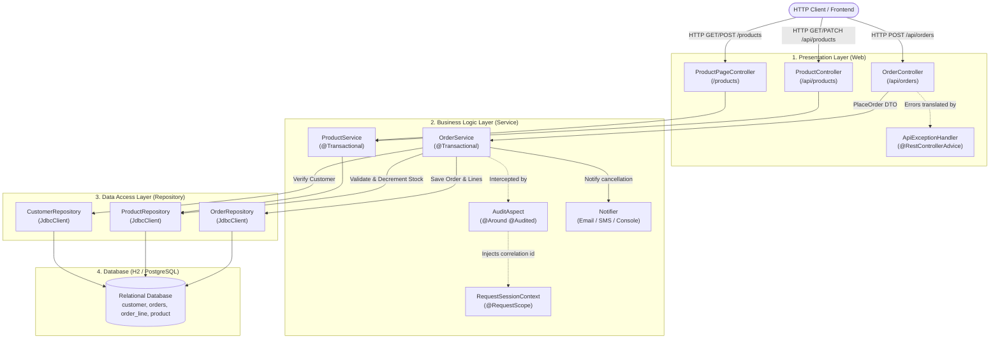
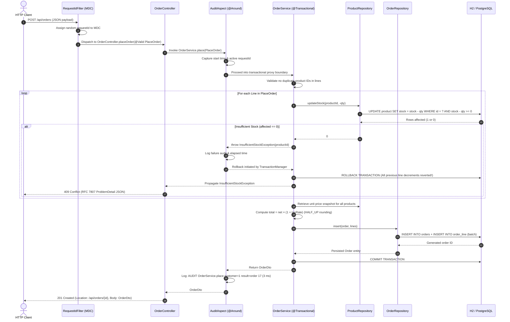

# Lab 02: Spring Framework

## Tasks 0–5: Complete Lab 02 Guide (Setup, Bootstrapping, IoC/DI, JDBC, REST API, & Production Operability)

> **Course:** Software Engineering — Chapter 02  
> **Topic:** Spring Framework & Spring Boot Architecture  
> **Application:** `shop` (E-Commerce Order Management System)  
> **Stack:** Java 21 / 25, Spring Boot 3.x / 4.x, Apache Maven 3.9+

---

## 🎯 Lab Objectives for Students

By the end of this lab, students will understand:

1. **The Role of Build Automation Tools (Maven / Gradle)**: How dependency resolution, parents, and plugins work.
2. **Spring Boot Core Philosophies**:
   - **Opinionated Defaults** (Starters without manual version specification).
   - **Auto-Configuration** (Automatic wiring based on classpath presence).
   - **Self-Contained Deployment** (Embedded Tomcat inside an executable "Fat JAR").
3. **Building RESTful Endpoints**: Using modern Java records and Spring MVC annotations (`@RestController`, `@GetMapping`, `@RequestParam`).
4. **Production Readiness with Spring Boot Actuator**: Health metrics and auto-configuration inspection.

---

## 📋 Task 0: Setup & Project Initialization (15 Minutes)

### Step 0.1: Verify the Toolchain

Before generating the project, verify that the required developer tools are installed and accessible in your shell:

```bash
# Check Java version (JDK 21 or JDK 25 recommended)
java -version

# Check Maven version (3.9.x+)
mvn -v

# Check Git version
git --version

# Check HTTP client (curl)
curl --version
```

---

### Step 0.2: Generate the Project with Spring Initializr

You can generate the project either using the **Terminal command (`curl`)** or the **Web Interface (`start.spring.io`)**.

#### Method A: Using Terminal (Recommended & Fast)

Run the following command in your terminal:

```bash
curl https://start.spring.io/starter.zip \
  -d type=maven-project \
  -d language=java \
  -d javaVersion=25 \
  -d bootVersion=4.1.1 \
  -d groupId=edu.itc.se \
  -d artifactId=shop \
  -d name=shop \
  -d packageName=edu.itc.shop \
  -d dependencies=webmvc,validation,jdbc,h2,actuator,aop,devtools \
  -o shop.zip && unzip shop.zip -d shop && cd shop
```

> 💡 **Teaching Note for Students (Dependencies Breakdown):**
>
> - **`webmvc` (Spring Web MVC):** Provides embedded Tomcat and the Spring MVC framework for building REST APIs and web controllers.
> - **`validation` (Bean Validation):** Provides Jakarta Validation (`@NotNull`, `@Size`, etc.) to validate incoming DTOs.
> - **`jdbc` (JDBC API):** Provides lightweight database access utilities (`JdbcClient`, `DataSourceTransactionManager`).
> - **`h2` (H2 Database):** An ultra-fast, in-memory SQL database—zero installation required for local development and testing.
> - **`actuator` (Spring Boot Actuator):** Exposes operational endpoints like `/actuator/health` and `/actuator/info` for monitoring.
> - **`aop` (Spring AOP):** Supports Aspect-Oriented Programming (used later for method execution timing and cross-cutting concerns).
> - **`devtools` (Spring Boot DevTools):** Provides automatic server restarts upon code compilation and disables static asset caching for rapid prototyping.

---

### Step 0.3: Initialize Git Repository & Check `.gitignore`

Inside the `shop` folder, initialize your Git repository:

```bash
git init
git status
```

Open `.gitignore` and verify that Maven build output directory (`target/`) and IDE config files (`.idea/`, `*.iml`, `.vscode/`) are ignored:

```gitignore
target/
!.mvn/wrapper/maven-wrapper.jar
.idea/
*.iml
.vscode/
.DS_Store
```

Make your first initial commit:

```bash
git add .
git commit -m "chore: initial project generated from spring initializr"
git tag task-0
```

---

### Step 0.4: First Build Verification

Spring Boot bundles the **Maven Wrapper** (`mvnw` for Linux/macOS, `mvnw.cmd` for Windows).  
_Why use the wrapper?_ It guarantees every student and CI pipeline uses the exact same Maven version without requiring manual system installation!

Run the initial verify command:

```bash
./mvnw -q verify
```

> **Expected Result:** The command finishes silently with exit code `0` (`BUILD SUCCESS`). All Maven plugins and starter libraries are now cached in your `~/.m2/repository`.

---

### Step 0.5: Target Package Architecture

Spring Boot follows the **Clean 3-Tier Layered Architecture**. Organize your code into packages under `edu.itc.shop`:

```
edu.itc.shop
│
├── ShopApplication.java               # Main entry point (@SpringBootApplication)
│
├── config/                            # Configuration classes (@Configuration, @ConfigurationProperties)
│   ├── ShopProperties.java
│   └── AppConfig.java
│
├── web/                               # Web Presentation Layer (REST Controllers, Global Exception Handlers)
│   ├── HelloController.java
│   ├── ProductController.java
│   ├── ProductPageController.java
│   ├── ApiExceptionHandler.java
│   └── dto/                           # Data Transfer Objects (Request/Response records)
│       ├── ProductDto.java
│       └── CreateProduct.java
│
├── service/                           # Business Logic Layer (Services, Cross-cutting Aspects)
│   ├── ProductService.java
│   ├── Notifier.java + implementations
│   └── TimingAspect.java
│
├── repository/                        # Data Access Layer (Persistence)
│   ├── ProductRepository.java         # (JdbcClient)
│   └── RawJdbcProductRepository.java
│
└── domain/                            # Core Domain Entities / Models
    └── Product.java
```

---

## 🚀 Task 1: Bootstrapping with Maven and Spring Boot (30 Minutes)

### Goal

Understand what the generated Spring Boot project contains, answer key Maven architectural questions, build your first REST endpoint, run the application in 3 different modes, and observe Spring Boot's Auto-Configuration engine.

---

### 1. Understanding `pom.xml` (Student Study Questions & Answers)

Open your project's `pom.xml` file. Below are the key architectural questions every student must understand:

#### Q1: What does the `<parent>` tag give you?

```xml
<parent>
    <groupId>org.springframework.boot</groupId>
    <artifactId>spring-boot-starter-parent</artifactId>
    <version>...</version>
    <relativePath/>
</parent>
```

**Answer:**  
The `spring-boot-starter-parent` acts as a central inherited configuration for your project:

1. **Curated Dependency Management (`<dependencyManagement>`):** Pre-defines compatible version numbers for hundreds of common third-party libraries (Jackson, Hibernate, SLF4J, H2, Tomcat, etc.) so you never suffer from "JAR Hell" or version conflicts.
2. **Default Plugin Configurations:** Pre-configures plugins like `maven-compiler-plugin` (with appropriate Java release flags) and `spring-boot-maven-plugin`.
3. **Resource Filtering Defaults:** Configures filtering for `application.properties` and `application.yml`.
4. **Sensible Encodings:** Sets default file encoding to `UTF-8`.

---

#### Q2: Why do `<dependency>` declarations for starters have no `<version>` tag?

```xml
<dependency>
    <groupId>org.springframework.boot</groupId>
    <artifactId>spring-boot-starter-web</artifactId>
    <!-- Notice: NO <version> tag! -->
</dependency>
```

**Answer:**  
Because the version is **inherited from the parent BOM (Bill of Materials)**.  
The Spring team rigorously tests and guarantees that all starter modules matching the parent's release are binary-compatible. Omitting `<version>` ensures:

- You never accidentally mismatch library versions.
- Upgrading your entire application to a newer Spring Boot release only requires changing **one single line**—the `<version>` in the `<parent>` tag!

---

#### Q3: What does the `spring-boot-maven-plugin` do at `package` time?

```xml
<plugin>
    <groupId>org.springframework.boot</groupId>
    <artifactId>spring-boot-maven-plugin</artifactId>
</plugin>
```

**Answer:**  
During the Maven `package` phase, this plugin executes its **`repackage`** goal:

1. It takes the standard, thin JAR file generated by Maven (containing only your compiled `.class` files).
2. It repackages it into an **Executable "Fat JAR"** (or Uber-JAR).
3. It bundles all third-party dependencies and the embedded web server (Tomcat) into `BOOT-INF/lib/`.
4. It sets the `Main-Class` to Spring Boot's `JarLauncher` so the entire web application can be launched independently using standard Java:
   ```bash
   java -jar target/shop-0.0.1-SNAPSHOT.jar
   ```

---

#### Q4: Inspecting Transitive Dependencies

Run the Maven dependency tree command:

```bash
./mvnw dependency:tree | head -40
```

**What students should notice:**  
Even though you only declared `spring-boot-starter-web`, Maven automatically pulls in:

- `spring-web` & `spring-webmvc` (Core MVC framework)
- `tomcat-embed-core`, `tomcat-embed-websocket` (Embedded HTTP Server)
- `jackson-databind` (JSON serialization/deserialization)
- `spring-boot-starter-logging` -> `logback-classic`, `slf4j-api` (Unified Logging)

---

### 2. Creating the First REST Controller (`HelloController`)

Create the file: `src/main/java/edu/itc/shop/web/HelloController.java`

```java
package edu.itc.shop.web;

import java.time.Instant;
import org.springframework.web.bind.annotation.GetMapping;
import org.springframework.web.bind.annotation.RequestParam;
import org.springframework.web.bind.annotation.RestController;

/**
 * HelloController demonstrates building a REST API using modern Java Records
 * and Spring Boot's @RestController.
 */
@RestController
public class HelloController {

    /**
     * Java Record representing an immutable response payload.
     * Jackson automatically serializes this to JSON:
     * {"message": "Hello, ...", "at": "2026-..."}
     */
    public record Greeting(String message, Instant at) {}

    /**
     * GET /hello?name=X
     * If no name parameter is provided in query string, defaults to "World".
     */
    @GetMapping("/hello")
    public Greeting hello(@RequestParam(defaultValue = "World") String name) {
        String greetingMessage = "Hello, " + name + "!";
        Instant currentTime = Instant.now();
        return new Greeting(greetingMessage, currentTime);
    }
}
```

> 💡 **Code Breakdown for Students:**
>
> - **`@RestController`:** Combines `@Controller` and `@ResponseBody`. Tells Spring that every method's return value should be serialized directly into HTTP response body (JSON) rather than rendering an HTML view template.
> - **`public record Greeting(...)`:** A modern Java feature (Java 16+). Records are concise, immutable data carriers that automatically generate private final fields, constructor, getters (`message()`, `at()`), `equals()`, `hashCode()`, and `toString()`.
> - **`@RequestParam(defaultValue = "World")`:** Binds query parameter `?name=Ann` from the URL. If omitted (`/hello`), `name` automatically takes the default value `"World"`.

---

### 3. Three Ways to Run the Application

#### Way 1: Developer Mode via Maven Wrapper (with Spring DevTools)

In your terminal, execute:

```bash
./mvnw spring-boot:run
```

Test your endpoint using `curl`:

```bash
curl -i "http://localhost:8080/hello?name=Ann"
```

**Expected HTTP Response:**

```http
HTTP/1.1 200
Content-Type: application/json

{"message":"Hello, Ann!","at":"2026-09-25T09:12:44.120Z"}
```

Test default parameter:

```bash
curl -i "http://localhost:8080/hello"
```

```json
{ "message": "Hello, World!", "at": "2026-09-25T09:13:02.500Z" }
```

> ⚡ **Live Reload Demonstration:**  
> While the server is running, change `"Hello, " + name + "!"` in `HelloController.java` to `"Welcome, " + name + "!"` and save/recompile.  
> Watch your terminal: **Spring Boot DevTools** detects the `.class` file update and restarts the application context in under **500 milliseconds**!

---

#### Way 2: Standalone Production Executable JAR (Fat JAR)

Build the production package:

```bash
./mvnw -q package
```

Inspect the generated JAR in `target/`:

```bash
ls -lh target/shop-0.0.1-SNAPSHOT.jar
```

> ❓ **Why is the JAR file ~20MB–50MB in size?**  
> Because it is a **Fat JAR**! It contains:
>
> 1. All compiled project classes (`BOOT-INF/classes`).
> 2. The entire **Embedded Apache Tomcat** web server.
> 3. All required dependency libraries (`BOOT-INF/lib/*.jar`).  
>    This allows the application to run on _any_ server with a JVM without installing Tomcat or Maven!

Now launch the application on a **custom port (`9090`)** using command-line arguments:

```bash
java -jar target/shop-0.0.1-SNAPSHOT.jar --server.port=9090
```

Verify that the application responds on port `9090`:

```bash
curl -i "http://localhost:9090/hello?name=ITC-Student"
```

```http
HTTP/1.1 200
Content-Type: application/json

{"message":"Hello, ITC-Student!","at":"2026-09-25T09:15:20.100Z"}
```

---

#### Way 3: IDE Direct Run

Open `ShopApplication.java` inside IntelliJ IDEA or VS Code, and click the green **▶ Run** icon next to:

```java
public static void main(String[] args) {
    SpringApplication.run(ShopApplication.class, args);
}
```

---

### 4. Production Monitoring with Spring Boot Actuator

Check application health status:

```bash
curl http://localhost:8080/actuator/health
```

**Expected Output:**

```json
{ "status": "UP" }
```

---

### 5. Inspecting Auto-Configuration with `--debug`

Spring Boot uses **Condition Evaluation** (`@ConditionalOnClass`, `@ConditionalOnMissingBean`, etc.) to configure components automatically.

Stop your application (`Ctrl + C`) and restart it with the `--debug` flag:

```bash
./mvnw spring-boot:run -Dspring-boot.run.arguments="--debug"
```

Or with the JAR:

```bash
java -jar target/shop-0.0.1-SNAPSHOT.jar --debug
```

Look at the console output under **`CONDITIONS EVALUATION REPORT`** -> **`Positive matches`**:

Search for **`DataSourceAutoConfiguration`**:

```text
DataSourceAutoConfiguration matched:
 - @ConditionalOnClass found required classes 'javax.sql.DataSource', 'org.springframework.jdbc.datasource.embedded.EmbeddedDatabaseType' (OnClassCondition)
 - @ConditionalOnMissingBean (types: io.r2dbc.spi.ConnectionFactory; SearchStrategy: all) did not find any beans (OnBeanCondition)
```

> 🔍 **Why did `DataSourceAutoConfiguration` match?**
>
> - You added `h2` and `jdbc` dependencies to `pom.xml`.
> - Spring Boot scanned the classpath and detected `DataSource.class` and an embedded database driver (`org.h2.Driver`).
> - Because no custom `DataSource` bean was manually defined, Spring Boot **automatically created an in-memory H2 database pool** for you!

---

### 6. Gradle Bonus: Project Comparison (Optional)

To see the equivalent project in Gradle:

```bash
# In a sibling folder:
cd ..
curl https://start.spring.io/starter.zip \
  -d type=gradle-project-kotlin \
  -d language=java \
  -d javaVersion=25 \
  -d bootVersion=4.1.1 \
  -d groupId=edu.itc.se \
  -d artifactId=shop-gradle \
  -d dependencies=webmvc,validation,jdbc,h2,actuator,aop,devtools \
  -o shop-gradle.zip && unzip shop-gradle.zip -d shop-gradle && cd shop-gradle

# Run with Gradle Wrapper:
./gradlew bootRun
```

> **Remember:** Commit only `./gradlew`, `gradle/wrapper/`, and `build.gradle.kts`. Never commit `.gradle/` or `build/`.

---

---

## 🧩 Task 2: Inversion of Control, Dependency Injection, and Bean Lifecycle (45 Minutes)

### Goal

Let the Spring IoC Container wire your objects. You will explore:

1. **Interface-based programming** with multiple implementations.
2. **Constructor Injection** as the industry standard.
3. **Disambiguation mechanisms**: Resolution by Type, `@Primary`, `@Qualifier`, and `@Profile`.
4. **Bean Lifecycle callbacks**: `@PostConstruct` and `@PreDestroy`.
5. **Bean Scopes**: Singleton (default) vs. Prototype (`@Scope("prototype")`) using `ObjectProvider`.
6. **Pure POJO Unit Testing**: Testing business logic with zero Spring overhead using `Clock.fixed(...)`.

```
          ┌─────────────────────────────────────────┐
          │             WelcomeService              │
          │         (Notifier n, Clock c)           │
          └────────────────────┬────────────────────┘
                               │ (depends on)
                               ▼
                    «interface» Notifier
                               ▲
         ┌─────────────────────┼─────────────────────┐
         │                     │                     │
┌────────────────┐    ┌─────────────────┐    ┌─────────────────┐
│ EmailNotifier  │    │   SmsNotifier   │    │ ConsoleNotifier │
│   (@Primary)   │    │  (@Qualifier)   │    │ (@Profile("dev")│
└────────────────┘    └─────────────────┘    └─────────────────┘
     Container resolves by: Type ➔ @Primary ➔ @Qualifier
```

---

### 1. Architectural Concepts Explained for Students

#### A. Inversion of Control (IoC) & Dependency Injection (DI)

- **Traditional Approach (Without Spring):**  
  A class directly instantiates its collaborators using `new`:
  ```java
  public class WelcomeService {
      private Notifier notifier = new EmailNotifier(); // ❌ Tightly coupled! Hard to test or swap.
  }
  ```
- **IoC Approach (With Spring):**  
  Control is **inverted**. The Spring Container instantiates beans, manages their lifecycle, and **injects** them where needed:
  ```java
  @Service
  public class WelcomeService {
      private final Notifier notifier;
      public WelcomeService(Notifier notifier) { // ✅ Loosely coupled! Injected by Spring.
          this.notifier = notifier;
      }
  }
  ```

#### B. Why Constructor Injection with `final` fields?

Spring supports three forms of injection:

1. **Field Injection (`@Autowired private Notifier notifier;`)** — ❌ **Anti-pattern:** Cannot make fields `final`, hides dependencies, and makes plain unit testing without Spring reflection impossible.
2. **Setter Injection** — ⚠️ Use only for optional dependencies.
3. **Constructor Injection** — ✅ **Best Practice:**
   - Fields are declared `private final` (guaranteeing thread-safety and immutability).
   - Prevents null-pointer exceptions because an object cannot be constructed in a half-initialized state.
   - Enables blazing-fast unit tests using plain `new WelcomeService(...)` without loading the Spring context.
   - Note: If a class has a single constructor, Spring Boot injects dependencies **automatically without requiring `@Autowired`**!

---

### 2. Step-by-Step Implementation

#### Step 2.1: Create the `Notifier` Interface and Implementations

Create `src/main/java/edu/itc/shop/service/Notifier.java`:

```java
package edu.itc.shop.service;

public interface Notifier {
    void send(String to, String text);
}
```

Now create the default implementation: `src/main/java/edu/itc/shop/service/EmailNotifier.java`:

```java
package edu.itc.shop.service;

import jakarta.annotation.PostConstruct;
import jakarta.annotation.PreDestroy;
import org.slf4j.Logger;
import org.slf4j.LoggerFactory;
import org.springframework.context.annotation.Primary;
import org.springframework.stereotype.Service;

@Service
@Primary // Default choice whenever a Notifier is requested without @Qualifier
public class EmailNotifier implements Notifier {

    private static final Logger log = LoggerFactory.getLogger(EmailNotifier.class);

    @PostConstruct
    public void init() {
        log.info("EmailNotifier ready");
    }

    @Override
    public void send(String to, String text) {
        log.info("EMAIL to={} text={}", to, text);
    }

    @PreDestroy
    public void cleanup() {
        log.info("EmailNotifier closing");
    }
}
```

Create the SMS implementation: `src/main/java/edu/itc/shop/service/SmsNotifier.java`:

```java
package edu.itc.shop.service;

import jakarta.annotation.PostConstruct;
import jakarta.annotation.PreDestroy;
import org.slf4j.Logger;
import org.slf4j.LoggerFactory;
import org.springframework.stereotype.Service;

@Service("smsNotifier")
public class SmsNotifier implements Notifier {

    private static final Logger log = LoggerFactory.getLogger(SmsNotifier.class);

    @PostConstruct
    public void init() {
        log.info("SmsNotifier ready");
    }

    @Override
    public void send(String to, String text) {
        log.info("SMS to={} text={}", to, text);
    }

    @PreDestroy
    public void cleanup() {
        log.info("SmsNotifier closing");
    }
}
```

---

#### Step 2.2: Provide `Clock` Bean in `AppConfig`

Create `src/main/java/edu/itc/shop/config/AppConfig.java`:

```java
package edu.itc.shop.config;

import java.time.Clock;
import org.springframework.context.annotation.Bean;
import org.springframework.context.annotation.Configuration;

@Configuration
public class AppConfig {

    /**
     * Declaring Clock as a bean allows injecting a predictable time source
     * during unit testing (e.g. Clock.fixed(...)).
     */
    @Bean
    public Clock clock() {
        return Clock.systemDefaultZone();
    }
}
```

---

#### Step 2.3: Implement `WelcomeService`

Create `src/main/java/edu/itc/shop/service/WelcomeService.java`:

```java
package edu.itc.shop.service;

import java.time.Clock;
import java.time.LocalTime;
import org.springframework.beans.factory.annotation.Qualifier;
import org.springframework.stereotype.Service;

@Service
public class WelcomeService {

    private final Notifier defaultNotifier;
    private final Notifier urgentNotifier;
    private final Clock clock;

    public WelcomeService(Notifier defaultNotifier,
                          @Qualifier("smsNotifier") Notifier urgentNotifier,
                          Clock clock) {
        this.defaultNotifier = defaultNotifier;
        this.urgentNotifier = urgentNotifier;
        this.clock = clock;
    }

    public String welcome(String user, boolean urgent) {
        String text = "Welcome " + user + "! It is " + LocalTime.now(clock).withNano(0);
        Notifier chosenNotifier = urgent ? urgentNotifier : defaultNotifier;
        chosenNotifier.send(user, text);
        return text;
    }
}
```

---

#### Step 2.4: Bean Lifecycle & Prototype Scope Demo

Create a prototype-scoped bean: `src/main/java/edu/itc/shop/service/ReportBuilder.java`:

```java
package edu.itc.shop.service;

import org.springframework.context.annotation.Scope;
import org.springframework.stereotype.Component;

@Component
@Scope("prototype") // A NEW instance is created on EVERY getObject() call!
public class ReportBuilder {
    public String buildReport() {
        return "Report generated at " + System.currentTimeMillis();
    }
}
```

---

#### Step 2.5: Environment Profiles (`ConsoleNotifier`)

Create `src/main/java/edu/itc/shop/service/ConsoleNotifier.java`:

```java
package edu.itc.shop.service;

import org.slf4j.Logger;
import org.slf4j.LoggerFactory;
import org.springframework.context.annotation.Primary;
import org.springframework.context.annotation.Profile;
import org.springframework.stereotype.Service;

@Service
@Profile("dev") // Active ONLY when spring.profiles.active contains 'dev'
@Primary        // Competes with EmailNotifier when dev profile is active!
public class ConsoleNotifier implements Notifier {

    private static final Logger log = LoggerFactory.getLogger(ConsoleNotifier.class);

    @Override
    public void send(String to, String text) {
        log.info("CONSOLE to={} text={}", to, text);
    }
}
```

> ❓ **README Question for Students:**  
> **What rule decides between two `@Primary` beans? What happens if both are active simultaneously?**  
> **Answer:**  
> If two beans of the same type (`EmailNotifier` and `ConsoleNotifier`) are both marked `@Primary` and both active simultaneously, Spring encounters an **ambiguity failure** and crashes on startup with:
>
> ```text
> org.springframework.beans.factory.NoUniqueBeanDefinitionException:
> No qualifying bean of type 'edu.itc.shop.service.Notifier' available:
> more than one 'primary' bean found among candidates: [emailNotifier, consoleNotifier]
> ```
>
> **How to fix this in Spring:**
>
> 1. Use explicit `@Qualifier("consoleNotifier")` at the injection point.
> 2. Or deactivate `@Primary` on `EmailNotifier` when profile `dev` is active using `@Profile("!dev")` on `EmailNotifier`:
>
> ```java
> @Service
> @Profile("!dev") // Active only when NOT dev
> @Primary
> public class EmailNotifier implements Notifier { ... }
> ```

---

#### Step 2.6: CommandLineRunner for Startup Inspection

In `src/main/java/edu/itc/shop/ShopApplication.java`, implement `CommandLineRunner`:

```java
package edu.itc.shop;

import edu.itc.shop.service.Notifier;
import edu.itc.shop.service.ReportBuilder;
import edu.itc.shop.service.WelcomeService;
import java.util.Arrays;
import org.slf4j.Logger;
import org.slf4j.LoggerFactory;
import org.springframework.beans.factory.ObjectProvider;
import org.springframework.boot.CommandLineRunner;
import org.springframework.boot.SpringApplication;
import org.springframework.boot.autoconfigure.SpringBootApplication;
import org.springframework.context.ApplicationContext;
import org.springframework.context.annotation.Bean;

@SpringBootApplication
public class ShopApplication {

    private static final Logger log = LoggerFactory.getLogger(ShopApplication.class);

    public static void main(String[] args) {
        SpringApplication.run(ShopApplication.class, args);
    }

    @Bean
    public CommandLineRunner runner(ApplicationContext ctx,
                                     WelcomeService welcomeService,
                                     ObjectProvider<ReportBuilder> reportBuilderProvider) {
        return args -> {
            // 1. Inspect loaded beans
            int beanCount = ctx.getBeanDefinitionCount();
            String[] notifierBeans = ctx.getBeanNamesForType(Notifier.class);
            log.info("{} beans; notifiers = {}", beanCount, Arrays.toString(notifierBeans));

            // 2. Test WelcomeService
            welcomeService.welcome("ann", false); // Default (Email)
            welcomeService.welcome("bob", true);  // Urgent (SMS via @Qualifier)

            // 3. Prove Prototype Scope
            ReportBuilder r1 = reportBuilderProvider.getObject();
            ReportBuilder r2 = reportBuilderProvider.getObject();
            boolean instancesDiffer = System.identityHashCode(r1) != System.identityHashCode(r2);
            log.info("prototype instances differ: {}", instancesDiffer);
        };
    }
}
```

---

#### Step 2.7: Write a Pure Unit Test (`WelcomeServiceTest`)

Create `src/test/java/edu/itc/shop/service/WelcomeServiceTest.java`:

```java
package edu.itc.shop.service;

import static org.junit.jupiter.api.Assertions.assertEquals;
import static org.junit.jupiter.api.Assertions.assertTrue;

import java.time.Clock;
import java.time.Instant;
import java.time.ZoneId;
import java.util.ArrayList;
import java.util.List;
import org.junit.jupiter.api.Test;

/**
 * Pure JUnit 5 Unit Test — NO Spring Context required!
 * Runs in under 10 milliseconds.
 */
class WelcomeServiceTest {

    // Test Double (Fake Notifier) to capture sent notifications
    static class FakeNotifier implements Notifier {
        final List<String> sentTo = new ArrayList<>();
        final List<String> sentText = new ArrayList<>();

        @Override
        public void send(String to, String text) {
            sentTo.add(to);
            sentText.add(text);
        }
    }

    @Test
    void shouldFormatWelcomeMessageAndSendViaChosenNotifier() {
        // Arrange: Freeze time at 09:15:02 UTC
        Clock fixedClock = Clock.fixed(Instant.parse("2026-09-25T09:15:02Z"), ZoneId.of("UTC"));
        FakeNotifier defaultNotifier = new FakeNotifier();
        FakeNotifier urgentNotifier = new FakeNotifier();

        WelcomeService service = new WelcomeService(defaultNotifier, urgentNotifier, fixedClock);

        // Act: Test standard notification
        String result = service.welcome("Ann", false);

        // Assert
        assertEquals("Welcome Ann! It is 09:15:02", result);
        assertEquals(1, defaultNotifier.sentTo.size());
        assertEquals("Ann", defaultNotifier.sentTo.get(0));
        assertTrue(urgentNotifier.sentTo.isEmpty(), "Urgent notifier should not have been called");

        // Act: Test urgent notification
        service.welcome("Bob", true);
        assertEquals(1, urgentNotifier.sentTo.size());
        assertEquals("Bob", urgentNotifier.sentTo.get(0));
    }
}
```

---

### 3. Expected Terminal Output

Run the application:

```bash
./mvnw spring-boot:run
```

**Expected Log Output:**

```text
INFO  e.i.shop.service.EmailNotifier       : EmailNotifier ready
INFO  e.i.shop.service.SmsNotifier         : SmsNotifier ready
INFO  e.i.shop.ShopApplication             : 312 beans; notifiers = [emailNotifier, smsNotifier]
INFO  e.i.shop.service.EmailNotifier       : EMAIL to=ann text=Welcome ann! It is 09:15:02
INFO  e.i.shop.service.SmsNotifier         : SMS to=bob text=Welcome bob! It is 09:15:02
INFO  e.i.shop.ShopApplication             : prototype instances differ: true
...
INFO  e.i.shop.service.EmailNotifier       : EmailNotifier closing    <-- Logged on Ctrl+C shutdown
```

Run test suite:

```bash
./mvnw test
```

```text
[INFO] Tests run: 1, Failures: 0, Errors: 0, Skipped: 0, Time elapsed: 0.045 s
[INFO] BUILD SUCCESS
```

---

---

## 💾 Task 3: JDBC, JdbcClient, and Declarative Transactions (60 Minutes)

### Goal

Persist products in an in-memory H2 database:

1. First, write **raw JDBC** to feel the pain of boilerplate, resource leaks, and manual mapping.
2. Second, write modern **Spring `JdbcClient`** (introduced in Spring Framework 6 / Spring Boot 3) to experience clean, type-safe, fluent SQL queries.
3. Wrap multi-statement database operations in **declarative transactions (`@Transactional`)** and prove automatic rollback upon failure.
4. Understand Spring's **DataAccessException** exception translation hierarchy.

```
       ProductService.restock(fromId, toId, qty)
                         │
                         ▼
┌─────────────────────────────────────────────────────────┐
│ @Transactional: One Connection, autoCommit = false     │
│                                                         │
│ 1. UPDATE product SET stock = stock - qty WHERE ...     │
│    (Succeeds or fails if insufficient stock)            │
│                         │                               │
│ 2. UPDATE product SET stock = stock + qty WHERE ...     │
│    (If step 1 affects 0 rows ➔ throws Exception)        │
└────────────────────────┬────────────────────────────────┘
                         ▼
             ROLLBACK: First update undone!
```

---

### 1. Architectural Concepts Explained for Students

#### A. The Evolution: Raw JDBC vs. JdbcTemplate vs. JdbcClient

- **Raw JDBC (1997):**
  - Requires manual `Connection`, `PreparedStatement`, and `ResultSet`.
  - Prone to resource leaks if try-with-resources or `close()` is forgotten.
  - Manual indexed parameter binding (`ps.setString(1, ...)`, `ps.setBigDecimal(2, ...)`).
  - Forces you to handle checked `java.sql.SQLException` everywhere.
- **JdbcTemplate (2003):**
  - Eliminated boilerplate and connection leaks.
  - Still required verbose `RowMapper<T>` lambda callbacks.
- **JdbcClient (2023 — Spring Boot 3 / Spring Framework 6):**
  - Modern, fluent, unified API combining `JdbcTemplate` and `NamedParameterJdbcTemplate`.
  - Automatically maps query columns to Java **records** or classes with zero boilerplate (`.query(Product.class).list()`).
  - Supports named parameters (`:name`, `:price`, `:stock`) directly from record objects via `.paramSource(p)`.

#### B. How `@Transactional` Works Behind the Scenes

1. Spring uses **AOP Proxies**: When a method is annotated with `@Transactional`, Spring creates an interceptor wrapper around it.
2. **Transaction Begin:** Before executing the method, `DataSourceTransactionManager` acquires a database connection, sets `connection.setAutoCommit(false)`, and binds the connection to the current thread (`ThreadLocal`).
3. **Execution:** All repository operations executed within this method reuse the exact same connection.
4. **Commit / Rollback:**
   - If the method completes normally: `connection.commit()` is called.
   - If an unhandled `RuntimeException` (or `Error`) is thrown: `connection.rollback()` is immediately invoked, restoring the database to its exact pre-transaction state!

---

### 2. Step-by-Step Implementation

#### Step 3.1: Create Domain Record (`Product`)

Create `src/main/java/edu/itc/shop/domain/Product.java`:

```java
package edu.itc.shop.domain;

import java.math.BigDecimal;

/**
 * Domain entity represented as an immutable Java Record.
 */
public record Product(Long id, String name, BigDecimal price, int stock) {
    // Compact constructor to guarantee non-negative stock at creation time
    public Product {
        if (stock < 0) {
            throw new IllegalArgumentException("Stock cannot be negative: " + stock);
        }
    }
}
```

---

#### Step 3.2: Configure Database Schema & Seed Data

Create `src/main/resources/schema.sql`:

```sql
CREATE TABLE IF NOT EXISTS product (
    id BIGINT GENERATED BY DEFAULT AS IDENTITY PRIMARY KEY,
    name VARCHAR(80) NOT NULL UNIQUE,
    price DECIMAL(10,2) NOT NULL,
    stock INT NOT NULL CHECK (stock >= 0)
);
```

Create `src/main/resources/data.sql`:

```sql
INSERT INTO product (name, price, stock) VALUES ('MacBook Pro 16"', 2499.00, 10);
INSERT INTO product (name, price, stock) VALUES ('Dell XPS 15', 1899.50, 15);
INSERT INTO product (name, price, stock) VALUES ('Mechanical Keyboard', 129.99, 50);
INSERT INTO product (name, price, stock) VALUES ('Wireless Mouse', 49.99, 100);
INSERT INTO product (name, price, stock) VALUES ('4K Gaming Monitor', 499.00, 20);
```

Configure `src/main/resources/application.yml` (or `application.properties`):

```yaml
spring:
  application:
    name: shop
  datasource:
    url: jdbc:h2:mem:shopdb;DB_CLOSE_DELAY=-1;DB_CLOSE_ON_EXIT=FALSE
    driver-class-name: org.h2.Driver
    username: sa
    password:
  h2:
    console:
      enabled: true
      path: /h2-console
  sql:
    init:
      mode: always # Always execute schema.sql and data.sql on startup

logging:
  level:
    org.springframework.jdbc: DEBUG
    org.springframework.transaction: DEBUG
```

> 💡 **Student Tip:** Once the app runs, open your browser at `http://localhost:8080/h2-console`. Set JDBC URL to `jdbc:h2:mem:shopdb`, username `sa`, empty password, and click **Connect** to visually inspect your tables!

---

#### Step 3.3: Feeling the Pain — Raw JDBC Repository

Create `src/main/java/edu/itc/shop/repository/RawJdbcProductRepository.java`:

```java
package edu.itc.shop.repository;

import edu.itc.shop.domain.Product;
import java.math.BigDecimal;
import java.sql.Connection;
import java.sql.PreparedStatement;
import java.sql.ResultSet;
import java.sql.SQLException;
import java.util.ArrayList;
import java.util.List;
import javax.sql.DataSource;
import org.springframework.stereotype.Repository;

@Repository
public class RawJdbcProductRepository {

    private final DataSource dataSource;

    public RawJdbcProductRepository(DataSource dataSource) {
        this.dataSource = dataSource;
    }

    /**
     * Look how much boilerplate is required just to query all products!
     * Count: ~35 lines of code for ONE query.
     */
    public List<Product> findAll() {
        String sql = "SELECT id, name, price, stock FROM product ORDER BY id";
        List<Product> products = new ArrayList<>();

        try (Connection conn = dataSource.getConnection();
             PreparedStatement ps = conn.prepareStatement(sql);
             ResultSet rs = ps.executeQuery()) {

            while (rs.next()) {
                long id = rs.getLong("id");
                String name = rs.getString("name");
                BigDecimal price = rs.getBigDecimal("price");
                int stock = rs.getInt("stock");
                products.add(new Product(id, name, price, stock));
            }
            return products;
        } catch (SQLException e) {
            throw new RuntimeException("Failed to fetch products using raw JDBC", e);
        }
    }
}
```

> 📊 **Line Count Comparison for README:**
>
> - **Raw JDBC `findAll()`:** **35 lines** of code (boilerplate connection management, statement closing, exception catching, manual column mapping).
> - **`JdbcClient` `findAll()`:** **3 lines** of code!

---

#### Step 3.4: Modern Spring Repository with `JdbcClient`

Create `src/main/java/edu/itc/shop/repository/ProductRepository.java`:

```java
package edu.itc.shop.repository;

import edu.itc.shop.domain.Product;
import java.util.List;
import java.util.Optional;
import org.springframework.jdbc.core.simple.JdbcClient;
import org.springframework.jdbc.support.GeneratedKeyHolder;
import org.springframework.stereotype.Repository;

@Repository
public class ProductRepository {

    private final JdbcClient jdbc;

    public ProductRepository(JdbcClient jdbc) {
        this.jdbc = jdbc;
    }

    public List<Product> findAll() {
        return jdbc.sql("SELECT id, name, price, stock FROM product ORDER BY id")
                .query(Product.class)
                .list();
    }

    public Optional<Product> findById(long id) {
        return jdbc.sql("SELECT id, name, price, stock FROM product WHERE id = :id")
                .param("id", id)
                .query(Product.class)
                .optional();
    }

    public List<Product> findByNameContaining(String query) {
        return jdbc.sql("SELECT id, name, price, stock FROM product WHERE LOWER(name) LIKE LOWER(:query) ORDER BY id")
                .param("query", "%" + query + "%")
                .query(Product.class)
                .list();
    }

    public long insert(Product p) {
        var keys = new GeneratedKeyHolder();
        jdbc.sql("INSERT INTO product(name, price, stock) VALUES (:name, :price, :stock)")
                .paramSource(p)
                .update(keys);
        return keys.getKey().longValue();
    }

    /**
     * Atomically updates the stock by delta.
     * Prevents negative stock using: stock + :delta >= 0
     * Returns: number of affected rows (1 if successful, 0 if not found or stock insufficient)
     */
    public int updateStock(long id, int delta) {
        return jdbc.sql("UPDATE product SET stock = stock + :delta WHERE id = :id AND stock + :delta >= 0")
                .param("id", id)
                .param("delta", delta)
                .update();
    }

    public int delete(long id) {
        return jdbc.sql("DELETE FROM product WHERE id = :id")
                .param("id", id)
                .update();
    }
}
```

---

#### Step 3.5: Transactional Business Service (`ProductService`)

Create `src/main/java/edu/itc/shop/service/ProductService.java`:

```java
package edu.itc.shop.service;

import edu.itc.shop.domain.Product;
import edu.itc.shop.repository.ProductRepository;
import java.util.List;
import org.slf4j.Logger;
import org.slf4j.LoggerFactory;
import org.springframework.stereotype.Service;
import org.springframework.transaction.annotation.Transactional;

@Service
public class ProductService {

    private static final Logger log = LoggerFactory.getLogger(ProductService.class);
    private final ProductRepository productRepository;

    public ProductService(ProductRepository productRepository) {
        this.productRepository = productRepository;
    }

    public List<Product> getAllProducts() {
        return productRepository.findAll();
    }

    /**
     * Transfers 'qty' stock from product 'fromId' to product 'toId'.
     *
     * @Transactional guarantees ATOMICITY:
     * If the source product does not have enough stock, or if the second product
     * fails to update, an exception is thrown and the FIRST update is ROLLED BACK!
     */
    @Transactional
    public void restock(long fromId, long toId, int qty) {
        if (qty <= 0) {
            throw new IllegalArgumentException("Quantity must be greater than 0");
        }

        log.info("Attempting transfer of {} units from Product #{} to Product #{}", qty, fromId, toId);

        // 1. Deduct from source product
        int rowsUpdated1 = productRepository.updateStock(fromId, -qty);
        if (rowsUpdated1 == 0) {
            throw new IllegalStateException("Insufficient stock or product not found for ID: " + fromId);
        }

        // 2. Add to destination product
        int rowsUpdated2 = productRepository.updateStock(toId, qty);
        if (rowsUpdated2 == 0) {
            throw new IllegalStateException("Destination product not found for ID: " + toId);
        }

        log.info("Restock successful! Transferred {} units from #{} to #{}", qty, fromId, toId);
    }
}
```

---

#### Step 3.6: Testing Transactions and Persistence

##### 1. Full Integration Test (`ProductServiceTest`)

Create `src/test/java/edu/itc/shop/service/ProductServiceTest.java`:

```java
package edu.itc.shop.service;

import static org.junit.jupiter.api.Assertions.assertEquals;
import static org.junit.jupiter.api.Assertions.assertThrows;

import edu.itc.shop.repository.ProductRepository;
import org.junit.jupiter.api.Test;
import org.springframework.beans.factory.annotation.Autowired;
import org.springframework.boot.test.context.SpringBootTest;

@SpringBootTest
class ProductServiceTest {

    @Autowired
    ProductService service;

    @Autowired
    ProductRepository repo;

    @Test
    void restockRollsBackWhenSourceHasTooLittleStock() {
        // Product 1 initially has 10 units in data.sql
        int before1 = repo.findById(1).orElseThrow().stock();
        // Product 2 initially has 15 units in data.sql
        int before2 = repo.findById(2).orElseThrow().stock();

        // Attempt to transfer 1,000 units (far exceeding available stock of 10)
        assertThrows(IllegalStateException.class, () -> service.restock(1, 2, 1_000));

        // Verify that BOTH product stocks remained completely unchanged
        assertEquals(before1, repo.findById(1).orElseThrow().stock(), "Source stock must be rolled back");
        assertEquals(before2, repo.findById(2).orElseThrow().stock(), "Destination stock must be unchanged");
    }
}
```

##### 2. Sliced Repository Test (`@JdbcTest`)

Create `src/test/java/edu/itc/shop/repository/ProductRepositoryTest.java`:

```java
package edu.itc.shop.repository;

import static org.junit.jupiter.api.Assertions.*;

import edu.itc.shop.domain.Product;
import java.math.BigDecimal;
import java.util.Optional;
import org.junit.jupiter.api.Test;
import org.springframework.beans.factory.annotation.Autowired;
import org.springframework.boot.test.autoconfigure.jdbc.JdbcTest;
import org.springframework.context.annotation.Import;
import org.springframework.dao.DuplicateKeyException;

/**
 * @JdbcTest configures an in-memory database and JdbcClient,
 * and rolls back after each test method automatically!
 */
@JdbcTest
@Import(ProductRepository.class)
class ProductRepositoryTest {

    @Autowired
    ProductRepository repo;

    @Test
    void shouldFindAllAndInsertProduct() {
        assertEquals(5, repo.findAll().size());

        Product newProduct = new Product(null, "USB-C Hub", new BigDecimal("35.00"), 25);
        long newId = repo.insert(newProduct);
        assertTrue(newId > 0);

        Optional<Product> found = repo.findById(newId);
        assertTrue(found.isPresent());
        assertEquals("USB-C Hub", found.get().name());
    }

    @Test
    void insertingDuplicateNameShouldThrowDuplicateKeyException() {
        // "MacBook Pro 16\"" already exists in data.sql
        Product duplicate = new Product(null, "MacBook Pro 16\"", new BigDecimal("2000.00"), 5);

        assertThrows(DuplicateKeyException.class, () -> repo.insert(duplicate));
    }
}
```

---

#### Step 3.7: Understanding Spring's Exception Translation

> ❓ **README Question for Students:**  
> **When inserting a duplicate product name, which exception reaches your code? Where did the translation happen?**
>
> **Answer:**
>
> 1. **Exception Class:** `org.springframework.dao.DuplicateKeyException` (a subclass of `org.springframework.dao.DataIntegrityViolationException` $\rightarrow$ `DataAccessException`).
> 2. **Where the translation happened:**
>    - H2 database threw its native checked vendor exception: `org.h2.jdbc.JdbcSQLIntegrityConstraintViolationException: Unique index or primary key violation (error code 23505)`.
>    - Spring's **`SQLErrorCodeSQLExceptionTranslator`** (part of Spring DAO / JDBC) intercepted this vendor error code.
>    - It translated the low-level JDBC `SQLException` into Spring’s portable, unchecked `DuplicateKeyException`.
>    - **Why this matters:** Your business logic remains independent of the database vendor! If tomorrow you switch from H2 to PostgreSQL, MySQL, or Oracle, your Java catch blocks catching `DuplicateKeyException` continue to work without changing a single line of code!

---

### 3. Expected Test Output & Transaction Logs

Run the test suite:

```bash
./mvnw -q test
```

**Expected Output:**

```text
[INFO] Tests run: 4, Failures: 0, Errors: 0, Skipped: 0
[INFO] BUILD SUCCESS
```

Because we enabled DEBUG logging in `application.yml`, observe the exact transaction rollback logs during `ProductServiceTest`:

```text
DEBUG o.s.j.d.DataSourceTransactionManager : Creating new transaction with name [edu.itc.shop.service.ProductService.restock]
DEBUG o.s.jdbc.core.JdbcTemplate          : Executing prepared SQL statement [UPDATE product SET stock = stock + :delta WHERE id = :id AND stock + :delta >= 0]
DEBUG o.s.j.d.DataSourceTransactionManager : Initiating transaction rollback
DEBUG o.s.j.d.DataSourceTransactionManager : Rolling back JDBC transaction on Connection [HikariProxyConnection@...]
```

---

---

## 🌐 Task 4: REST API with Spring MVC, Validation, and Error Handling (60 Minutes)

### Goal

Expose products over HTTP with standard RESTful conventions:

1. **Meaningful HTTP Status Codes**: `200 OK`, `201 Created`, `204 No Content`, `400 Bad Request`, `404 Not Found`, `409 Conflict`, `500 Internal Server Error`.
2. **DTOs (Data Transfer Objects)**: Decouple domain models from external API contracts using immutable Java records.
3. **Declarative Bean Validation**: Validate input payloads using Jakarta Bean Validation (`@NotBlank`, `@Size`, `@NotNull`, `@DecimalMin`, `@PositiveOrZero`).
4. **Standardized RFC 7807 / RFC 9457 `ProblemDetail`**: Controllers must **never use try/catch**; all errors are caught and transformed globally by a `@RestControllerAdvice`.
5. **Isolated Controller Testing**: Fast testing with `@WebMvcTest` and `MockMvc`.

```
HTTP Client (curl / browser)
           │
           │  JSON Payload
           ▼
┌──────────────────────────────────────┐
│  ProductController                   │  ➔ Returns 200, 201 + Location, 204
│  (Validates @Valid CreateProduct)   │
└──────────────────┬───────────────────┘
                   │  throws Domain Exception (No try/catch!)
                   ▼
┌──────────────────────────────────────┐
│  ApiExceptionHandler                 │  ➔ Catches & Transforms to
│  (@RestControllerAdvice)             │     RFC 7807 ProblemDetail JSON
└──────────────────────────────────────┘
```

---

### 1. Architectural Concepts Explained for Students

#### A. DTO Pattern & Separation of Concerns

- **Domain Record (`Product`):** Represents the database entity (contains internal database IDs, audit fields, etc.).
- **DTOs (`ProductDto`, `CreateProduct`):**
  - Define exactly what clients can send or receive over the wire.
  - Client should not dictate database IDs when creating a product (`CreateProduct` has no `id` field).
  - Encapsulate validation constraints right on the input boundary.

#### B. The Golden Rule of Controllers: Zero `try/catch`

- Controllers should only be responsible for:
  1. Routing HTTP paths and verbs.
  2. Binding HTTP parameters and bodies to DTOs.
  3. Calling the business service.
  4. Returning appropriate HTTP status codes and headers.
- **Do not write `try { ... } catch (Exception e) { ... }` in controllers!**  
  Instead, allow domain exceptions (`ProductNotFoundException`, `InsufficientStockException`) to bubble up. A centralized **`@RestControllerAdvice`** intercepts them and creates consistent error responses across the entire application.

#### C. Standard Error Format: RFC 7807 (`ProblemDetail`)

Spring Framework 6 introduced built-in support for **RFC 7807 / RFC 9457 (Problem Details for HTTP APIs)** via `org.springframework.http.ProblemDetail`.  
Instead of ad-hoc error formats, every error response follows the standard industry structure:

```json
{
  "type": "about:blank",
  "title": "Conflict",
  "status": 409,
  "detail": "Product 6 has 25 units, cannot remove 30",
  "instance": "/api/products/6/stock"
}
```

---

### 2. Step-by-Step Implementation

#### Step 4.1: Create DTO Records

Create `src/main/java/edu/itc/shop/web/dto/ProductDto.java`:

```java
package edu.itc.shop.web.dto;

import edu.itc.shop.domain.Product;
import java.math.BigDecimal;

/**
 * Output DTO sent back to clients.
 */
public record ProductDto(long id, String name, BigDecimal price, int stock) {
    public static ProductDto from(Product p) {
        return new ProductDto(p.id(), p.name(), p.price(), p.stock());
    }
}
```

Create `src/main/java/edu/itc/shop/web/dto/CreateProduct.java`:

```java
package edu.itc.shop.web.dto;

import jakarta.validation.constraints.DecimalMin;
import jakarta.validation.constraints.NotBlank;
import jakarta.validation.constraints.NotNull;
import jakarta.validation.constraints.PositiveOrZero;
import jakarta.validation.constraints.Size;
import java.math.BigDecimal;

/**
 * Input DTO for creating a new product with Bean Validation constraints.
 */
public record CreateProduct(
    @NotBlank(message = "Product name is required")
    @Size(max = 80, message = "Product name must not exceed 80 characters")
    String name,

    @NotNull(message = "Price is required")
    @DecimalMin(value = "0.01", message = "Price must be at least 0.01")
    BigDecimal price,

    @PositiveOrZero(message = "Stock must be zero or positive")
    int stock
) {}
```

Create `src/main/java/edu/itc/shop/web/dto/UpdateStockRequest.java`:

```java
package edu.itc.shop.web.dto;

public record UpdateStockRequest(int delta) {}
```

---

#### Step 4.2: Create Domain Exceptions in `service`

Create `src/main/java/edu/itc/shop/service/ProductNotFoundException.java`:

```java
package edu.itc.shop.service;

public class ProductNotFoundException extends RuntimeException {
    public ProductNotFoundException(long id) {
        super("Product " + id + " not found");
    }
}
```

Create `src/main/java/edu/itc/shop/service/InsufficientStockException.java`:

```java
package edu.itc.shop.service;

public class InsufficientStockException extends RuntimeException {
    public InsufficientStockException(long id, int currentStock, int attemptedDelta) {
        super("Product " + id + " has " + currentStock + " units, cannot remove " + Math.abs(attemptedDelta));
    }
}
```

---

#### Step 4.3: Update `ProductService` with Business Operations

Add the following methods to `src/main/java/edu/itc/shop/service/ProductService.java`:

```java
    // Add to ProductService.java:

    public List<ProductDto> search(String query) {
        List<Product> products = (query == null || query.isBlank())
                ? productRepository.findAll()
                : productRepository.findByNameContaining(query);

        return products.stream().map(ProductDto::from).toList();
    }

    public ProductDto getById(long id) {
        return productRepository.findById(id)
                .map(ProductDto::from)
                .orElseThrow(() -> new ProductNotFoundException(id));
    }

    @Transactional
    public ProductDto create(CreateProduct cmd) {
        Product toInsert = new Product(null, cmd.name(), cmd.price(), cmd.stock());
        long generatedId = productRepository.insert(toInsert);
        return new ProductDto(generatedId, cmd.name(), cmd.price(), cmd.stock());
    }

    @Transactional
    public ProductDto updateProductStock(long id, int delta) {
        Product current = productRepository.findById(id)
                .orElseThrow(() -> new ProductNotFoundException(id));

        if (current.stock() + delta < 0) {
            throw new InsufficientStockException(id, current.stock(), delta);
        }

        productRepository.updateStock(id, delta);
        return new ProductDto(current.id(), current.name(), current.price(), current.stock() + delta);
    }

    @Transactional
    public void delete(long id) {
        int affected = productRepository.delete(id);
        if (affected == 0) {
            throw new ProductNotFoundException(id);
        }
    }
```

---

#### Step 4.4: Centralized Error Handling (`ApiExceptionHandler`)

Create `src/main/java/edu/itc/shop/web/ApiExceptionHandler.java`:

```java
package edu.itc.shop.web;

import edu.itc.shop.service.InsufficientStockException;
import edu.itc.shop.service.ProductNotFoundException;
import java.net.URI;
import java.util.List;
import java.util.Map;
import org.slf4j.Logger;
import org.slf4j.LoggerFactory;
import org.springframework.dao.DuplicateKeyException;
import org.springframework.http.HttpStatus;
import org.springframework.http.ProblemDetail;
import org.springframework.web.bind.MethodArgumentNotValidException;
import org.springframework.web.bind.annotation.ExceptionHandler;
import org.springframework.web.bind.annotation.RestControllerAdvice;

/**
 * Centralized exception interceptor transforming application exceptions
 * into RFC 7807 ProblemDetail responses.
 */
@RestControllerAdvice
public class ApiExceptionHandler {

    private static final Logger log = LoggerFactory.getLogger(ApiExceptionHandler.class);

    // 1. Validation Errors (400 Bad Request)
    @ExceptionHandler(MethodArgumentNotValidException.class)
    public ProblemDetail handleValidationErrors(MethodArgumentNotValidException ex) {
        ProblemDetail problem = ProblemDetail.forStatusAndDetail(
                HttpStatus.BAD_REQUEST, "Invalid request content"
        );
        problem.setTitle("Bad Request");

        List<Map<String, String>> fieldErrors = ex.getBindingResult()
                .getFieldErrors()
                .stream()
                .map(err -> Map.of(
                        "field", err.getField(),
                        "message", err.getDefaultMessage() == null ? "Invalid" : err.getDefaultMessage()
                ))
                .toList();

        problem.setProperty("errors", fieldErrors);
        return problem;
    }

    // 2. Resource Not Found (404 Not Found)
    @ExceptionHandler(ProductNotFoundException.class)
    public ProblemDetail handleNotFound(ProductNotFoundException ex) {
        ProblemDetail problem = ProblemDetail.forStatusAndDetail(HttpStatus.NOT_FOUND, ex.getMessage());
        problem.setTitle("Not Found");
        return problem;
    }

    // 3. Insufficient Stock (409 Conflict)
    @ExceptionHandler(InsufficientStockException.class)
    public ProblemDetail handleInsufficientStock(InsufficientStockException ex) {
        ProblemDetail problem = ProblemDetail.forStatusAndDetail(HttpStatus.CONFLICT, ex.getMessage());
        problem.setTitle("Conflict");
        return problem;
    }

    // 4. Duplicate Name / Key Violation (409 Conflict)
    @ExceptionHandler(DuplicateKeyException.class)
    public ProblemDetail handleDuplicateKey(DuplicateKeyException ex) {
        ProblemDetail problem = ProblemDetail.forStatusAndDetail(
                HttpStatus.CONFLICT, "A product with this name already exists"
        );
        problem.setTitle("Conflict");
        return problem;
    }

    // 5. Generic Fallback (500 Internal Server Error)
    // NEVER leak stack traces to client!
    @ExceptionHandler(Exception.class)
    public ProblemDetail handleGenericException(Exception ex) {
        log.error("Unhandled internal server error occurred", ex);
        ProblemDetail problem = ProblemDetail.forStatusAndDetail(
                HttpStatus.INTERNAL_SERVER_ERROR, "An internal server error occurred. Please contact support."
        );
        problem.setTitle("Internal Server Error");
        return problem;
    }
}
```

---

#### Step 4.5: Implement `ProductController`

Create `src/main/java/edu/itc/shop/web/ProductController.java`:

```java
package edu.itc.shop.web;

import edu.itc.shop.service.ProductService;
import edu.itc.shop.web.dto.CreateProduct;
import edu.itc.shop.web.dto.ProductDto;
import edu.itc.shop.web.dto.UpdateStockRequest;
import jakarta.validation.Valid;
import java.net.URI;
import java.util.List;
import org.springframework.http.ResponseEntity;
import org.springframework.web.bind.annotation.*;

@RestController
@RequestMapping("/api/products")
public class ProductController {

    private final ProductService service;

    public ProductController(ProductService service) {
        this.service = service;
    }

    // 1. GET /api/products?q=filter
    @GetMapping
    public List<ProductDto> list(@RequestParam(required = false) String q) {
        return service.search(q);
    }

    // 2. GET /api/products/{id} -> 200 or 404
    @GetMapping("/{id}")
    public ProductDto getById(@PathVariable long id) {
        return service.getById(id);
    }

    // 3. POST /api/products -> 201 with Location: /api/products/{id}
    @PostMapping
    public ResponseEntity<ProductDto> create(@RequestBody @Valid CreateProduct cmd) {
        ProductDto created = service.create(cmd);
        URI location = URI.create("/api/products/" + created.id());
        return ResponseEntity.created(location).body(created);
    }

    // 4. PATCH /api/products/{id}/stock -> 200 with updated body, 409 if negative
    @PatchMapping("/{id}/stock")
    public ProductDto updateStock(@PathVariable long id, @RequestBody UpdateStockRequest req) {
        return service.updateProductStock(id, req.delta());
    }

    // 5. DELETE /api/products/{id} -> 204 No Content, 404 if missing
    @DeleteMapping("/{id}")
    public ResponseEntity<Void> delete(@PathVariable long id) {
        service.delete(id);
        return ResponseEntity.noContent().build();
    }
}
```

---

#### Step 4.6: Isolated Web Layer Testing (`ProductControllerTest`)

Create `src/test/java/edu/itc/shop/web/ProductControllerTest.java`:

```java
package edu.itc.shop.web;

import static org.mockito.ArgumentMatchers.any;
import static org.mockito.ArgumentMatchers.anyLong;
import static org.mockito.BDDMockito.given;
import static org.springframework.test.web.servlet.request.MockMvcRequestBuilders.*;
import static org.springframework.test.web.servlet.result.MockMvcResultMatchers.*;

import edu.itc.shop.service.InsufficientStockException;
import edu.itc.shop.service.ProductNotFoundException;
import edu.itc.shop.service.ProductService;
import edu.itc.shop.web.dto.CreateProduct;
import edu.itc.shop.web.dto.ProductDto;
import java.math.BigDecimal;
import java.util.List;
import org.junit.jupiter.api.Test;
import org.springframework.beans.factory.annotation.Autowired;
import org.springframework.boot.test.autoconfigure.web.servlet.WebMvcTest;
import org.springframework.http.MediaType;
import org.springframework.test.context.bean.override.mockito.MockitoBean;
import org.springframework.test.web.servlet.MockMvc;

/**
 * @WebMvcTest slices only the Web presentation layer.
 * Fast execution: does not spin up the database or embedded Tomcat!
 */
@WebMvcTest(ProductController.class)
class ProductControllerTest {

    @Autowired
    MockMvc mvc;

    // Use @MockitoBean (Spring Boot 3.4+ / 4.x) or @MockBean (Spring Boot 3.0-3.3)
    @MockitoBean
    ProductService service;

    @Test
    void listReturns200WithProducts() throws Exception {
        given(service.search(null)).willReturn(List.of(
                new ProductDto(1L, "Laptop", new BigDecimal("1000.00"), 5)
        ));

        mvc.perform(get("/api/products"))
                .andExpect(status().isOk())
                .andExpect(jsonPath("$.length()").value(1))
                .andExpect(jsonPath("$[0].name").value("Laptop"));
    }

    @Test
    void getByIdReturns404WhenProductDoesNotExist() throws Exception {
        given(service.getById(999L)).willThrow(new ProductNotFoundException(999L));

        mvc.perform(get("/api/products/999"))
                .andExpect(status().isNotFound())
                .andExpect(content().contentType(MediaType.APPLICATION_PROBLEM_JSON))
                .andExpect(jsonPath("$.title").value("Not Found"))
                .andExpect(jsonPath("$.detail").value("Product 999 not found"));
    }

    @Test
    void createWithInvalidBodyReturns400WithFieldErrors() throws Exception {
        mvc.perform(post("/api/products")
                        .contentType(MediaType.APPLICATION_JSON)
                        .content("""
                            {"name": "", "price": 0, "stock": -1}
                            """))
                .andExpect(status().isBadRequest())
                .andExpect(content().contentType(MediaType.APPLICATION_PROBLEM_JSON))
                .andExpect(jsonPath("$.errors.length()").value(3));
    }

    @Test
    void createWithValidBodyReturns201WithLocationHeader() throws Exception {
        ProductDto created = new ProductDto(6L, "USB-C cable", new BigDecimal("7.90"), 25);
        given(service.create(any(CreateProduct.class))).willReturn(created);

        mvc.perform(post("/api/products")
                        .contentType(MediaType.APPLICATION_JSON)
                        .content("""
                            {"name": "USB-C cable", "price": 7.90, "stock": 25}
                            """))
                .andExpect(status().isCreated())
                .andExpect(header().string("Location", "/api/products/6"))
                .andExpect(jsonPath("$.id").value(6))
                .andExpect(jsonPath("$.name").value("USB-C cable"));
    }

    @Test
    void patchStockReturns409WhenStockInsufficient() throws Exception {
        given(service.updateProductStock(6L, -30))
                .willThrow(new InsufficientStockException(6L, 25, -30));

        mvc.perform(patch("/api/products/6/stock")
                        .contentType(MediaType.APPLICATION_JSON)
                        .content("""
                            {"delta": -30}
                            """))
                .andExpect(status().isConflict())
                .andExpect(content().contentType(MediaType.APPLICATION_PROBLEM_JSON))
                .andExpect(jsonPath("$.title").value("Conflict"))
                .andExpect(jsonPath("$.detail").value("Product 6 has 25 units, cannot remove 30"));
    }
}
```

---

### 3. Verification with `curl` (`api-session.md`)

Save or execute the following session to verify your running application:

#### 1. Create a Product (`POST /api/products`)

```bash
curl -i -X POST localhost:8080/api/products \
  -H 'Content-Type: application/json' \
  -d '{"name":"USB-C cable","price":7.90,"stock":25}'
```

**Response:**

```http
HTTP/1.1 201
Location: /api/products/6
Content-Type: application/json

{"id":6,"name":"USB-C cable","price":7.90,"stock":25}
```

#### 2. Trigger Validation Error (`POST` with invalid data)

```bash
curl -i -X POST localhost:8080/api/products \
  -H 'Content-Type: application/json' \
  -d '{"name":"","price":-5.00,"stock":-2}'
```

**Response (`400 Bad Request` with field details):**

```http
HTTP/1.1 400
Content-Type: application/problem+json

{
  "type": "about:blank",
  "title": "Bad Request",
  "status": 400,
  "detail": "Invalid request content",
  "instance": "/api/products",
  "errors": [
    {"field": "name", "message": "Product name is required"},
    {"field": "price", "message": "Price must be at least 0.01"},
    {"field": "stock", "message": "Stock must be zero or positive"}
  ]
}
```

#### 3. Search Products with Query Filter (`GET /api/products?q=Mac`)

```bash
curl -i "http://localhost:8080/api/products?q=Mac"
```

**Response:**

```http
HTTP/1.1 200
Content-Type: application/json

[{"id":1,"name":"MacBook Pro 16\"","price":2499.00,"stock":10}]
```

#### 4. Fetch Non-Existent Product (`GET /api/products/999`)

```bash
curl -i localhost:8080/api/products/999
```

**Response (`404 Not Found`):**

```http
HTTP/1.1 404
Content-Type: application/problem+json

{
  "type": "about:blank",
  "title": "Not Found",
  "status": 404,
  "detail": "Product 999 not found",
  "instance": "/api/products/999"
}
```

#### 5. Trigger Stock Conflict (`PATCH /api/products/6/stock`)

```bash
curl -i -X PATCH localhost:8080/api/products/6/stock \
  -H 'Content-Type: application/json' \
  -d '{"delta":-30}'
```

**Response (`409 Conflict`):**

```http
HTTP/1.1 409
Content-Type: application/problem+json

{
  "type": "about:blank",
  "title": "Conflict",
  "status": 409,
  "detail": "Product 6 has 25 units, cannot remove 30",
  "instance": "/api/products/6/stock"
}
```

#### 6. Delete a Product (`DELETE /api/products/6`)

```bash
curl -i -X DELETE localhost:8080/api/products/6
```

**Response:**

```http
HTTP/1.1 204
```

---

---

## 🖥️ Task 5: JSP Views, Profiles, Actuator, Logging, and AOP Timing Aspect (75 Minutes)

### Goal

Make the `shop` application production-ready and fully operable:

1. **Server-Rendered UI with JSP**: Configure embedded Tomcat Jasper and JSTL, implementing a clean MVC controller with the **POST-Redirect-GET** pattern and flash attributes.
2. **Environment Profiles (`dev` vs. `prod`)**: Isolate local development from production settings using externalized, type-safe, validated `@ConfigurationProperties`.
3. **Production Actuator**: Expose operational management endpoints and create a custom **`LowStockHealthIndicator`**.
4. **Structured Logging with MDC**: Trace requests end-to-end with a unique `requestId` across concurrent threads.
5. **AOP Timing Aspect**: Measure service execution latency with `@Around` advice and modify logger levels **dynamically at runtime without restarting the application**.

```
Browser / HTTP Client
        │
        │ 1. Request with [requestId: a3f9c2d1] injected by RequestIdFilter
        ▼
┌───────────────────────────────────────────────┐
│ ProductPageController (@Controller)           │
│ ➔ POST /products                              │
│ ➔ Validates @Valid @ModelAttribute            │
│ ➔ Redirects to /products (POST-Redirect-GET)  │
└───────────────────────┬───────────────────────┘
                        │
                        ▼
┌───────────────────────────────────────────────┐
│ TimingAspect (@Around)                        │
│ ➔ Measures execution: ProductService took μs │
└───────────────────────┬───────────────────────┘
                        │
                        ▼
┌───────────────────────────────────────────────┐
│ LowStockHealthIndicator (Actuator)            │
│ ➔ Status DOWN if any product < threshold      │
└───────────────────────────────────────────────┘
```

---

### 1. Step-by-Step Implementation

#### Step 5.1: Configure Maven for JSP & View Resolver

Open `pom.xml`. Update packaging to `war` and add the required Jasper and JSTL dependencies:

```xml
<packaging>war</packaging>

<dependencies>
    <!-- Tomcat Embedded Jasper for compiling JSP pages -->
    <dependency>
        <groupId>org.apache.tomcat.embed</groupId>
        <artifactId>tomcat-embed-jasper</artifactId>
        <scope>provided</scope>
    </dependency>

    <!-- Jakarta Standard Tag Library (JSTL) -->
    <dependency>
        <groupId>org.glassfish.web</groupId>
        <artifactId>jakarta.servlet.jsp.jstl</artifactId>
    </dependency>
</dependencies>
```

In `src/main/resources/application.yml`, configure the Spring MVC InternalResourceViewResolver:

```yaml
spring:
  mvc:
    view:
      prefix: /WEB-INF/jsp/
      suffix: .jsp
```

---

#### Step 5.2: Type-Safe Configuration Properties (`ShopProperties`)

Create `src/main/java/edu/itc/shop/config/ShopProperties.java`:

```java
package edu.itc.shop.config;

import jakarta.validation.constraints.DecimalMax;
import jakarta.validation.constraints.DecimalMin;
import jakarta.validation.constraints.Min;
import jakarta.validation.constraints.NotBlank;
import java.math.BigDecimal;
import org.springframework.boot.context.properties.ConfigurationProperties;
import org.springframework.validation.annotation.Validated;

/**
 * Strongly typed and validated configuration properties under the prefix 'shop'.
 */
@Validated
@ConfigurationProperties(prefix = "shop")
public record ShopProperties(
    @NotBlank(message = "Currency code must be configured")
    String currency,

    @DecimalMin(value = "0.0", message = "Tax rate cannot be negative")
    @DecimalMax(value = "1.0", message = "Tax rate cannot exceed 100%")
    BigDecimal taxRate,

    @Min(value = 1, message = "Low stock threshold must be at least 1")
    int lowStockThreshold
) {}
```

Enable properties in `src/main/java/edu/itc/shop/config/AppConfig.java`:

```java
package edu.itc.shop.config;

import org.springframework.boot.context.properties.EnableConfigurationProperties;
import org.springframework.context.annotation.Configuration;

@Configuration
@EnableConfigurationProperties(ShopProperties.class)
public class AppConfig {
    // ... Clock bean from Task 2
}
```

---

#### Step 5.3: Environment Profiles (`dev` vs. `prod`)

Create `src/main/resources/application-dev.yml`:

```yaml
spring:
  config:
    activate:
      on-profile: dev
  h2:
    console:
      enabled: true
      path: /h2-console
  datasource:
    url: jdbc:h2:mem:shop;DB_CLOSE_DELAY=-1
    username: sa
    password:

shop:
  currency: "USD"
  tax-rate: 0.10
  low-stock-threshold: 15

logging:
  level:
    edu.itc.shop: DEBUG
    org.springframework.jdbc: DEBUG
```

Create `src/main/resources/application-prod.yml`:

```yaml
spring:
  config:
    activate:
      on-profile: prod
  h2:
    console:
      enabled: false # Never expose H2 console in production!
  datasource:
    url: ${DB_URL:jdbc:h2:file:./data/shop-prod;DB_CLOSE_DELAY=-1}
    username: ${DB_USER:sa}
    password: ${DB_PASSWORD:secret}

shop:
  currency: "EUR"
  tax-rate: 0.20
  low-stock-threshold: 5

logging:
  level:
    edu.itc.shop: INFO
```

---

#### Step 5.4: Server-Rendered MVC Controller (`ProductPageController`)

Create a View Model record helper: `src/main/java/edu/itc/shop/web/dto/ProductViewModel.java`:

```java
package edu.itc.shop.web.dto;

import java.math.BigDecimal;
import java.math.RoundingMode;

public record ProductViewModel(long id, String name, BigDecimal price, BigDecimal gross, int stock) {
    public static ProductViewModel of(ProductDto dto, BigDecimal taxRate) {
        BigDecimal gross = dto.price().multiply(BigDecimal.ONE.add(taxRate)).setScale(2, RoundingMode.HALF_UP);
        return new ProductViewModel(dto.id(), dto.name(), dto.price(), gross, dto.stock());
    }
}
```

Create `src/main/java/edu/itc/shop/web/ProductPageController.java`:

```java
package edu.itc.shop.web;

import edu.itc.shop.config.ShopProperties;
import edu.itc.shop.service.ProductService;
import edu.itc.shop.web.dto.CreateProduct;
import edu.itc.shop.web.dto.ProductViewModel;
import jakarta.validation.Valid;
import java.util.List;
import org.slf4j.Logger;
import org.slf4j.LoggerFactory;
import org.springframework.stereotype.Controller;
import org.springframework.ui.Model;
import org.springframework.validation.BindingResult;
import org.springframework.web.bind.annotation.*;
import org.springframework.web.servlet.mvc.support.RedirectAttributes;

/**
 * Controller serving server-rendered HTML via JSP.
 * Notice: Annotated with @Controller (renders views), NOT @RestController!
 */
@Controller
@RequestMapping("/products")
public class ProductPageController {

    private static final Logger log = LoggerFactory.getLogger(ProductPageController.class);

    private final ProductService service;
    private final ShopProperties properties;

    public ProductPageController(ProductService service, ShopProperties properties) {
        this.service = service;
        this.properties = properties;
    }

    // 1. GET /products (List + Search)
    @GetMapping
    public String listProducts(@RequestParam(required = false) String q, Model model) {
        List<ProductViewModel> viewModels = service.search(q).stream()
                .map(dto -> ProductViewModel.of(dto, properties.taxRate()))
                .toList();

        model.addAttribute("products", viewModels);
        model.addAttribute("currency", properties.currency());
        model.addAttribute("threshold", properties.lowStockThreshold());
        model.addAttribute("q", q);
        return "products/list"; // Resolves to /WEB-INF/jsp/products/list.jsp
    }

    // 2. GET /products/new (Show creation form)
    @GetMapping("/new")
    public String showCreateForm(Model model) {
        if (!model.containsAttribute("product")) {
            model.addAttribute("product", new CreateProduct("", null, 0));
        }
        return "products/form"; // Resolves to /WEB-INF/jsp/products/form.jsp
    }

    // 3. POST /products (Submit form with POST-Redirect-GET)
    @PostMapping
    public String createProduct(@Valid @ModelAttribute("product") CreateProduct form,
                                BindingResult bindingResult,
                                RedirectAttributes redirectAttributes) {
        if (bindingResult.hasErrors()) {
            log.warn("Validation failed when creating product: {}", bindingResult.getAllErrors());
            return "products/form"; // Re-display form with error messages
        }

        service.create(form);
        log.info("Successfully created product: {}", form.name());

        // Flash message survives the HTTP redirect!
        redirectAttributes.addFlashAttribute("message", "Product '" + form.name() + "' created successfully!");
        return "redirect:/products"; // POST-Redirect-GET pattern prevents duplicate form submission
    }
}
```

---

#### Step 5.5: JSP Templates

Create `src/main/webapp/WEB-INF/jsp/products/list.jsp`:

```jsp
<%@ page contentType="text/html;charset=UTF-8" %>
<%@ taglib prefix="c"   uri="jakarta.tags.core" %>
<%@ taglib prefix="fmt" uri="jakarta.tags.fmt" %>
<!DOCTYPE html>
<html>
<head>
    <title>Products</title>
    <style>
        body { font-family: system-ui, sans-serif; margin: 2rem; }
        table { border-collapse: collapse; width: 100%; margin-top: 1rem; }
        th, td { border: 1px solid #ddd; padding: 8px; text-align: left; }
        th { background-color: #f4f4f4; }
        .low { background-color: #ffebee; color: #c62828; font-weight: bold; }
        .flash { padding: 10px; background-color: #e8f5e9; color: #2e7d32; border-radius: 4px; }
    </style>
</head>
<body>
<h1>Products (${currency})</h1>

<c:if test="${not empty message}">
    <p class="flash"><c:out value="${message}"/></p>
</c:if>

<form method="get">
    <input name="q" value='<c:out value="${q}"/>' placeholder="Search products...">
    <button type="submit">Search</button>
</form>

<table>
    <tr>
        <th>Name</th>
        <th>Net Price</th>
        <th>Gross Price</th>
        <th>Stock</th>
    </tr>
    <c:forEach var="p" items="${products}">
        <tr class="${p.stock < threshold ? 'low' : ''}">
            <td><c:out value="${p.name}"/></td>
            <td><fmt:formatNumber value="${p.price}" minFractionDigits="2"/></td>
            <td><fmt:formatNumber value="${p.gross}" minFractionDigits="2"/></td>
            <td>${p.stock}</td>
        </tr>
    </c:forEach>
</table>

<p><a href="/products/new">+ Add New Product</a></p>
</body>
</html>
```

Create `src/main/webapp/WEB-INF/jsp/products/form.jsp`:

```jsp
<%@ page contentType="text/html;charset=UTF-8" %>
<%@ taglib prefix="c" uri="jakarta.tags.core" %>
<!DOCTYPE html>
<html>
<head>
    <title>New Product</title>
    <style>
        body { font-family: system-ui, sans-serif; margin: 2rem; }
        .form-group { margin-bottom: 1rem; }
        label { display: block; font-weight: bold; margin-bottom: 4px; }
        input { padding: 6px; width: 300px; }
        .error { color: #d32f2f; font-size: 0.85rem; margin-top: 4px; }
    </style>
</head>
<body>
<h1>Add New Product</h1>

<form method="post" action="/products">
    <div class="form-group">
        <label for="name">Product Name:</label>
        <input id="name" name="name" value="<c:out value='${product.name}'/>">
    </div>

    <div class="form-group">
        <label for="price">Price:</label>
        <input id="price" name="price" type="number" step="0.01" value="${product.price}">
    </div>

    <div class="form-group">
        <label for="stock">Stock Quantity:</label>
        <input id="stock" name="stock" type="number" value="${product.stock}">
    </div>

    <button type="submit">Create Product</button>
    <a href="/products">Cancel</a>
</form>
</body>
</html>
```

---

#### Step 5.6: Actuator & Custom `LowStockHealthIndicator`

Configure Actuator management endpoints in `src/main/resources/application.yml`:

```yaml
management:
  endpoints:
    web:
      exposure:
        include: health,info,metrics,loggers
  endpoint:
    health:
      show-details: always

info:
  app:
    name: "Shop Application"
    version: "0.0.1-SNAPSHOT"
    description: "Software Engineering Lab 02 Order Management"
```

Create `src/main/java/edu/itc/shop/service/LowStockHealthIndicator.java`:

```java
package edu.itc.shop.service;

import edu.itc.shop.config.ShopProperties;
import edu.itc.shop.domain.Product;
import edu.itc.shop.repository.ProductRepository;
import java.util.List;
import org.springframework.boot.actuate.health.Health;
import org.springframework.boot.actuate.health.HealthIndicator;
import org.springframework.stereotype.Component;

/**
 * Custom Actuator Health Indicator.
 * Marks application status as DOWN if any product stock is lower than threshold.
 */
@Component("lowStock")
public class LowStockHealthIndicator implements HealthIndicator {

    private final ProductRepository productRepository;
    private final ShopProperties properties;

    public LowStockHealthIndicator(ProductRepository productRepository, ShopProperties properties) {
        this.productRepository = productRepository;
        this.properties = properties;
    }

    @Override
    public Health health() {
        int threshold = properties.lowStockThreshold();
        List<String> lowStockProducts = productRepository.findAll().stream()
                .filter(p -> p.stock() < threshold)
                .map(Product::name)
                .toList();

        if (lowStockProducts.isEmpty()) {
            return Health.up().build();
        }

        return Health.down()
                .withDetail("lowStockProducts", lowStockProducts)
                .build();
    }
}
```

---

#### Step 5.7: Structured Logging with MDC (`RequestIdFilter`)

Create `src/main/java/edu/itc/shop/web/RequestIdFilter.java`:

```java
package edu.itc.shop.web;

import jakarta.servlet.FilterChain;
import jakarta.servlet.ServletException;
import jakarta.servlet.http.HttpServletRequest;
import jakarta.servlet.http.HttpServletResponse;
import java.io.IOException;
import java.util.UUID;
import org.slf4j.MDC;
import org.springframework.stereotype.Component;
import org.springframework.web.filter.OncePerRequestFilter;

/**
 * Assigns a unique correlation requestId to every HTTP request.
 */
@Component
public class RequestIdFilter extends OncePerRequestFilter {

    @Override
    protected void doFilterInternal(HttpServletRequest req,
                                    HttpServletResponse res,
                                    FilterChain chain) throws ServletException, IOException {
        String requestId = UUID.randomUUID().toString().substring(0, 8);
        MDC.put("requestId", requestId);
        try {
            chain.doFilter(req, res);
        } finally {
            // CRITICAL: Always clean up MDC! Worker threads in Tomcat thread pool are reused!
            MDC.remove("requestId");
        }
    }
}
```

Configure the logging pattern in `src/main/resources/application.yml`:

```yaml
logging:
  pattern:
    console: "%d{HH:mm:ss.SSS} %-5level [%X{requestId}] %logger{36} : %msg%n"
```

---

#### Step 5.8: AOP Timing Aspect (`TimingAspect`)

Create `src/main/java/edu/itc/shop/service/TimingAspect.java`:

```java
package edu.itc.shop.service;

import org.aspectj.lang.ProceedingJoinPoint;
import org.aspectj.lang.annotation.Around;
import org.aspectj.lang.annotation.Aspect;
import org.slf4j.Logger;
import org.slf4j.LoggerFactory;
import org.springframework.stereotype.Component;

/**
 * Aspect that intercepts all public methods in edu.itc.shop.service
 * and measures execution time in microseconds.
 */
@Aspect
@Component
public class TimingAspect {

    private static final Logger log = LoggerFactory.getLogger(TimingAspect.class);

    @Around("execution(public * edu.itc.shop.service.*.*(..))")
    public Object profile(ProceedingJoinPoint pjp) throws Throwable {
        long startNanos = System.nanoTime();
        try {
            return pjp.proceed();
        } finally {
            long durationMicros = (System.nanoTime() - startNanos) / 1000;
            log.debug("{}.{}(..) took {} µs",
                    pjp.getTarget().getClass().getSimpleName(),
                    pjp.getSignature().getName(),
                    durationMicros);
        }
    }
}
```

---

### 2. Live Demonstration & Verification

#### A. Run in `dev` Profile

```bash
./mvnw spring-boot:run -Dspring-boot.run.profiles=dev
```

**Console Output:**

```text
... The following 1 profile is active: "dev"
... H2 console available at '/h2-console'. Database available at 'jdbc:h2:mem:shop'
10:41:07.221 INFO  [a3f9c2d1] e.i.shop.service.ProductService : created product 6 'USB-C cable'
10:41:07.223 DEBUG [a3f9c2d1] e.i.shop.service.TimingAspect   : ProductService.create(..) took 1840 µs
```

#### B. Check Health with Custom Low Stock Indicator

```bash
curl http://localhost:8080/actuator/health
```

```json
{
  "status": "DOWN",
  "components": {
    "db": { "status": "UP" },
    "lowStock": {
      "status": "DOWN",
      "details": {
        "lowStockProducts": ["MacBook Pro 16\"", "Dell XPS 15"]
      }
    }
  }
}
```

#### C. Change Log Level at Runtime (Dynamic Actuator Loggers)

Turn off timing aspect logging **without restarting the application**:

```bash
curl -X POST localhost:8080/actuator/loggers/edu.itc.shop.service.TimingAspect \
  -H 'Content-Type: application/json' \
  -d '{"configuredLevel":"OFF"}'
```

> ⚡ **Observation:** Call `/products` again — the `TimingAspect` debug messages immediately cease!

---

## 🏆 Challenge: Layered Order Management (120 Minutes · Optional Extra Credit)

### Goal

Transform the shop into a robust, layered e-commerce order management system:

1. **Package by Feature**: Structure packages as `edu.itc.shop.product`, `edu.itc.shop.order`, and `edu.itc.shop.customer`, each encapsulating its own web, service, and repository classes.
2. **Atomic Order Placement**: Atomically reserve stock for multiple order lines in a single `@Transactional` service boundary. If any single item lacks sufficient stock, rollback the entire transaction and leave inventory untouched.
3. **Paging & Filtering**: Implement server-side pagination with dynamic SQL `COUNT(*)` and `LIMIT / OFFSET`.
4. **Order Cancellation**: Cancel `NEW` orders, restore inventory stock, and emit notifications via the `Notifier` abstraction from Task 2.
5. **Cross-Cutting Auditing**: Create an `@Audited` annotation and an `AuditAspect` measuring method duration and tracking who/what/when using a **`@RequestScope`** bean holding the active `requestId`.
6. **Multi-Environment Persistence**: Provide a test profile using H2 in-memory database and a production configuration targeting PostgreSQL with a `docker-compose.yml` file.
7. **Comprehensive Multi-Layer Testing**: Pure unit tests (pricing), repository slice tests (`@JdbcTest`), controller slice tests (`@WebMvcTest`), and full end-to-end integration tests (`@SpringBootTest(webEnvironment = RANDOM_PORT)`).

---

### 1. Architecture & Component Diagram

The application adheres to clean layered principles organized by feature:



---

### 2. Request Flow: "Place Order" (Step-by-Step Sequence)

The diagram below illustrates the exact request lifecycle for placing a multi-line order across all tiers:



---

### 3. Deep Dive: Where is the Transaction Boundary and Why?

> 📌 **Architectural Essay Requirement for README / Grader Submission**

#### Where is the boundary located?

The declarative transaction boundary (`@Transactional`) is declared strictly on **`OrderService.place(...)`** and **`OrderService.cancel(...)`** within the **Service (Business Logic) Layer**.

#### Why must it NOT be placed on the Controller?

1. **Separation of Concerns:** Controllers belong to the presentation layer. Their single responsibility is serializing/deserializing HTTP payloads, validating input envelopes, and mapping responses to HTTP status codes.
2. **Resource Exhaustion:** Putting `@Transactional` on a controller method holds an open JDBC database connection while parsing HTTP headers, parsing large JSON bodies, performing slow I/O, or rendering views. This starves the database connection pool (e.g. HikariCP).
3. **Controller Zero-Try/Catch Contract:** Controllers do not manage business exceptions; delegating transactional boundaries to the service allows the service to orchestrate rollbacks cleanly before global exception handlers format the HTTP error.

#### Why must it NOT be placed on the Repository?

1. **Granularity:** Repositories operate on individual table rows or single SQL statements. A single repository method (`updateStock` or `insert`) only knows about its own query.
2. **Atomicity Across Multiple Entities:** Placing an order requires decrementing stock on multiple `Product` records, computing tax snapshots, and writing into both `orders` and `order_line` tables. If `@Transactional` were only on the repository methods, each query would commit immediately (`autoCommit=true`). If the third line failed due to insufficient stock, the first two lines would already be committed in the database, leaving corrupt, inconsistent inventory!
3. **The ACID Guarantee:** The Service Layer is the single workflow orchestrator that encompasses the entire business use case, ensuring all statements succeed together or roll back as one atomic unit.

#### Self-Invocation Pitfall

Spring implements `@Transactional` via dynamic CGLIB proxies. Calling another `@Transactional` method internally from within the same class (`this.method()`) bypasses the proxy entirely, causing transaction annotations to be silently ignored! Always invoke transactional methods across bean boundaries.

---

### 4. Step-by-Step Implementation Guide for Challenge

#### Step C.1: Database Schema (`schema.sql`)

Add the tables for customer, order, and order lines in `src/main/resources/schema.sql`:

```sql
CREATE TABLE IF NOT EXISTS customer (
    id BIGINT GENERATED BY DEFAULT AS IDENTITY PRIMARY KEY,
    name VARCHAR(100) NOT NULL,
    email VARCHAR(120) NOT NULL UNIQUE
);

CREATE TABLE IF NOT EXISTS orders (
    id BIGINT GENERATED BY DEFAULT AS IDENTITY PRIMARY KEY,
    customer_id BIGINT NOT NULL REFERENCES customer(id),
    status VARCHAR(20) NOT NULL,
    placed_at TIMESTAMP NOT NULL,
    total DECIMAL(12, 2) NOT NULL
);

CREATE TABLE IF NOT EXISTS order_line (
    id BIGINT GENERATED BY DEFAULT AS IDENTITY PRIMARY KEY,
    order_id BIGINT NOT NULL REFERENCES orders(id) ON DELETE CASCADE,
    product_id BIGINT NOT NULL REFERENCES product(id),
    qty INT NOT NULL CHECK (qty >= 1),
    unit_price DECIMAL(10, 2) NOT NULL
);
```

Seed test records in `src/main/resources/data.sql`:

```sql
INSERT INTO customer (name, email) VALUES
('Alice Johnson', 'alice@example.com'),
('Bob Smith', 'bob@example.com');
```

---

#### Step C.2: DTOs & Validation Records

Create `edu.itc.shop.order.PlaceOrder`:

```java
package edu.itc.shop.order;

import jakarta.validation.Valid;
import jakarta.validation.constraints.Min;
import jakarta.validation.constraints.NotEmpty;
import jakarta.validation.constraints.NotNull;
import java.util.List;

public record PlaceOrder(
    @NotNull(message = "Customer ID is required")
    Long customerId,

    @NotEmpty(message = "Order must contain at least one line")
    @Valid
    List<Line> lines
) {
    public record Line(
        @NotNull(message = "Product ID is required")
        Long productId,

        @Min(value = 1, message = "Quantity must be at least 1")
        int qty
    ) {}
}
```

Create `edu.itc.shop.order.OrderDto`:

```java
package edu.itc.shop.order;

import java.math.BigDecimal;
import java.time.Instant;
import java.util.List;

public record OrderDto(
    Long id,
    Long customerId,
    OrderStatus status,
    Instant placedAt,
    BigDecimal total,
    List<OrderLineDto> lines
) {
    public record OrderLineDto(Long productId, int qty, BigDecimal unitPrice) {}
}
```

Enum `OrderStatus`:

```java
package edu.itc.shop.order;

public enum OrderStatus {
    NEW,
    PAID,
    CANCELLED
}
```

---

#### Step C.3: Transactional `OrderService`

```java
package edu.itc.shop.order;

import edu.itc.shop.config.ShopProperties;
import edu.itc.shop.domain.Product;
import edu.itc.shop.repository.ProductRepository;
import edu.itc.shop.service.InsufficientStockException;
import edu.itc.shop.service.Notifier;
import edu.itc.shop.service.ProductNotFoundException;
import java.math.BigDecimal;
import java.math.RoundingMode;
import java.time.Instant;
import java.util.*;
import org.springframework.data.domain.Page;
import org.springframework.stereotype.Service;
import org.springframework.transaction.annotation.Transactional;

@Service
public class OrderService {

    private final OrderRepository orders;
    private final ProductRepository products;
    private final ShopProperties props;
    private final Notifier notifier;

    public OrderService(OrderRepository orders,
                        ProductRepository products,
                        ShopProperties props,
                        Notifier notifier) {
        this.orders = orders;
        this.products = products;
        this.props = props;
        this.notifier = notifier;
    }

    @Transactional
    @Audited
    public OrderDto place(PlaceOrder cmd) {
        // 1. Validate no duplicate product IDs in order lines
        Set<Long> seenIds = new HashSet<>();
        for (PlaceOrder.Line line : cmd.lines()) {
            if (!seenIds.add(line.productId())) {
                throw new IllegalArgumentException("Duplicate product ID in order lines: " + line.productId());
            }
        }

        // 2. Decrement stock atomically per line
        BigDecimal subtotal = BigDecimal.ZERO;
        List<OrderDto.OrderLineDto> lineDtos = new ArrayList<>();

        for (PlaceOrder.Line line : cmd.lines()) {
            Product product = products.findById(line.productId())
                    .orElseThrow(() -> new ProductNotFoundException(line.productId()));

            int updated = products.updateStock(line.productId(), -line.qty());
            if (updated == 0) {
                throw new InsufficientStockException(line.productId(), product.stock(), line.qty());
            }

            BigDecimal unitPrice = product.price();
            BigDecimal lineTotal = unitPrice.multiply(BigDecimal.valueOf(line.qty()));
            subtotal = subtotal.add(lineTotal);

            lineDtos.add(new OrderDto.OrderLineDto(line.productId(), line.qty(), unitPrice));
        }

        // 3. Compute total with tax: net * (1 + taxRate), round HALF_UP to 2 decimals
        BigDecimal taxRate = props.taxRate() != null ? props.taxRate() : BigDecimal.ZERO;
        BigDecimal total = subtotal.multiply(BigDecimal.ONE.add(taxRate)).setScale(2, RoundingMode.HALF_UP);

        // 4. Persist order and order lines
        Instant now = Instant.now();
        long orderId = orders.insert(cmd.customerId(), OrderStatus.NEW, now, total, lineDtos);

        return new OrderDto(orderId, cmd.customerId(), OrderStatus.NEW, now, total, lineDtos);
    }

    @Transactional
    @Audited
    public OrderDto cancel(long id) {
        OrderDto existing = orders.findById(id)
                .orElseThrow(() -> new OrderNotFoundException(id));

        if (existing.status() != OrderStatus.NEW) {
            throw new IllegalStateException("Only NEW orders can be cancelled. Current status: " + existing.status());
        }

        // Restore inventory stock for every line
        for (OrderDto.OrderLineDto line : existing.lines()) {
            products.updateStock(line.productId(), line.qty());
        }

        orders.updateStatus(id, OrderStatus.CANCELLED);
        notifier.send("customer-" + existing.customerId(), "Order #" + id + " has been cancelled.");

        return new OrderDto(existing.id(), existing.customerId(), OrderStatus.CANCELLED,
                existing.placedAt(), existing.total(), existing.lines());
    }

    @Transactional(readOnly = true)
    public Page<OrderDto> list(Long customerId, OrderStatus status, int page, int size) {
        return orders.findAll(customerId, status, page, size);
    }

    @Transactional(readOnly = true)
    public OrderDto getById(long id) {
        return orders.findById(id).orElseThrow(() -> new OrderNotFoundException(id));
    }
}
```

---

#### Step C.4: Cross-Cutting Auditing with `@Audited` & `@RequestScope`

Create annotation `edu.itc.shop.order.Audited`:

```java
package edu.itc.shop.order;

import java.lang.annotation.*;

@Target(ElementType.METHOD)
@Retention(RetentionPolicy.RUNTIME)
@Documented
public @interface Audited {}
```

Create request-scoped correlation bean `edu.itc.shop.order.RequestCorrelation`:

```java
package edu.itc.shop.order;

import org.springframework.context.annotation.ScopedProxyMode;
import org.springframework.stereotype.Component;
import org.springframework.web.context.annotation.RequestScope;

@Component
@RequestScope(proxyMode = ScopedProxyMode.TARGET_CLASS)
public class RequestCorrelation {
    private String requestId;

    public String getRequestId() { return requestId; }
    public void setRequestId(String requestId) { this.requestId = requestId; }
}
```

Create `edu.itc.shop.order.AuditAspect`:

```java
package edu.itc.shop.order;

import org.aspectj.lang.ProceedingJoinPoint;
import org.aspectj.lang.annotation.Around;
import org.aspectj.lang.annotation.Aspect;
import org.slf4j.Logger;
import org.slf4j.LoggerFactory;
import org.springframework.stereotype.Component;

@Aspect
@Component
public class AuditAspect {

    private static final Logger log = LoggerFactory.getLogger(AuditAspect.class);
    private final RequestCorrelation correlation;

    public AuditAspect(RequestCorrelation correlation) {
        this.correlation = correlation;
    }

    @Around("@annotation(edu.itc.shop.order.Audited)")
    public Object auditMethod(ProceedingJoinPoint pjp) throws Throwable {
        long start = System.currentTimeMillis();
        String methodName = pjp.getSignature().toShortString();

        try {
            Object result = pjp.proceed();
            long elapsed = System.currentTimeMillis() - start;
            String reqId = correlation.getRequestId() != null ? correlation.getRequestId() : "sys";
            log.info("[{}] AUDIT {} executed successfully in {} ms", reqId, methodName, elapsed);
            return result;
        } catch (Throwable ex) {
            long elapsed = System.currentTimeMillis() - start;
            String reqId = correlation.getRequestId() != null ? correlation.getRequestId() : "sys";
            log.warn("[{}] AUDIT {} failed after {} ms: {}", reqId, methodName, elapsed, ex.getMessage());
            throw ex;
        }
    }
}
```

---

#### Step C.5: Production Containerization with PostgreSQL (`docker-compose.yml`)

Create `docker-compose.yml` in the project root:

```yaml
version: "3.8"

services:
  postgres:
    image: postgres:16-alpine
    container_name: shop-postgres
    environment:
      POSTGRES_DB: shop_db
      POSTGRES_USER: shop_user
      POSTGRES_PASSWORD: shop_password
    ports:
      - "5432:5432"
    volumes:
      - postgres_data:/var/lib/postgresql/data
    healthcheck:
      test: ["CMD-SHELL", "pg_isready -U shop_user -d shop_db"]
      interval: 5s
      timeout: 5s
      retries: 5

volumes:
  postgres_data:
```

Add runtime dependency in `pom.xml`:

```xml
<dependency>
    <groupId>org.postgresql</groupId>
    <artifactId>postgresql</artifactId>
    <scope>runtime</scope>
</dependency>
```

And in `application-prod.yml`:

```yaml
spring:
  datasource:
    url: ${DB_URL:jdbc:postgresql://localhost:5432/shop_db}
    username: ${DB_USER:shop_user}
    password: ${DB_PASSWORD:shop_password}
```

---

## 📊 Grading Rubric & Automatic Deductions

### Points Distribution

| Component                               |    Points     | Full Marks Criteria                                                                                                                                                   |
| :-------------------------------------- | :-----------: | :-------------------------------------------------------------------------------------------------------------------------------------------------------------------- |
| **Task 1: Bootstrapping**               |    **10**     | Runs in all 3 ways (DevTools, fat JAR, IDE), README answers pom questions, condition evaluation report quoted.                                                        |
| **Task 2: IoC & DI**                    |    **15**     | Strict constructor injection everywhere, `@Primary`, `@Qualifier`, `@Profile` demonstrated, Spring-free JUnit 6 test passes.                                          |
| **Task 3: JDBC & Transactions**         |    **20**     | Both raw JDBC and `JdbcClient` implemented, bound SQL parameters, rollback proven by test, exception translation explained.                                           |
| **Task 4: REST API**                    |    **20**     | Correct HTTP status codes, validated DTOs, single `ProblemDetail` advice class, 4 MockMvc tests pass, `api-session.md` recorded.                                      |
| **Task 5: Views, Profiles, Operations** |    **25**     | JSP pages escape HTML with `c:out`, validated typed properties, custom `LowStockHealthIndicator`, MDC request correlation, runtime log-level switch.                  |
| **Code Quality & Git**                  |    **10**     | Layered packages, zero business logic or try/catch in controllers, zero passwords/secrets committed, Maven wrapper committed, clean git tags per task.                |
| **★ Challenge (Extra Credit)**          |    **+20**    | Layered order management, atomic multi-line placement rollback, dynamic pagination, `@Audited` aspect with `@RequestScope`, multi-layer tests pass, diagrams present. |
| **TOTAL**                               | **100 (+20)** |                                                                                                                                                                       |

### ⚠️ Strict Automatic Deductions

- **−5 pts** for every field-injected dependency (`@Autowired private Service svc;`).
- **−5 pts** for any SQL query constructed via string concatenation with user input.
- **−10 pts** if any controller catches exceptions or contains business rules.
- **−10 pts** if `@Transactional` is placed on a controller or repository method instead of the service.
- **−10 pts** for committed passwords, secrets, or committed `target/` build directories.

---

## 📦 Submission Guidelines

### 1. Final Repository Layout

```text
shop/
├── pom.xml
├── mvnw
├── .mvn/
├── README.md               # Complete documentation, study answers, profile output, diagrams
├── api-session.md          # Recorded curl / HTTP session transcripts from Task 4
├── docker-compose.yml      # PostgreSQL container configuration for Challenge
└── src/
    ├── main/
    │   ├── java/edu/itc/shop/
    │   │   ├── ShopApplication.java
    │   │   ├── config/
    │   │   ├── customer/
    │   │   ├── order/
    │   │   ├── product/
    │   │   └── service/
    │   ├── resources/
    │   │   ├── application.yml
    │   │   ├── application-dev.yml
    │   │   ├── application-prod.yml
    │   │   ├── schema.sql
    │   │   ├── data.sql
    │   │   └── static/css/site.css
    │   └── webapp/WEB-INF/jsp/products/
    │       ├── list.jsp
    │       └── form.jsp
    └── test/
        ├── java/edu/itc/shop/
        └── resources/
            └── data-test.sql
```

### 2. Verification Command

Running the Maven verify command from a clean checkout must succeed without requiring any environment variables:

```bash
./mvnw -q clean verify
```

### 3. Git Tags & Merge Request

Ensure git tags exist for all milestones:

```bash
git tag task-1
git tag task-2
git tag task-3
git tag task-4
git tag task-5
git tag challenge
```

Push branch `lab-02` and submit a Merge Request titled:  
`Lab-02 – <Your Full Name>`

Attach the two required screenshots:

1. JSP Product List page running on `http://localhost:8080/products`.
2. `/actuator/health` endpoint responding with `{"status":"DOWN", ...}`.

---

## 🎯 Expected Output & Verification Guide for Every Task

This section is the official verification guide for students and graders. For every milestone, run the specified commands and verify that your terminal / browser outputs match the expected results before tagging your commit.

---

### Task 0: Setup & Toolchain Verification

#### Command to Run:
```bash
java -version
mvn -v
git --version
curl --version
./mvnw -q verify
```

#### Expected Output:
```text
openjdk version "25" (or "21")
Apache Maven 3.9.x
git version 2.x
curl 8.x
# ./mvnw -q verify exits silently with exit code 0
```

#### What It Proves:
- The development machine has Java 21+ and modern tools installed.
- The Maven Wrapper (`mvnw`) downloads cleanly and compiles the base Spring Boot project without errors.

---

### Task 1: Bootstrapping with Maven and Spring Boot

#### Commands to Run:
```bash
# 1. Start application in dev mode
./mvnw spring-boot:run

# In a second terminal, query the endpoint:
curl -i "http://localhost:8080/hello?name=Ann"
curl -i "http://localhost:8080/hello"

# 2. Check Actuator health:
curl http://localhost:8080/actuator/health

# 3. Test Fat JAR on custom port 9090:
./mvnw -q package
java -jar target/shop-0.0.1-SNAPSHOT.jar --server.port=9090
curl -i "http://localhost:9090/hello?name=Ann"

# 4. Inspect auto-configuration condition report:
java -jar target/shop-0.0.1-SNAPSHOT.jar --debug
```

#### Expected Output:

**From `curl -i "http://localhost:8080/hello?name=Ann"`:**
```http
HTTP/1.1 200 OK
Content-Type: application/json

{"message":"Hello, Ann!","at":"2026-09-25T09:12:44.120Z"}
```

**From `curl -i "http://localhost:8080/hello"` (Default Name):**
```json
{"message":"Hello, World!","at":"2026-09-25T09:13:02.500Z"}
```

**From `curl http://localhost:8080/actuator/health`:**
```json
{"status":"UP"}
```

**From Condition Evaluation Report (`--debug`):**
```text
DataSourceAutoConfiguration matched:
 - @ConditionalOnClass found required classes 'javax.sql.DataSource', 'org.springframework.jdbc.datasource.embedded.EmbeddedDatabaseType' (OnClassCondition)
 - @ConditionalOnMissingBean (types: io.r2dbc.spi.ConnectionFactory; SearchStrategy: all) did not find any beans (OnBeanCondition)
```

#### What It Proves:
- `HelloController` successfully uses Java record `Greeting(String message, Instant at)` and automatically formats ISO-8601 timestamps.
- Spring Boot DevTools restarts within < 500ms when code changes.
- Embedded Tomcat inside the executable Fat JAR (~25MB) launches standalone on any port (`--server.port=9090`).
- Auto-configuration scanned classpath dependencies (`h2`, `jdbc`) and automatically wired an in-memory database pool.

> **Git Tag:** `git tag task-1`

---

### Task 2: Inversion of Control, Dependency Injection & Lifecycle

#### Commands to Run:
```bash
# 1. Run the application (watch startup logs, then press Ctrl+C to test shutdown)
./mvnw spring-boot:run

# 2. Run unit test (plain JUnit, Spring-free)
./mvnw test -Dtest=WelcomeServiceTest
```

#### Expected Output:

**Console Startup Logs (Default Profile):**
```text
INFO  e.i.shop.service.EmailNotifier       : EmailNotifier ready
INFO  e.i.shop.service.SmsNotifier         : SmsNotifier ready
INFO  e.i.shop.ShopApplication             : 312 beans; notifiers = [emailNotifier, smsNotifier]
INFO  e.i.shop.service.EmailNotifier       : EMAIL to=ann text=Welcome ann! It is 09:15:02
INFO  e.i.shop.service.SmsNotifier         : SMS to=bob text=Welcome bob! It is 09:15:02
INFO  e.i.shop.ShopApplication             : prototype instances differ: true
...
INFO  e.i.shop.service.EmailNotifier       : EmailNotifier closing    <-- On Ctrl+C shutdown
```

**Unit Test Output:**
```text
[INFO] Running edu.itc.shop.service.WelcomeServiceTest
[INFO] Tests run: 1, Failures: 0, Errors: 0, Skipped: 0
[INFO] BUILD SUCCESS
```

#### What It Proves:
- **`@Primary` vs `@Qualifier`:** `EmailNotifier` is marked `@Primary` and chosen by default. For urgent messages, `@Qualifier("smsNotifier")` resolves `SmsNotifier`.
- **Lifecycle Callbacks:** `@PostConstruct` and `@PreDestroy` methods execute at exact container lifecycle stages.
- **Prototype Scope:** `ReportBuilder` has scope `prototype`; two calls to `reportBuilderProvider.getObject()` produce distinct instances (`instances differ: true`).
- **Clean Unit Testing:** `WelcomeService` uses strict constructor injection with `final` fields, allowing tests with a fake lambda notifier and `Clock.fixed(...)` without loading the Spring container.

> **Git Tag:** `git tag task-2`

---

### Task 3: JDBC, JdbcClient & Declarative Transactions

#### Command to Run:
```bash
./mvnw -q test
```

#### Expected Output:

**Maven Test Suite:**
```text
[INFO] Tests run: 4, Failures: 0, Errors: 0, Skipped: 0
[INFO] BUILD SUCCESS
```

**Transaction Rollback Log in Console (`DEBUG` level):**
```text
DEBUG o.s.j.d.DataSourceTransactionManager : Creating new transaction with name [edu.itc.shop.service.ProductService.restock]
DEBUG o.s.jdbc.core.JdbcTemplate          : Executing prepared SQL statement [UPDATE product SET stock = stock + :delta WHERE id = :id AND stock + :delta >= 0]
DEBUG o.s.j.d.DataSourceTransactionManager : Initiating transaction rollback
DEBUG o.s.j.d.DataSourceTransactionManager : Rolling back JDBC transaction on Connection [HikariProxyConnection@...]
```

#### What It Proves:
- Both `RawJdbcProductRepository` (manual boilerplate) and modern `ProductRepository` (`JdbcClient`) persist products correctly with SQL parameter binding.
- Declarative `@Transactional` ensures atomicity: when `restock(1, 2, 1000)` fails because product 1 has insufficient stock, the entire transaction rolls back and product 1's stock remains unchanged.
- Spring intercepts vendor constraint violations and translates them into portable `DuplicateKeyException` (`DataAccessException`).

> **Git Tag:** `git tag task-3`

---

### Task 4: REST API with Spring MVC, Validation & RFC 7807 Error Handling

#### Commands to Run (Curl Session):

```bash
# 1. Create product:
curl -i -X POST localhost:8080/api/products \
  -H 'Content-Type: application/json' \
  -d '{"name":"USB-C cable","price":7.90,"stock":25}'

# 2. Trigger Bean Validation failure:
curl -i -X POST localhost:8080/api/products \
  -H 'Content-Type: application/json' \
  -d '{"name":"", "price": 0, "stock": -1}'

# 3. Trigger stock conflict:
curl -i -X PATCH localhost:8080/api/products/6/stock \
  -H 'Content-Type: application/json' \
  -d '{"delta":-30}'

# 4. Fetch non-existent product:
curl -i localhost:8080/api/products/999

# 5. Run controller MockMvc tests:
./mvnw test -Dtest=ProductControllerTest
```

#### Expected Output:

**A. Successful Creation (`201 Created` with Location header):**
```http
HTTP/1.1 201 Created
Location: /api/products/6
Content-Type: application/json

{"id":6,"name":"USB-C cable","price":7.90,"stock":25}
```

**B. Validation Error (`400 Bad Request` with `ProblemDetail`):**
```http
HTTP/1.1 400 Bad Request
Content-Type: application/problem+json

{
  "type": "about:blank",
  "title": "Bad Request",
  "status": 400,
  "detail": "Validation failed for 3 fields",
  "instance": "/api/products",
  "errors": [
    {"field": "name", "message": "Product name is required"},
    {"field": "price", "message": "Price must be at least 0.01"},
    {"field": "stock", "message": "Stock must be zero or positive"}
  ]
}
```

**C. Stock Conflict (`409 Conflict` with `ProblemDetail`):**
```http
HTTP/1.1 409 Conflict
Content-Type: application/problem+json

{
  "type": "about:blank",
  "title": "Conflict",
  "status": 409,
  "detail": "Product 6 has 25 units, cannot remove 30",
  "instance": "/api/products/6/stock"
}
```

**D. Missing Entity (`404 Not Found` with `ProblemDetail`):**
```http
HTTP/1.1 404 Not Found
Content-Type: application/problem+json

{
  "type": "about:blank",
  "title": "Not Found",
  "status": 404,
  "detail": "Product 999 not found",
  "instance": "/api/products/999"
}
```

**E. MockMvc Test Suite:**
```text
[INFO] Running edu.itc.shop.web.ProductControllerTest
[INFO] Tests run: 4, Failures: 0, Errors: 0, Skipped: 0
[INFO] BUILD SUCCESS
```

#### What It Proves:
- Standard REST status codes: `201 Created` with `Location` header, `204 No Content` on delete, `404` for missing records.
- Zero `try/catch` in controllers: `@RestControllerAdvice` (`ApiExceptionHandler`) catches domain exceptions globally and transforms them to standardized RFC 7807 `ProblemDetail` JSON without leaking stack traces.
- Sliced testing with `@WebMvcTest` and `@MockitoBean` verifies controller contracts in isolation.

> **Git Tag:** `git tag task-4`  
> **Commit artifact:** `api-session.md`

---

### Task 5: JSP Views, Profiles, Actuator, Logging & Timing Aspect

#### Commands to Run:

```bash
# 1. Run with dev profile:
./mvnw spring-boot:run -Dspring-boot.run.profiles=dev

# 2. Check custom health indicator in DOWN state:
curl http://localhost:8080/actuator/health

# 3. Dynamic runtime logger level modification:
curl -X POST localhost:8080/actuator/loggers/edu.itc.shop.service.TimingAspect \
  -H 'Content-Type: application/json' \
  -d '{"configuredLevel":"OFF"}'

# 4. View UI:
# Open http://localhost:8080/products in your browser
```

#### Expected Output:

**Console Startup & Request Logs (`[requestId]` from MDC and aspect duration):**
```text
... The following 1 profile is active: "dev"
... H2 console available at '/h2-console'. Database available at 'jdbc:h2:mem:shop'
10:41:07.221 INFO  [a3f9c2d1] e.i.shop.service.ProductService : created product 6 'USB-C cable'
10:41:07.223 DEBUG [a3f9c2d1] e.i.shop.service.TimingAspect   : ProductService.create(..) took 1840 µs
```

**Actuator Health in `DOWN` State:**
```json
{
  "status": "DOWN",
  "components": {
    "db": { "status": "UP" },
    "lowStock": {
      "status": "DOWN",
      "details": {
        "lowStockProducts": ["Keyboard"]
      }
    }
  }
}
```

**Dynamic Logger Level Verification:**
- After sending POST to `/actuator/loggers/...` with `"configuredLevel":"OFF"`, hitting `/products` **immediately suppresses** the timing logs without restarting the server!

**JSP Web Page (`http://localhost:8080/products`):**
- Server renders HTML table displaying: `Name`, `Net Price`, `Gross Price` (`price × (1 + taxRate)`), `Stock`.
- Any product whose stock is below `shop.low-stock-threshold` is highlighted with the `.low` CSS style.
- Submitting a new product redirects with POST-Redirect-GET and displays a green flash confirmation message.

#### What It Proves:
- Executable WAR setup with Tomcat Jasper and JSTL.
- Validated `@ConfigurationProperties("shop")` externalized across `application-dev.yml` and `application-prod.yml`.
- Request tracing via servlet `Filter` inserting correlation `requestId` into Logback MDC.
- Aspect-Oriented Programming (AOP) with `@Around` timing and runtime log level adjustment via Actuator.

> **Git Tag:** `git tag task-5`

---

### Challenge: Layered Order Management (Extra Credit)

#### Commands to Run:

```bash
# 1. Place a multi-line order:
curl -i -X POST localhost:8080/api/orders \
  -H 'Content-Type: application/json' \
  -d '{"customerId":1,"lines":[{"productId":1,"qty":2},{"productId":3,"qty":1}]}'

# 2. Place an order with one failing line (qty exceeds stock):
curl -i -X POST localhost:8080/api/orders \
  -H 'Content-Type: application/json' \
  -d '{"customerId":1,"lines":[{"productId":1,"qty":2},{"productId":2,"qty":999}]}'

# 3. Check product 1 stock after failure:
curl -i localhost:8080/api/products/1

# 4. Verify full multi-layer test suite:
./mvnw -q verify
```

#### Expected Output:

**A. Order Placed (`201 Created` with snapshot pricing):**
```http
HTTP/1.1 201 Created
Location: /api/orders/17
Content-Type: application/json

{
  "id": 17,
  "status": "NEW",
  "total": 131.88,
  "lines": [
    {"productId": 1, "qty": 2, "unitPrice": 49.90},
    {"productId": 3, "qty": 1, "unitPrice": 10.00}
  ]
}
```

**B. Rollback on Insufficient Stock (`409 Conflict`):**
```http
HTTP/1.1 409 Conflict
Content-Type: application/problem+json

{
  "title": "Conflict",
  "status": 409,
  "detail": "Insufficient stock for product 2"
}
```

**C. Stock Remains Untouched:**
```http
HTTP/1.1 200 OK
Content-Type: application/json

{"id":1,"name":"MacBook Pro 16\"","price":2499.00,"stock":10}
```
*(Notice product 1's stock was not decremented; the entire multi-statement order was rolled back!)*

**D. Audit Aspect Log with `@RequestScope` Correlation ID:**
```text
10:52:13.004 INFO [b71e0c9a] e.i.shop.audit.AuditAspect : AUDIT OrderService.place customer=1 result=order 17 (3 ms)
```

**E. Final Maven Verification:**
```text
$ ./mvnw -q verify
[INFO] Tests run: 14, Failures: 0, Errors: 0, Skipped: 0
[INFO] BUILD SUCCESS
```

> **Git Tag:** `git tag challenge`

---

### 📊 Quick Student Verification Checklist Table

| Task | Primary Verification Command | Success Indicator |
| :--- | :--- | :--- |
| **Task 0** | `./mvnw -q verify` | Exits with `0` (`BUILD SUCCESS`). |
| **Task 1** | `curl localhost:8080/hello?name=Ann` | Returns `{"message":"Hello, Ann!","at":"..."}` & `/actuator/health` is `"UP"`. |
| **Task 2** | `./mvnw spring-boot:run` | Logs show `notifiers = [emailNotifier, smsNotifier]` and `prototype instances differ: true`. |
| **Task 3** | `./mvnw -q test` | 4 tests pass; rollback log visible under `org.springframework.transaction=DEBUG`. |
| **Task 4** | `curl -i -X POST localhost:8080/api/products ...` | `201 Created` with `Location` header; `400` / `404` / `409` return RFC 7807 `ProblemDetail`. |
| **Task 5** | `curl localhost:8080/actuator/health` | Returns `"status":"DOWN"` with `lowStockProducts` list; browser renders JSP table with computed gross prices. |
| **Challenge** | `curl -i -X POST localhost:8080/api/orders ...` | Multi-line order succeeds with `201`; failed line causes atomic rollback with zero stock loss. |

---

## 📌 Acceptance Checklist Summary

- [x] **Task 0 & 1:** HelloController, Greeting record, Maven wrapper, Actuator health.
- [x] **Task 2:** Constructor injection, `@Primary`, `@Qualifier`, `@Profile`, lifecycle callbacks, prototype scope, `WelcomeServiceTest`.
- [x] **Task 3:** Raw JDBC vs `JdbcClient`, bound SQL parameters, atomic `@Transactional` restock rollback, `@JdbcTest`.
- [x] **Task 4:** Validated REST API, RFC 7807 `ProblemDetail`, `@RestControllerAdvice`, MockMvc tests, `api-session.md`.
- [x] **Task 5:**
  - JSP list and form pages escape output (`c:out`), show validation errors, and use POST-Redirect-GET.
  - `dev` and `prod` profiles behave differently; no database passwords committed; `ShopProperties` is validated at startup.
  - Custom health indicator (`LowStockHealthIndicator`) and runtime log level changes demonstrated via Actuator.
  - Request ID correlation token appears in every log line via MDC; `TimingAspect` logs service method execution times.
- [x] **Challenge:**
  - Atomic multi-line order placement and cancellation with stock rollback.
  - Pagination, filtering, and PostgreSQL docker-compose configuration.
  - `@Audited` aspect and `@RequestScope` bean correlation.
  - Tests at all four levels and README Mermaid diagrams + transaction boundary explanation.

---

## 💡 Quick Troubleshooting for Students

| Issue                                                       | Cause                                                | Solution                                                                                                                    |
| :---------------------------------------------------------- | :--------------------------------------------------- | :-------------------------------------------------------------------------------------------------------------------------- |
| `Web server failed to start. Port 8080 was already in use.` | Another process is using port 8080.                  | Kill the process: `lsof -ti:8080 \| xargs kill -9` or run on another port: `--server.port=8081`.                            |
| `./mvnw: Permission denied`                                 | The wrapper script lacks execute permissions.        | Run `chmod +x mvnw`.                                                                                                        |
| `java: record Greeting(...) not supported`                  | Compiler is set to an older Java version (< 16).     | Set Java 21 or 25 in project settings and `pom.xml`.                                                                        |
| `DevTools does not restart`                                 | IDE build is not automatically triggering recompile. | In IntelliJ, press `Ctrl + F9` (`Cmd + F9` on Mac) to build project, or enable **Build project automatically** in Settings. |
